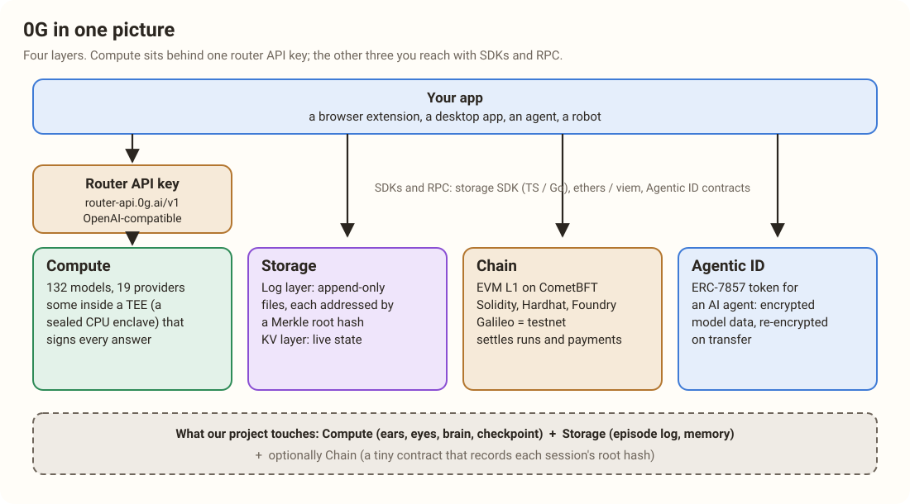

# Start Here: What This Book Is For

You are going to Mumbai to build one thing in 36 hours, alone, on a stack you have never shipped on. This book exists so that when the clock starts on Thursday night, nothing about 0G is a surprise. Every piece has a story you can picture, every story ends with what that piece does in our project, and every claim points at the real page it came from.

Read it on the train. Listen to it in the car. By Thursday you should be able to explain 0G to a stranger at the booth in two minutes, and know exactly which part of it you are reaching for at every hour of the build.

## The one-paragraph version

**0G calls itself the trust layer for AI.** It is four things in one stack. **Compute**: one API key that reaches more than a hundred AI models, a few of which run inside sealed hardware that nobody can look into, not even 0G, and that signs every answer. **Storage**: a place to keep files and live state, where every file is known by its fingerprint. **Chain**: an ordinary EVM blockchain where those fingerprints, payments and ownership get written down. **Agentic ID**: a way to make an AI agent an object you own, like a token. Our project uses the first two heavily and the third lightly.

## The one-sentence version of our project

**An AI that watches your screen and teaches you by pointing at things, and that can prove nobody, not even us, saw your screen.**

You speak a question. The tutor transcribes it on your laptop, turns your screen into a text outline, thinks inside a sealed enclave that nobody can read into, checks with a second sealed model whether it is sure enough to act, and then moves a pointer to the exact button while it explains. If 0G is unreachable or the tutor is not sure, the pointer freezes and it says so. Every decision leaves a signed record you can check.

## How each chapter works

Most chapters have the same four beats, so you always know where you are.

> [!STORY]
> A small scene you can picture. The stories use Mumbai on purpose: a dabbawala, a kitchen, a traffic constable, a library. They are there so the mechanism sticks.

Then the mechanism, said plainly, with the real names, the real numbers and a diagram where a picture helps.

> [!PROJECT]
> What this piece does in our build. Which call, which model, which hour.

> [!GOTCHA]
> The trap someone already fell into, so we don't.

> [!LINKS]
> The real pages, so you can check every claim or go deeper.

## The map of the book

1. **Why 0G exists** (chapter 1). The problem in a story: why nobody lets an AI look at their screen.
2. **0G at a glance** (chapter 2). The whole stack, its token, testnet and mainnet, and the hub you build from.
3. **Sealed compute** (chapters 3 to 6). What a TEE really is, the router and its models, the sealed ears (Whisper), and the checkpoint model that answers in probabilities (laya).
4. **Memory and records** (chapters 7 and 8). Storage, the chain, Agentic ID.
5. **Proof you can check** (chapter 9). How a signature is actually verified, and the traps.
6. **Who built on 0G before us** (chapters 10 to 12). Every winner, the instructive losers, and the creative uses 0G did not plan for.
7. **The Mumbai 0G tracks, line by line** (chapter 13).
8. **Our second sponsor, the Ethereum Foundation** (chapters 14 and 15). CROPS letter by letter, the four EF tracks, what EF paid for before, and its two tools, Anon-RPC and the alternative mempool.
9. **Our project** (chapters 16 to 19). The design and how it meets both sponsors, browser first then desktop, where the seconds go, and the 36 hours.
10. **The field guide** (chapters 20 and 21). Every gotcha in one place, then links and a glossary.

## Three facts to carry into everything

**First, the Fresh rule.** Our tracks are "Start Fresh". ETHGlobal's words: all work on your project must begin after the hackathon officially starts, and prior project-specific code, designs or assets are not allowed unless they come from public libraries or starter kits. A project built before the event can still enter, but it cannot win a partner prize or be a finalist. So screen-tutor, brain-ops and lifelog come with us as knowledge, not as code. We have built this shape many times. That is the speed. We rewrite it from what we know, in front of the commit history.

**Second, the prize page changed on 30 October.** 0G replaced two tracks. The one called "Build with iAI" is now **"Build with 0G PC"**: a consumer app where AI on 0G is the product, something people open, use and come back to tomorrow. "Wildcard" became "Agents That Pay for Themselves". Our project fits two 0G tracks with one build: **Physical AI** (its personal-devices lane asks for a desktop companion) and **Build with 0G PC**. Chapter 13 reads every line of both.

**Third, only nine models on 0G are truly sealed, and only one of them can look at an image.** That one is 0G's own model, 0GM-1.0. This fact shapes the whole design, and chapter 4 tells the story of how we found it.

**Fourth, we enter two sponsors with one build.** 0G (Physical AI and Build with 0G PC, one partner pick) and the **Ethereum Foundation's Best CROPS App** (a second pick), where the lead property is *Private*: a tutor that sees your screen while no server, including ours, can. Chapters 14 and 15 are about the EF in the same detail as the 0G chapters, and chapter 16 writes the CROPS section of our README line by line.

> [!LINKS]
> [0G home](https://0g.ai) · [Builder Hub](https://build.0g.ai) · [Private Computer](https://pc.0g.ai) · [The model catalog](https://pc.0g.ai/models) · [Mumbai's 0G prize page](https://ethglobal.com/events/mumbai/prizes/0g) · [Mumbai rules and judging](https://ethglobal.com/events/mumbai/info/details)
