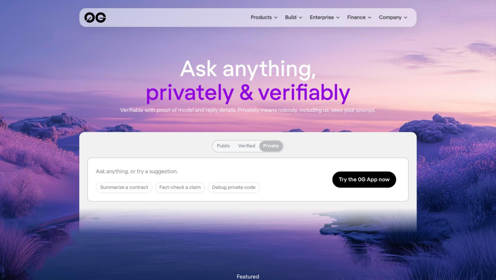

# 1. Why 0G Exists: Nobody Lets an AI Look at Their Screen

> [!STORY] Asha's second week
> Asha is in her second week as an engineer at a payments company in Lower Parel. Her team lead asks her to verify a contract on Etherscan, then file a ticket in the internal admin panel, then change a setting in the bank partner's portal. Three tools she has never used. Each one has forty buttons. She is stuck on the first one.
>
> She opens a chat assistant and starts typing a description of the screen. It is slow and she describes it badly. The obvious thing would be to show the assistant her screen. She stops. The admin panel shows customer names. The partner portal shows account numbers. Her company's policy is clear: no screenshots of internal systems go to an outside AI. Not because the AI is evil, but because once a screenshot is on someone else's server, nobody can say who reads it, how long it is kept, or what it trains.
>
> So Asha does it the slow way. She asks a colleague, who is busy, and loses an hour.

That hour is the whole problem 0G is built around, and it is the whole problem our project is built around.

## The problem, said plainly

Every useful AI today runs on somebody else's computer. When you send it your words, your file or your screen, three things are true and none of them can be checked by you:

1. **Someone can read it.** The provider's servers decrypt your request to run the model. Their logs, their staff, their subcontractors, a court order, an attacker.
2. **You cannot prove which model answered.** The service says it ran a particular model. You take its word.
3. **You cannot prove the answer was not changed.** Between the model and you, anything could have rewritten it.

For a chat about recipes none of this matters. For anything private (a medical note, a bank screen, a company's internal tools) it is the reason the AI never gets the job. The most useful assistant in the world is the one that can see what you see, and that is exactly the one nobody is allowed to use.

## What 0G's answer is

0G's bet is that you can keep the convenience of a cloud AI while removing the "take our word for it". Three ideas do the work, and the next chapters give each one its own story:

- **Run the model inside sealed hardware.** A TEE (trusted execution environment) is a part of a processor that keeps its memory encrypted even from the machine's owner. The model runs inside it. The cloud host cannot read your request, and for the models 0G encrypts end to end, 0G cannot read it either. Chapter 3 explains which ones.
- **Make the hardware sign what it did.** The enclave signs each answer with a key that only exists inside it, and the chip itself vouches for which code is running. You can check the signature later. Chapter 9.
- **Write the evidence down where nobody can quietly change it.** Logs and fingerprints go to 0G Storage, and the fingerprints can be anchored on 0G Chain. Chapters 7 and 8.

0G's own homepage puts it in one line: privately means nobody, including us, sees your prompt.

Notice the three buttons on that box: **Public, Verified, Private**. That is the most important idea in the whole stack, and chapter 3 is about the difference.

## Why this is also our project

Asha is the user of our tutor. She wants three things at once:

- **To be shown, not told.** "Click the third tab, then the blue button" is slow. A pointer that moves to the button while a voice explains is fast.
- **For the helper to see her screen.** Describing a screen in words is where the hour went.
- **For nobody else to see her screen.** Her company's rule is not going away.

The first two are a normal AI product. The third is the reason it has never been allowed. 0G is the piece that makes the third one true, and makes it checkable instead of promised. That is why the project and the sponsor fit, and it is the sentence a judge needs to hear: **without sealed compute, this product is not allowed to exist.**

> [!PROJECT]
> The track asks for "one sentence on what breaks if 0G is removed". Ours: without 0G, the tutor either cannot see your screen, or it sends your screen to a server that can read it, and the person in Asha's seat is not allowed to use it.

> [!WHY]
> Judges at Lisbon read 67 projects' source code "the way an auditor would" and kept rewarding the same thing: one sealed decision at the exact moment it matters, with a record you can check. A sealed AI that only chats is a chat wrapper. A sealed AI that sees something private and then acts on it is the product 0G wants to show off.

> [!LINKS]
> [0G home](https://0g.ai) · [Why Private Computer is private](https://pc.0g.ai/trusted-privacy) · [0G's Lisbon recap: 67 builds, 9 winners](https://0g.ai/blog/ethglobal-lisbon-2026-recap)
