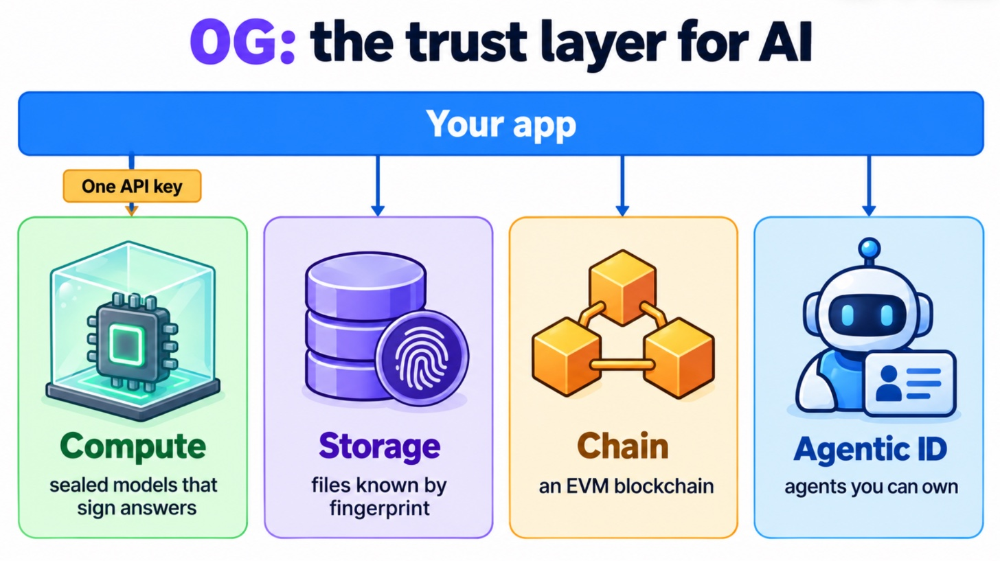
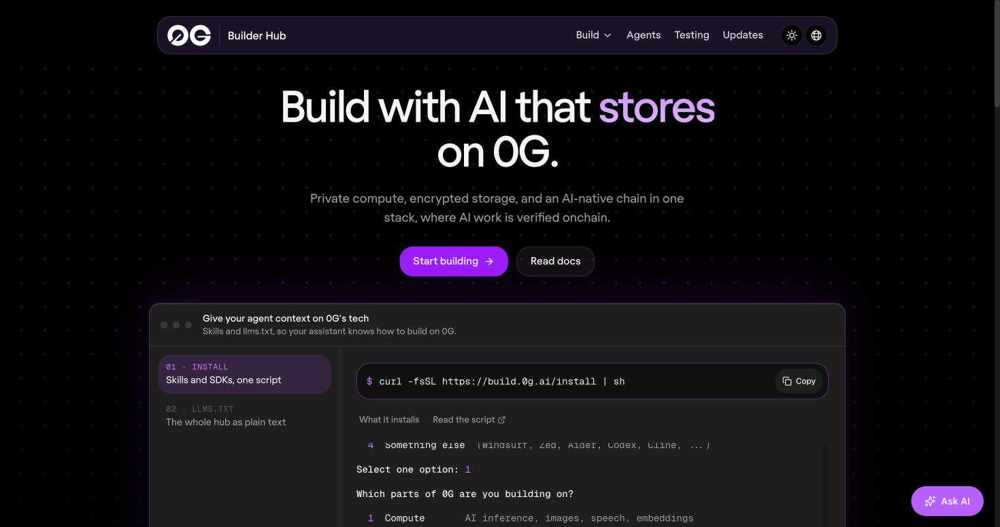

# 2. 0G at a Glance: The Whole Stack in One Sitting

> [!STORY] The new building in BKC
> Imagine a new office building in Bandra Kurla Complex built for one kind of tenant: people who work with secrets. The ground floor has a single reception counter where you show one pass and ask for any service. The first floor is a row of sealed rooms where work gets done that nobody can watch. The basement is an archive that files every document under its fingerprint, so a changed page is spotted instantly. And on the roof is a public notice board, bolted down, where anyone can read what was filed and when.
>
> The building also issues ID cards for robots, so a robot that works there can be owned, lent out and sold like property.

That building is 0G. The reception counter is the **router**, the sealed rooms are **Compute**, the archive is **Storage**, the notice board is the **Chain**, and the robot ID cards are **Agentic ID**.

## Who builds it

**0G Labs**, founded in 2023, with Michael Heinrich as CEO. The code lives under the **0G Foundation** GitHub organisation (older npm packages still carry the earlier `0glabs` name). Its own one-line description: the trust layer for AI. An older framing, still in the whitepaper, calls it a decentralised AI operating system.

## The layers, plainly

| Layer | What it does | What you touch |
|---|---|---|
| **0G Chain** | An EVM blockchain (CometBFT consensus, Reth execution). Holds contracts, registries and payments | an RPC URL, Solidity, Hardhat or Foundry |
| **0G Compute Network** | A marketplace of GPU providers. Each provider registers its model, price and enclave signing key in a contract on the chain | usually nothing directly; the router does it |
| **0G Private Computer** | The product on top of Compute, launched 27 April 2026: the router, a dashboard, a playground, the model catalog | one API key, OpenAI-shaped calls |
| **0G Storage** | A decentralised store: an append-only **log layer** (files addressed by their Merkle root) and a **key-value layer** built on it | the storage SDK |
| **0G DA** | Data availability for rollups. Irrelevant to an app like ours | nothing |
| **Agentic ID** | ERC-7857 tokens for AI agents, with encrypted data re-encrypted on transfer | contracts, optional |

## The token, and the two networks

The token is called **0G** (the old name A0GI is retired). It pays gas on the chain, storage fees and compute.

| | Galileo testnet | Mainnet ("Aristotle") |
|---|---|---|
| Chain id | **16602** (hex `0x40DA`) | **16661** (hex `0x4115`) |
| RPC | `evmrpc-testnet.0g.ai` | `evmrpc.0g.ai` |
| Explorer | chainscan-galileo.0g.ai | chainscan.0g.ai |
| Block time (measured) | about 0.49 s | about 0.84 s |
| Router | a separate testnet router with **two models** | `router-api.0g.ai`, **120 models** |

> [!GOTCHA] 0G's own pages disagree
> The Builder Hub's text gives the chain-id hex values as 0x40EA and 0x412D. They are wrong: the chains themselves answer 0x40DA (16602) and 0x4115 (16661), and the docs' AI-context page agrees. Some older pages also say every provider runs in a TEE; the newer ones, and the catalog, say most do not. When two 0G sources disagree, trust the one measured live.

## How one request flows through the building

Your app sends an OpenAI-shaped request with an `sk-` key to the router. The router picks a provider whose service is registered on the chain, forwards the request, and bills your balance. A Private provider runs the model inside an Intel TDX enclave with an NVIDIA H100 or H200 GPU in confidential mode, and signs hashes of the request and the response. Your app writes the evidence (request id, provider, signature) into Storage, whose contract records the file's Merkle root on the chain.

## The 2026 timeline, so the booth conversation lands

- **April**: the 0G App and Private Computer launch.
- **May 14**: 0GM-1.0-35B-A3B released, vision-capable, Apache-2.0.
- **July**: GLM-5.2 runs sealed; ETHGlobal Lisbon (67 projects, 9 winners).
- **September**: the catalog grows from 64 to 130 models; iAI launches on 28 and 29 September.
- **October**: **Encrypted Transit** (end-to-end encryption), the Decisions tab (laya, Vela), sealed embeddings, text-to-speech.
- **New repos in October**: 0g-pc-e2ee (the verifier), project-floaty (a desk bot), 0g-agentic-id, 0g-sandbox.

> [!TIP] Give a coding agent 0G's context
> The Builder Hub has an install script that drops 25 skills into a project, an `llms.txt` with the whole hub as plain text, and an MCP server for Claude Code. Worth installing in the fresh repo on Thursday night (a public tool, allowed under the Fresh rule).

> [!LINKS]
> [Builder Hub](https://build.0g.ai) · [Builder changelog](https://build.0g.ai/updates) · [0G docs](https://docs.0g.ai) · [Addresses on one page](https://docs.0g.ai/ai-context) · [Testnet overview](https://docs.0g.ai/developer-hub/testnet/testnet-overview) · [Whitepaper](https://docs.0g.ai/whitepaper.pdf) · [0G Foundation on GitHub](https://github.com/0gfoundation) · [Router API reference](https://0gfoundation.github.io/0g-router/)
