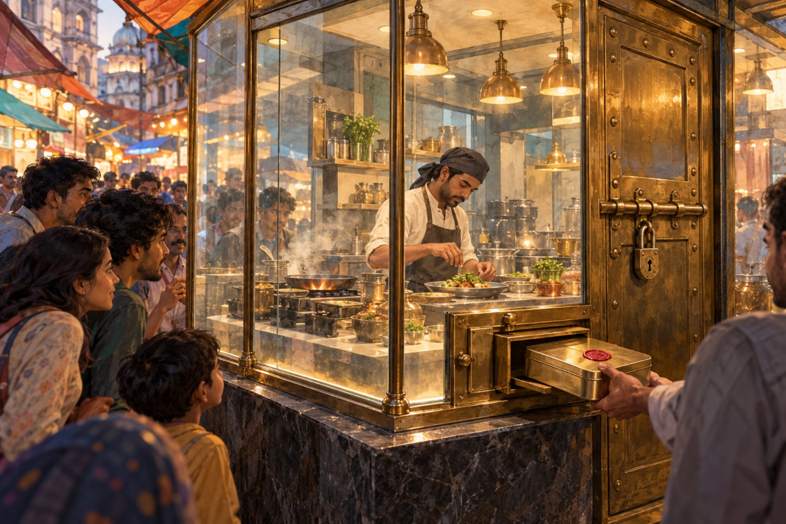
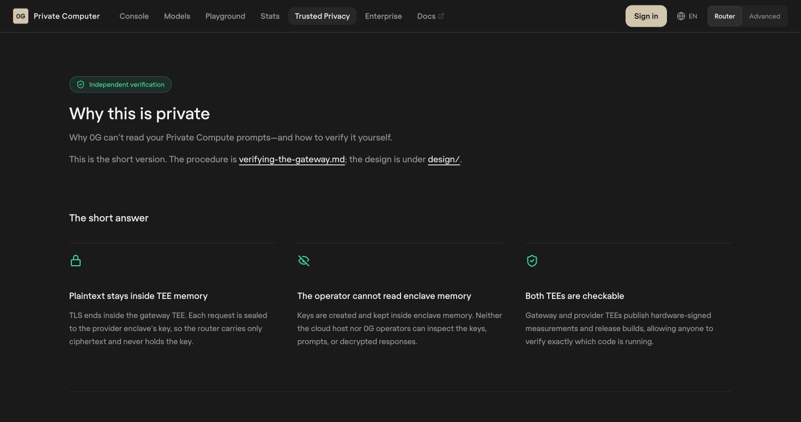
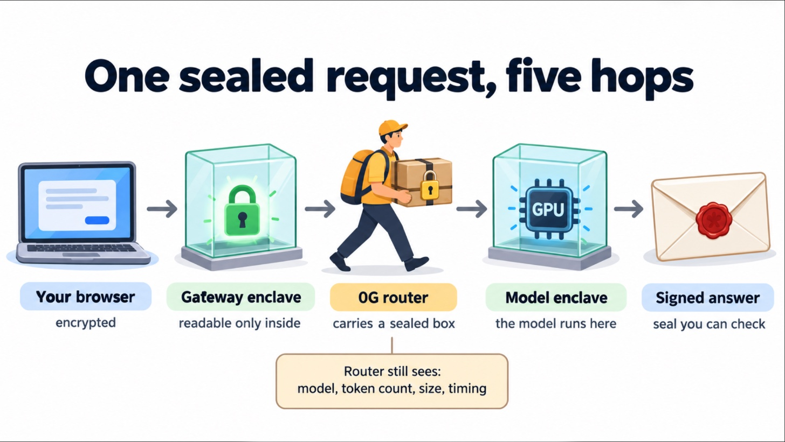
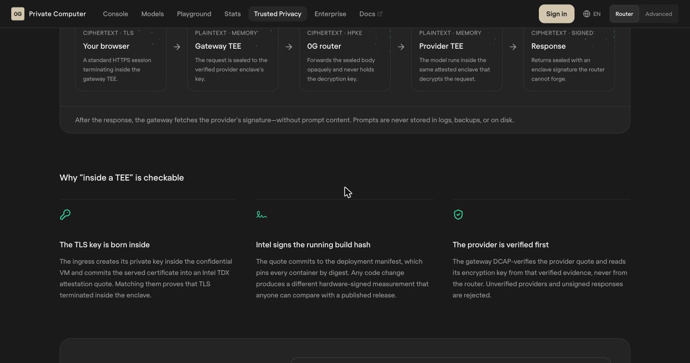
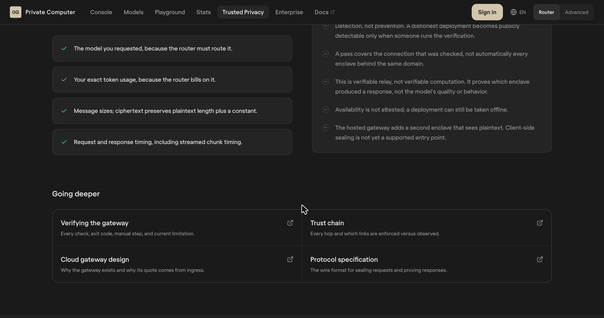
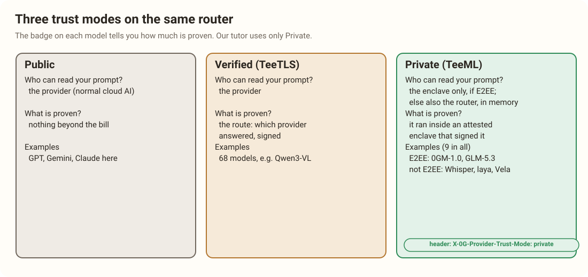
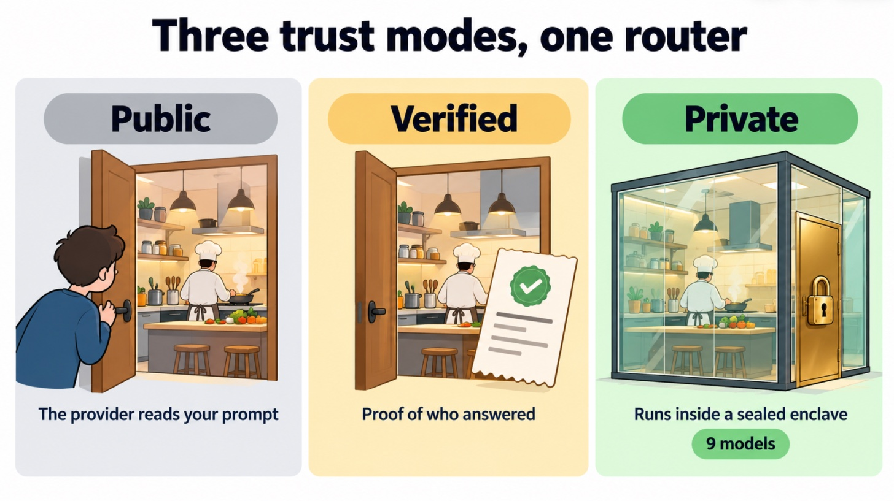
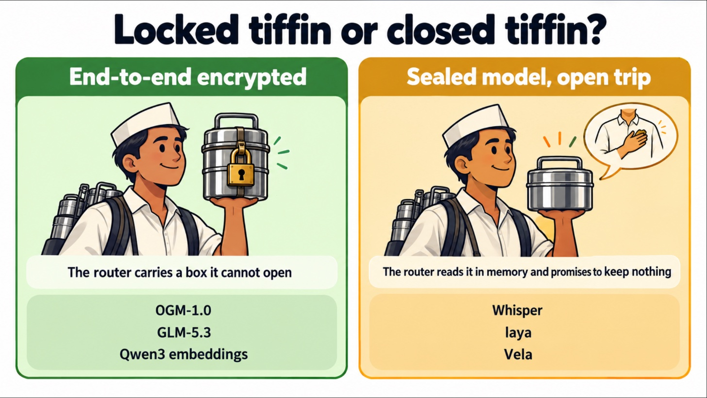

# 3. Sealed Compute: The Kitchen With Glass Walls

> [!STORY] The kitchen nobody can enter
> Picture a kitchen in the middle of Crawford Market, with walls made of glass. You can see in. You can see the cook, the stove, the shelf of ingredients. What you cannot do is open the door. Nobody can: not the owner of the building, not the market inspector, not the cook's boss. The only things that pass in and out go through a small brass slot.
>
> You slide your order through the slot in a locked tin. Only the cook has the key to that tin, and the key was made inside the kitchen and has never left it. The cook opens the tin, cooks, puts the dish in a new locked tin, and stamps it with a seal that only this kitchen's stamp can make. Out it comes.
>
> Two things make this kitchen trustworthy. First, the glass. A respected inspector, who does not work for the market, certified what is inside and published a photograph of it: this stove, this recipe book, this cook. Anyone can compare the kitchen in front of them with that photograph. Second, the stamp. If the dish arrives with this kitchen's seal, it came from this kitchen, unopened.

That kitchen is a **TEE**, a trusted execution environment. The rest of this chapter maps every part of the story onto the real thing.

## What a TEE actually is

A TEE is a region of a processor that runs code with its memory **encrypted by the chip itself**. The machine's operating system, the cloud company that owns the server, and anyone with physical access see only scrambled bytes. The keys live inside the chip and never leave it.

0G's Private Computer uses **Intel TDX** (Trust Domain Extensions), which seals a whole virtual machine this way. The pieces of the story:

| In the story | In reality |
|---|---|
| The glass walls | Memory encryption by the CPU. The host can see the machine exists and is busy, not what it is doing |
| The locked door | Nobody, including the cloud operator and 0G, can read the enclave's memory |
| The key made inside the kitchen | The enclave creates its own private key at start-up; it never exists outside |
| The inspector's photograph | An **attestation quote**: a report signed by Intel's hardware saying exactly which code (a build hash) is running |
| The stamp on the tin | A **signature** on each response, made with the enclave's key |

The attestation is the clever part. The chip measures the code it is running and Intel's hardware signs that measurement. 0G publishes its release builds. So anyone can compare "the code this chip says it is running" with "the code 0G says it shipped". 0G's page states it directly: any code change produces a different hardware-signed measurement that anyone can compare with a published release.

## The dabbawala and the sealed tiffin: one request, five hops

> [!STORY] The dabbawala
> Every lunchtime, Mumbai's dabbawalas carry two hundred thousand tiffins across the city. A dabbawala knows a lot about the tiffin on his head: its colour code, which station it goes to, roughly how heavy it is, and what time it must arrive. He does not know what is inside. It is sealed, and he does not have the key. He delivers it anyway, perfectly.

0G's router is the dabbawala. When you send a **Private** request, it travels in five hops:

: readable only inside the two enclaves")

1. **Your browser to the Gateway TEE.** An ordinary HTTPS connection, except that it ends inside an enclave, not on a normal server.
2. **The Gateway TEE seals your request** to the key of the specific provider enclave that will run the model. It has checked that provider's attestation first.
3. **The 0G router forwards the sealed envelope.** It never holds the key. Like the dabbawala, it knows the colour code (which model), the weight (how many tokens), and the time.
4. **The Provider TEE decrypts it and runs the model**, inside its own enclave.
5. **The response comes back sealed and signed** with an enclave signature the router cannot forge.

After the answer, the gateway fetches the provider's signature without the prompt content, and 0G says prompts are never stored in logs, backups or on disk.

## What the router can still see

Being honest about this is part of what judges reward, and the Ethereum Foundation's CROPS track will ask for exactly this paragraph in our README. Even for a Private request, the router can read:

- **which model you asked for** (it has to, to route it)
- **how many tokens you used** (it bills on it)
- **message sizes** (the sealed envelope is the same length as the plaintext plus a constant)
- **request and response timing**, including streamed chunk timing

## What this does not prove

0G lists these itself, and they are worth memorising before the booth:

- **Detection, not prevention.** A dishonest deployment becomes publicly visible only when someone runs the verification.
- **A pass covers the connection that was checked**, not every enclave behind the same domain.
- **Verifiable relay, not verifiable computation.** It proves which enclave produced a response. It does not prove the answer is good.
- **Availability is not attested.** A deployment can still be switched off.
- **The hosted gateway is a second enclave that sees plaintext.** Sealing on your own device before the gateway is not yet a supported entry point.

That last line matters for us. In the story, Asha's screen is readable in two places: the gateway's enclave and the provider's enclave. Both are sealed. Neither is a normal server. But it is two places, and we will say so.

## Three trust modes on one router

Every model in 0G's catalog carries one of three badges, and the difference between them is the most important thing in this book.

- **Public**: an ordinary cloud model. The provider reads your prompt. Nothing is proven beyond the bill.
- **Verified** (0G calls the mechanism TeeTLS): the route is attested. You get proof of *which provider* answered, signed. But the model runs on the provider's normal infrastructure, so the provider can still read your prompt. Our research notes put it in one line: TeeTLS attests the routing path, not the execution.
- **Private** (TeeML): the model itself runs inside an attested enclave. Nobody reads the prompt. This is the kitchen with glass walls.

On 30 October 2026 the web catalog showed **68 Verified models and 9 Private ones** (the API's own count that day: 9 Private, 59 Verified, 52 with no attestation, out of 120). Chapter 4 lists the nine.

## Sealed kitchen, but is the tiffin sealed too?

> [!STORY] Two kinds of dabbawala
> Some tiffins leave your house locked with a key only the kitchen has. The dabbawala carries a box he cannot open. Other tiffins leave closed but not locked: the dabbawala could lift the lid. He is honest, his company publishes a promise that no dabbawala ever looks or keeps a crumb, and nobody has caught one cheating. But that is a promise, not a lock.

The five-hop picture above is the **locked tiffin**: 0G calls it **Encrypted Transit**, it launched in October 2026, and the request crosses the router as ciphertext all the way to the provider's enclave. On the catalog it is the extra **E2EE** badge.

**Only four models have it:** 0GM-1.0-35B-A3B, GLM-5.3 and the two Qwen3 embedding models. The other five Private models (Whisper, laya, Vela, Z-Image and 0GM-SIA) still run inside an enclave, but the router reads their requests **in memory** and keeps none of them. 0G's own word for that is zero data retention, and it is a policy.

That single fact decides two things in our design: the screen goes only to 0GM-1.0 (locked tiffin), and laya is only ever told short, non-identifying text (element ids, button labels, a paraphrase of the question). Chapter 5 is about what it means for voice.

> [!GOTCHA] On a locked-tiffin request, `tee_verified` disappears
> On an end-to-end-encrypted request, the router no longer returns `tee_verified`, even if you asked for it. So a rule like "freeze unless `tee_verified` is true" would wrongly freeze every 0GM-1.0 call. For E2EE calls, the evidence is the attested gateway (verifiable with 0G's `pcverify` tool) and the provider the request was pinned to (the `X-Provider` response header). For the non-E2EE calls (laya, Whisper), `tee_verified: true` is the check. And measured on 30 October, there is a per-answer proof for 0GM-1.0 too: its provider signature, fetched by hand in about 130 milliseconds. The signed text starts with `zg-sig-v1/e2ee-ct`, a seal over the encrypted traffic, and the signer matched the key 0G's contract lists for that provider.

> [!GOTCHA] Private is opt-in
> A Private model is not automatically routed to a sealed provider. The model page says it plainly: to pin requests to a TEE-backed provider, add the header `X-0G-Provider-Trust-Mode: private`. Opt-in, not applied by default. Forget the header and your "sealed" request might not be. Our client sends it on every call, and the lab checks that the response trace says it was verified.

> [!PROJECT]
> Every call the tutor makes goes to a Private model with the trust-mode header and `verify_tee: true`. The screen goes only to 0GM-1.0, end to end encrypted, so it exists as plaintext only inside enclave memory. laya only ever sees ids and labels. Voice is transcribed on the laptop by default. That is the claim on the first slide, and the CROPS section of the README states the caveats: two enclaves see plaintext, the router sees metadata, and the non-E2EE calls rest on a no-retention policy.

> [!LINKS]
> [Why this is private (0G)](https://pc.0g.ai/trusted-privacy) · [Build the verifier yourself: 0g-pc-e2ee on GitHub](https://github.com/0gfoundation/0g-pc-e2ee) · [Intel TDX overview](https://www.intel.com/content/www/us/en/developer/tools/trust-domain-extensions/overview.html)
