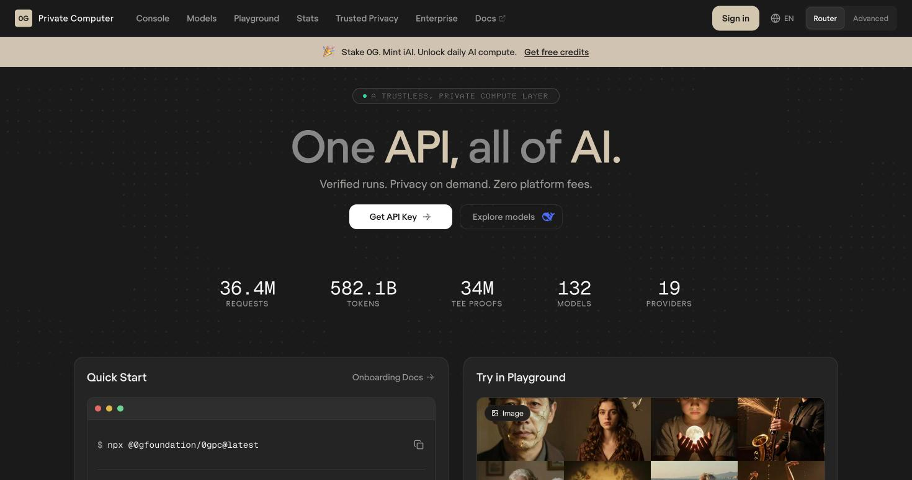
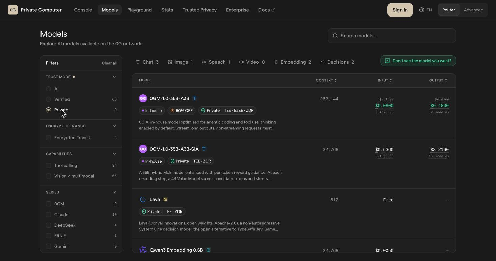
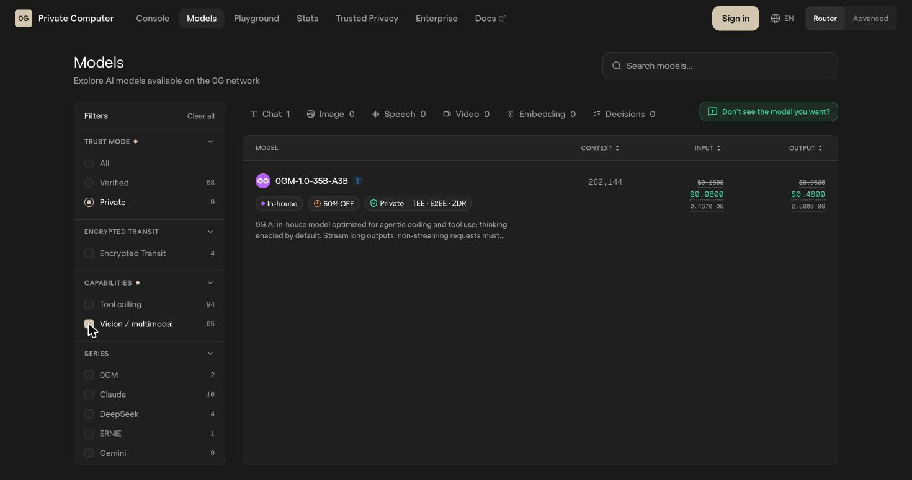
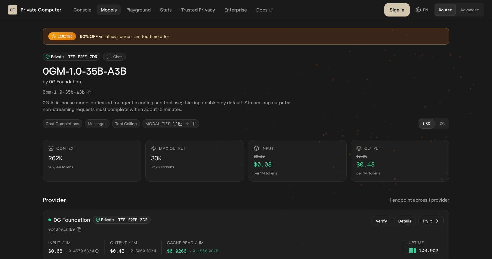

# 4. The Router and Its Models: One Counter, a Hundred Kitchens

> [!STORY] The counter at the station
> At the end of a long platform there is one counter. You hand over one card, the same card every time, and say what you want: a translation, a summary, a picture, a transcript. Behind the counter is a corridor of a hundred and thirty kitchens run by nineteen different owners. The counter clerk picks the kitchen, carries your order there, brings the dish back, and charges your card. Most of the kitchens are ordinary. A few, at the far end, have glass walls.
>
> If you want the glass-walled kitchen, you have to say so at the counter. The clerk will not assume.

The counter is **0G Private Computer's router**. The card is **one API key**. The kitchens are the models.

## One API that you already know

The router speaks the same language as OpenAI's API. If you have ever called `chat/completions`, you already know how to use it. You change the base URL and the key, and keep your code. 0G's prize page says it in one line: if you've used the OpenAI SDK, you already know how to build on it.

The base URL is **router-api.0g.ai/v1**. The endpoints we care about:

| Endpoint | What it does | Our use |
|---|---|---|
| `/chat/completions` | Text (and image) in, text out. OpenAI shape | The tutor's brain |
| `/audio/transcriptions` | Speech to text | The tutor's ears |
| `/decisions` | Typed questions, answers with probabilities | The act-or-hold checkpoint |
| `/embeddings` | Text to vectors | Optional: memory search |
| `/images/generations` | Text to image | Not needed |

Two optional fields matter on every call:

- **`verify_tee: true`** in the body asks for on-chain signature verification. The response then carries a `tee_verified` field in its trace.
- **`X-0G-Provider-Trust-Mode: private`** as a header pins the call to a TEE-backed provider. Without it, the router picks by price and health.

There are also headers to pin one exact provider (`X-0G-Provider-Address`), to sort by latency (`X-0G-Provider-Sort: latency`), to allow or forbid fallbacks, and to cap the price. You can also set **trust mode Private on the API key itself**, in the dashboard, so every call made with that key routes only to sealed providers. We will do both.

Every response carries an **`x_0g_trace`** object with a `request_id`, the `provider` address and the billing. The same request id comes back in the **`X-Request-ID`** header. A different header, **`ZG-Res-Key`**, carries the *chat id* used to fetch the provider's signature (chapter 9). Keep all three.

**Testnet and mainnet are separate worlds**, with separate dashboards, keys and balances. The testnet router serves only two models (0GM-1.0 and an image editor). **Whisper, laya and GLM-5.3 exist only on mainnet**, so the tutor runs on mainnet with real (small) credit: a linked email gives $1, card deposits start at $5, and 0G gives every Mumbai team credits.

## The catalog, and the nine that are sealed

The catalog on 30 October had **98 chat models, 7 image, 7 speech, 3 video, 3 embedding and 2 decision models**. Filter it to **Private** and it shrinks to nine.

| Private model | What it is | Price | Locked tiffin (E2EE)? | Our role |
|---|---|---|---|---|
| **0GM-1.0-35B-A3B** | 0G's own model (a Qwen 3.6 35B base, about 3B active), built for agentic coding and tool use. **Takes text and images.** 262K context, thinking on by default | $0.08 per million input tokens, $0.48 output (50% off at the time) | **yes** | **Eyes and brain** |
| 0GM-1.0-35B-A3B-SIA | Same family, with a small value model steering each token | $0.536 / $3.216 | no | Spare |
| GLM-5.3 | Zhipu's long-reasoning model, 1M context, text only, thinking always on | $0.90 / $3.15 | yes | Spare brain for text-only turns |
| **Laya** | A decision model: typed questions, calibrated probabilities. 512-token context | **Input is free** | no | **The checkpoint** |
| Vela 2.0 9B | A bigger decision model with extra question types, including finding personal information inside text | $0.04 per million input | no | Optional PII check |
| **Whisper Large v3** | Speech recognition, many languages | $0.00013 per second | no | Optional ears (chapter 5) |
| Qwen3 Embedding 0.6B and 8B | Text to vectors | $0.005 / $0.01 per million | yes | Optional memory search |
| Z-Image-Turbo | Image generation | per image | no | Not needed |

## The discovery that shaped the design

> [!STORY] The evening we checked
> On 30 October we opened the catalog to answer one question: which sealed model can look at a screenshot? The answer the whole design hung on.
>
> The full catalog lists sixty-five vision models. Qwen3-VL, MiniMax-M3, GPT, Gemini, Claude. It looked easy. Then we clicked Private. Nine models were left. Then we clicked Vision. **One** was left.

Every other vision model on 0G is either **Verified** (the route is signed, but the provider reads your screenshot) or carries no badge at all. If the tutor sent a screenshot to Qwen3-VL, it would be sending Asha's bank screen to someone who can read it. That breaks the one promise the product makes.

So the design has two honest options, and the lab will measure both:

1. **Send the screenshot to 0GM-1.0**, the one sealed model with eyes. It is "thinking enabled by default", which is good for accuracy and bad for speed. We need to know whether thinking can be turned off and how long a turn takes.
2. **Turn the screen into text on the laptop, and send only text.** In a browser, the page's structure (the DOM) already says what every button is and where it sits. Screen-tutor proved this: compiling the screen into a short outline with ids took 525 elements down to 296 lines, and it is what stopped the model inventing targets. On the desktop, the macOS accessibility tree and Apple's on-device text recognition do the same job. The pixels never leave the laptop. Only text does, and only to a sealed model.

On that model page, three badges deserve a translation: **TEE** (it runs in an enclave), **E2EE** (the request is encrypted end to end, from the gateway to the model) and **ZDR** (zero data retention: nothing is kept after the answer).

> [!PROJECT]
> The brain is 0GM-1.0 with the trust-mode header, fed the text outline first and the screenshot only when the outline is not enough (a canvas, an image, a chart). It is the one model that is Private, sees images and is end to end encrypted. The checkpoint is laya. The ears are on the laptop by default, with 0G Whisper as a switch. The freeze rule is per model: laya and Whisper must come back with `tee_verified: true`; 0GM-1.0, being E2EE, must come back through the attested gateway pinned to its TEE provider.

> [!GOTCHA]
> "Thinking enabled by default" means hidden reasoning tokens before the answer. For GLM on 0G, thinking is switched off with `chat_template_kwargs: {"enable_thinking": false}`; 0GM-1.0 is built on a Qwen base, so the same switch is the first thing the lab tries. They cost time and money and they count against the output limit. Some reasoning models return empty content when the token limit is too small (0run hit this with a 20-token cap). Measure with thinking on and off, and never set a tiny `max_tokens` on a thinking model.

> [!GOTCHA]
> The router rate-limits per account and says so in `X-RateLimit-*` headers, with `Retry-After` on a 429. A Lisbon team, Zero-In, was rate-limited live during onboarding. Back off and retry; do not hammer.

> [!LINKS]
> [The model catalog](https://pc.0g.ai/models) · [0GM-1.0 model page](https://pc.0g.ai/models/0gm-1.0-35b-a3b) · [Laya model page](https://pc.0g.ai/models/laya) · [Private Computer docs](https://docs.0g.ai) · [Compute on the Builder Hub](https://build.0g.ai/compute)
