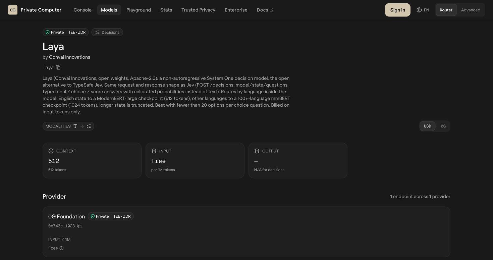
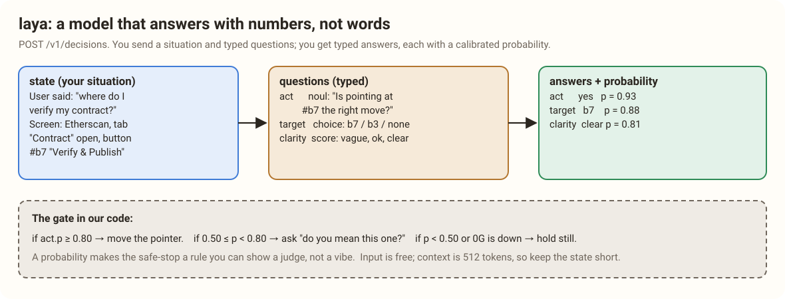

# 6. The Checkpoint: laya, the Model That Answers in Percentages

> [!STORY] The constable at Hutatma Chowk
> At a busy junction near Flora Fountain, a traffic constable stands on a small box. He does not give speeches. Cars arrive and he makes one of three gestures: go, wait, or stop. Ask him why and he could tell you, but his job is the gesture, and he makes it in a fraction of a second.
>
> Now imagine he also tells you how sure he is. "Go, ninety-three percent." "Wait, sixty." "Stop, I can't see past the bus." You could build rules on that: go only above eighty, ask the driver to check between fifty and eighty, stop below fifty.

That constable is **laya**, 0G's decision model, and he is the most underused piece of the whole stack. **Nobody in the corpus has used him.**

## What laya is

Most AI models write text. laya does not. It is a **decision model** (its makers, Convai Innovations, call it a "System One" model, the fast instinctive kind). You send it two things:

- **`state`**: a short description of the situation, in plain words.
- **`questions`**: a set of typed questions about that situation.

It sends back **typed answers, each with a calibrated probability**. Three question types:

| Type | What it asks | What comes back |
|---|---|---|
| `noul` | a yes-or-no question | yes or no, with a probability |
| `choice` | pick one of several options (best with fewer than 20) | the chosen option, with a probability |
| `score` | rate on a scale you define | a point on the scale, with a probability |

"Calibrated" is the important word. A calibrated 0.9 means that across many such answers, it is right about nine times in ten. That turns a feeling ("the AI seems sure") into a number you can put a rule on.

## The facts

- **Endpoint**: `POST https://router-api.0g.ai/v1/decisions`, with `model: "laya"`.
- **Private**, TEE · ZDR, served by the 0G Foundation.
- **Context is 512 tokens** for English (a ModernBERT-large checkpoint inside); other languages route to a multilingual checkpoint with 1,024. Longer state is cut off, so the state must be short.
- **Input is free.** It is billed on input tokens only, and the price is zero.
- **`verify_tee: true`** works here too, and the trace carries `tee_verified`.
- **Not end-to-end encrypted.** laya runs in an enclave, but the router reads the state in memory under its no-retention policy (chapter 3). So the state must never contain anything private: element ids, button labels, a paraphrase of the question.
- **Mainnet only**: laya is not on the testnet router.
- It is a small model, about **421 million parameters**. 0G's provider list reported a figure of about 1,537 for laya's latency on 30 October, with the unit undocumented (probably milliseconds, possibly a health probe). The lab measures the real thing.
- A bigger sibling, **Vela 2.0 9B** (also Private, $0.04 per million input), answers the same three types plus **set** questions (every label above a threshold) and **span** questions (it marks character ranges in the text, for example personal information).

The model page's own example is a customer-support message: which department, how urgent, is the customer threatening to cancel. Ours is a screen and a question.

**What comes back is not documented by 0G.** laya says it has the same request and response shape as Jev, TypeSafe's decision model, whose documented answer looks like this: an `answers` object with one entry per question; a `choice` answer carries the chosen option, a `confidence` and a `probabilities` map; a `noul` answer is simply the probability that the answer is yes. Treat that as a guide until the lab prints a real laya response.

## Why the checkpoint is the heart of our project

The Physical AI track has one rule that disqualifies teams: **a safe-stop fallback is required, and a fallback that fakes the decision disqualifies.** Hands Unchained, a Lisbon winner, paid workers on a local grading heuristic when 0G was down. Under Mumbai's rule, that design would be out.

laya gives us a safe-stop that is a rule rather than a guess:

- **p of "act" at or above 0.80**: move the pointer and explain.
- **between 0.50 and 0.80**: ask. "Do you mean this blue button?"
- **below 0.50, or 0G unreachable, or a timeout**: hold still, and say so.

Every one of those outcomes is logged with laya's request id and the probability. A judge can open the log and see that the tutor refused to guess at 0.41. That is the moment of consequence, sealed and checkable, which is what every Lisbon winner had.

> [!PROJECT]
> After the brain picks a target (say element b7, "Verify & Publish"), the tutor asks laya three questions in one call: **act** (noul: is pointing at b7 the right move for what the user asked?), **target** (choice: b7, b3, or none), **clarity** (score: was the question vague, okay or clear?). The state is about a hundred tokens: a short paraphrase of the question, the page title, and the two or three candidate elements with their labels. Never names, numbers or anything private, because laya's requests are not end to end encrypted. The gate in our code turns the probabilities into point, ask or hold.

> [!GOTCHA]
> 512 tokens is small. Do not send laya the whole page outline. Send the question and the shortlist the brain already picked. If the state is cut off, the probabilities are about the wrong situation.

> [!TRY] For the lab
> Write ten situations: five where the right button is obvious, five where the question is vague ("make it work"). Check that the obvious ones come back above 0.8 and the vague ones below. If the probabilities do not separate, the gate needs different questions, and we learn that now, not on Friday.

> [!LINKS]
> [laya on 0G](https://pc.0g.ai/models/laya) · [Vela 2.0 9B](https://pc.0g.ai/models) (in the Decisions tab) · [The Mumbai Physical AI track](https://ethglobal.com/events/mumbai/prizes/0g)
