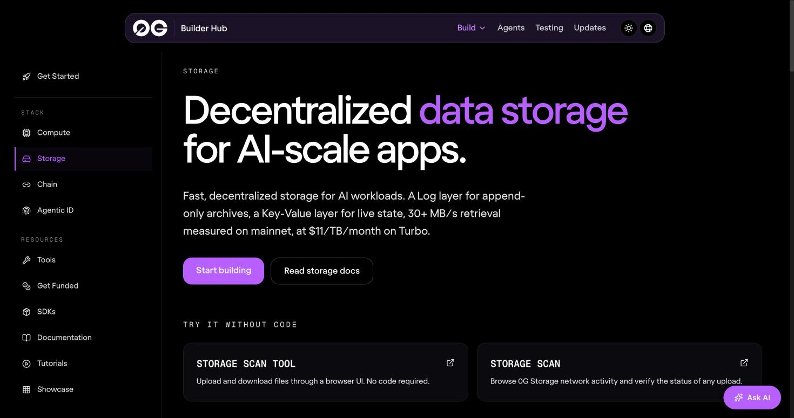
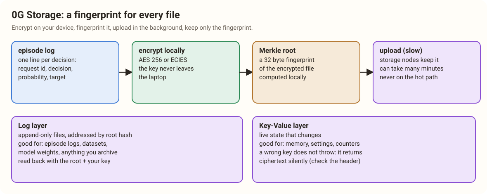
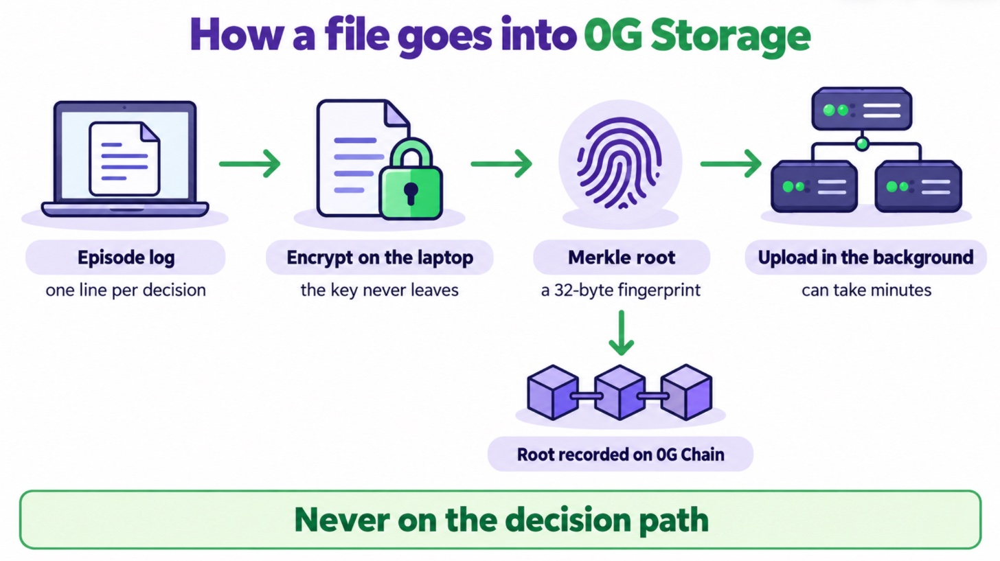

# 7. The Archive That Keeps Fingerprints: 0G Storage

> [!STORY] The land records office
> In the land records office in Fort, every deed is stored in a steel almirah, but nobody looks deeds up by name. Each deed was given a unique number the day it was filed, computed from its contents, and the number is written in a public register. If anyone changes a single word of a deed, its number no longer matches the register, and the change is caught at once.
>
> The almirah can be anywhere. A copy can be anywhere. What makes a deed trustworthy is that its number matches the register.

That is **0G Storage**. Every file is known by a **Merkle root**: a 32-byte fingerprint computed from its contents. The root is the file's address, and it is recorded on 0G Chain. The bytes can sit on any storage node; the fingerprint proves they are the right bytes.

## Two layers

- **The log layer**: append-only and immutable. You upload a file, you get its root; nobody can change it, only add new files. This is what every 0G project in the corpus used.
- **The key-value layer**: mutable "streams" of keys and values, built by replaying log entries. Good for live state that changes. **Nobody in the corpus used it.** The catch, measured on 30 October: reading values needs a KV node, and the one in 0G's docs did not answer. Using KV means running our own node.

## The facts that matter

- **Use the Turbo network.** The testnet indexer is `indexer-storage-testnet-turbo.0g.ai` and mainnet's is `indexer-storage-turbo.0g.ai`. The "Standard" indexers returned 503 or nothing on 30 October.
- **The SDK**: `@0gfoundation/0g-storage-ts-sdk` (version 1.2.13, published 24 October). Upload from Node: build the file object, compute its Merkle tree (the root is known *before* uploading), then `indexer.upload(...)`. Every call returns a `[value, error]` pair and never throws. It installs only next to **ethers 6.13.1 exactly**; with any other version, npm refuses.
- **Encryption is built in**: pass `aes256` (a 32-byte key) or `ecies` (to a recipient's public key) as an upload option, and the SDK encrypts on your machine before anything leaves it. Lose the key and there is no recovery.
- **The encrypted file has its own fingerprint.** When the SDK encrypts inside the upload, the root it stores is the root of the scrambled bytes, not of your original. To know the real root before uploading, encrypt first with `newSymmetricEncryptedFile`, compute the root of that, and upload it with no encryption option. Measured in the lab: the two roots matched.
- **A wrong key fails silently.** Measured: download with the wrong key and you get back garbage exactly as long as the original, with no error. The SDK's encryption (AES-256 in counter mode) carries no check of its own. So keep a SHA-256 of the original next to the root and compare it after decrypting.
- **The browser is awkward**: the browser build needs Node polyfills, and downloads must be reassembled from segments. Doing Storage from a small local Node helper is simpler.
- **It costs almost nothing.** The fee is a one-time payment per 256-byte sector: about 0.000126 0G per MiB, measured on chain. In the lab, a 50 KB encrypted log cost 0.0012 0G in total, nearly all of it gas, so one faucet claim of 0.5 0G covers about four hundred uploads.
- **It was fast when we measured it.** On 30 October, on the test network from home Wi-Fi, that 50 KB log was finalized in 15 seconds and read back and decrypted in 20. But 0run once waited more than 22 minutes for a 658 KB upload to be readable, and one upload call never returned. One fast run does not cancel one slow run, which is the reason the next rule exists.

> [!GOTCHA] Never put Storage on the decision path
> The tutor writes its episode log line by line to a local buffer, and a background job uploads it in batches with a timeout (120 seconds for upload, 30 for download, as 0run used). The decision loop never waits for Storage. The fingerprint is computed locally, so the proof exists the moment the file does, even before the upload finishes.

> [!PROJECT] What we store
> 1. **The episode log**: one line per decision (request ids, the decision, laya's probability, the target id, a hash of the outline, the provider's signature). Encrypted with a key that lives only on the laptop, uploaded at the end of each session, its root and the SHA-256 of the original recorded by our small contract. This is a Physical AI must-show.
> 2. **The learner's memory** (stretch): a small encrypted file ("got stuck on the Contract tab twice last week") uploaded as a new version each session, with a pointer to the latest root kept locally. The key-value layer would be more natural, but reading it needs our own node, so the log layer it is.
> 3. **Never the screen.** Screenshots and outlines are not stored anywhere. Only their hashes go into the log.

> [!LINKS]
> [Storage on the Builder Hub](https://build.0g.ai/storage) · [Storage SDK docs](https://docs.0g.ai/developer-hub/building-on-0g/storage/sdk) · [The TS SDK on GitHub](https://github.com/0gfoundation/0g-storage-ts-sdk) · [Storage starter kit](https://github.com/0gfoundation/0g-storage-ts-starter-kit) · [Testnet storage explorer](https://storagescan-galileo.0g.ai) · [Storage concepts](https://docs.0g.ai/concepts/storage)
