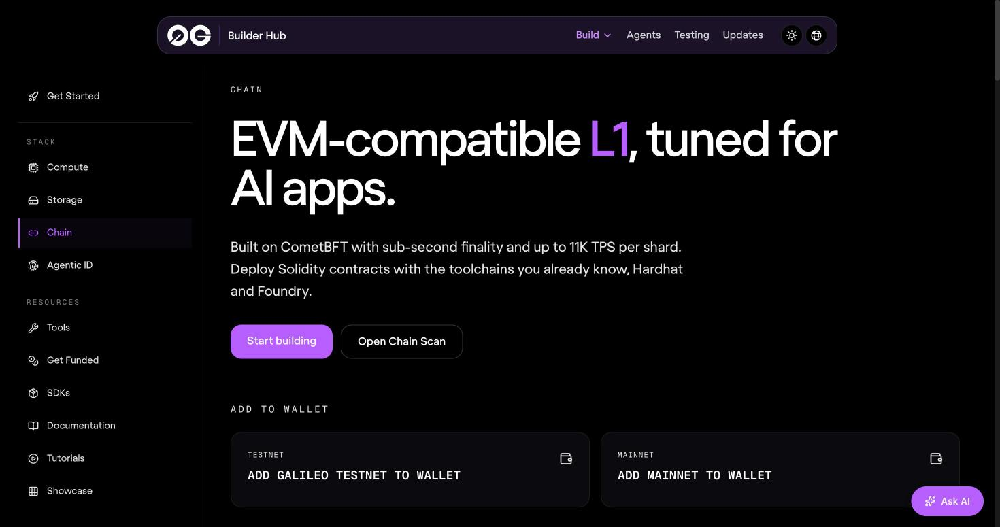
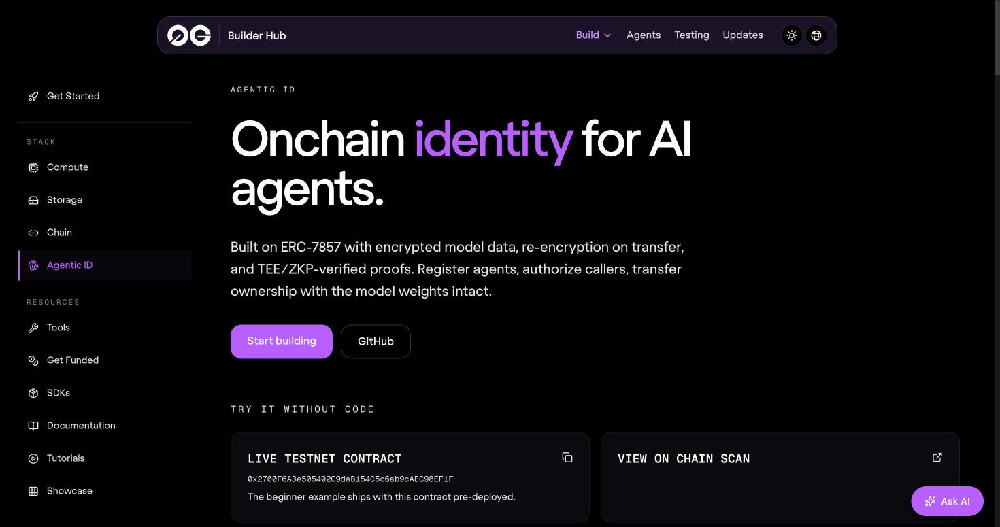

# 8. The Notice Board and the Robot's ID Card: 0G Chain and Agentic ID

## 0G Chain

> [!STORY] The board outside the collector's office
> Outside every district collector's office there is a glass-fronted notice board. Orders are pinned there, dated and stamped, behind glass that only the office can open. Anyone walking past can read them. Nobody can quietly swap one for another, because a hundred people saw the original.

0G Chain is that board, built as an ordinary EVM blockchain: if you have written Solidity, you already know how to use it.

**What we use it for (optional):** a tiny contract that records each session's episode-log root hash. Then anyone can check that a replayed session is the one that happened. Physical AI lists "contract deployment addresses" in its submission requirements; Build with 0G PC needs them only if you have any.

The facts, from live measurements on 30 October:

- **Galileo testnet**: chain id 16602, RPC `https://evmrpc-testnet.0g.ai`, explorer `chainscan-galileo.0g.ai`, blocks about every half second.
- **Gas** is about 4 gwei. A 1-million-gas deploy costs about 0.004 0G, so one day's faucet covers about 25 small deploys.
- **Compile for `cancun`**; newer EVM targets may not verify on the explorer. Verification works through the explorer's `/open/api` with any placeholder key.
- **WebSocket subscriptions are refused on Galileo** (they work on mainnet). Poll instead.
- **The faucet** (faucet.0g.ai) gives 0.1 0G per wallet per day and asks for a captcha. It accepts promo codes and has an event mode that lifts the per-IP limit, so ask at the booth.

> [!GOTCHA]
> A Lisbon team found Galileo rejects the default EIP-1559 priority tip; deploy with `--legacy` and a fixed gas price. Receipts can take about 10 seconds on the public RPC.

## Agentic ID (ERC-7857)

> [!STORY] The elephant's papers
> In old Kerala temples, a working elephant had papers: who owned it, who was allowed to ride it, its training. The elephant could be lent to another temple for a festival without changing owners, and sold with its papers. The papers made a living thing into property that could be trusted.

Agentic ID does that for an AI agent. An **ERC-7857** token is an NFT that carries an agent's private "intelligence" (prompts, memory, model data) encrypted, with its hash on the chain. When it is transferred, a TEE or zero-knowledge oracle re-encrypts the data for the new owner. You can also **lend** it: `authorizeUsage` gives someone usage rights without ownership (up to 100 users per token, cleared on transfer), and `revokeAuthorization` takes them back.

There is a pre-deployed Galileo contract for the beginner example, and an examples repo with three walkthroughs (mint and manage, authorise and delegate, marketplace trading). They are simplified and use placeholder transfer proofs.

> [!GOTCHA]
> 0run found 0G's reference agent-token contract is 24.6 KB, over Ethereum's contract-size limit, and wrote a minimal one. The Builder Hub page and the reference repo also show different function signatures for the transfer. Use the examples repo as the source of truth.

> [!PROJECT] Do we need it?
> Probably not in 36 hours. The story would be "you own your tutor, and you can lend it to a colleague without giving them your memory". It is a good "what's next" slide. And 46% of Lisbon's 0G entries used Agentic ID, which is a reason *not* to make it our headline.

> [!LINKS]
> [0G Chain on the Builder Hub](https://build.0g.ai/chain) · [Deploy contracts on 0G](https://docs.0g.ai/developer-hub/building-on-0g/contracts-on-0g/deploy-contracts) · [Galileo explorer](https://chainscan-galileo.0g.ai) · [Faucet](https://faucet.0g.ai) · [Agentic ID](https://build.0g.ai/agentic-id) · [ERC-7857 docs](https://docs.0g.ai/developer-hub/building-on-0g/agentic-id/erc7857) · [Agentic ID examples](https://github.com/0gfoundation/agenticID-examples)
