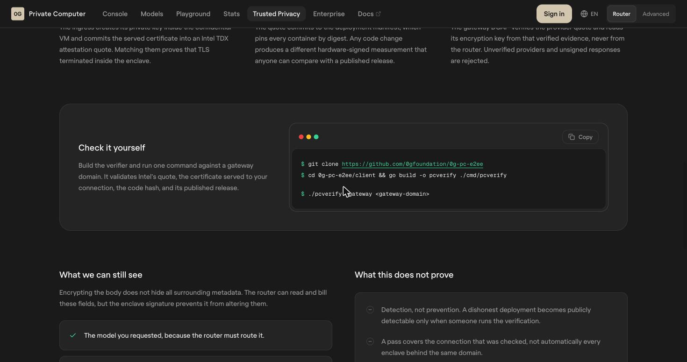

# 9. Proof You Can Check: How a Sealed Answer Is Actually Verified

> [!STORY] The wax seal and the signet ring
> A merchant in old Bombay received a letter sealed with red wax. He did not trust the courier, and he did not need to. He kept a drawing of the sender's signet ring in a book. He pressed the drawing against the seal: same crest, same chip on the left edge. The letter was genuine, unopened, from that sender. It did not tell him the letter was *true*. It told him who sent it and that nobody had changed it on the way.

A 0G signature is that wax seal. This chapter is about pressing the drawing against it, which turns out to be harder than the docs suggest, and it is where the most teams at Lisbon lost their evidence.

## What is signed, and by whom

When a Private model answers, the provider's enclave signs the response with a key that exists only inside the enclave. The public half of that key is the **TEE signer address**. You check a signature by recovering the address from it and comparing it with the signer address 0G publishes for that provider.

There are two ways to reach a model, and verification behaves differently on each:

- **The router** (router-api.0g.ai): one API key, OpenAI-compatible, the path we use. Send `verify_tee: true` and the trace in the response carries `tee_verified`. Our research notes add a warning from 0G's own docs: `tee_verified` is the router's word, a boolean it computed, not the raw proof. True, false or absent means verified, failed or not requested. If the claim matters, fetch the signature yourself.
- **The Direct broker** (the compute SDK, paying a provider on-chain): you talk to one provider, get a chat id back, and call the SDK's `processResponse` to check the signature.

## Three facts the docs bury

1. **Signatures expire after about 20 minutes.** The provider's broker caches each `{text, signature}` pair for 20 minutes by default, then forgets it. A "check it later" design must fetch the signature within that window and **store it** (in our case, in the episode log). Re-fetching live on Saturday morning a signature from Friday night will fail.
2. **What is signed is two hashes.** For chat and speech, the enclave signs `sha256(request body):sha256(response bytes)`. Because the router strips some fields before forwarding and adds its trace on the way back, hashing the bytes *your* client saw may not reproduce the provider's hashes. The lab tested it on 30 October, and it does not match, for laya or for 0GM-1.0. So the signature proves that this sealed provider answered this chat id, not these exact words. The proof sheet should say exactly that, and no more.
3. **The SDK's `processResponse` checks only the signature.** It recovers the signer and compares addresses. It does not check that the signed text matches your content.

The manual check, step by step (what the SDK does, from its source): read the provider's service record from 0G's Inference contract (its `url`, `teeSignerAddress` and `additionalInfo`); if `additionalInfo` says the target is separated, use its `TargetTeeAddress` instead (capitalised keys); fetch `{url}/v1/proxy/signature/{chatID}?model={model}`; recover the address from the EIP-191 hash of `text`; compare.

> [!NOTE] What the lab measured, 30 October
> The manual check works through the router. For laya, the signature came back in 118 milliseconds; for 0GM-1.0, in 136. Both times the recovered signer was the key 0G's contract lists for that provider. laya's signed text is two hashes; 0GM-1.0's starts with `zg-sig-v1/e2ee-ct`, because what it seals is the encrypted traffic. That fetched signature is the proof for 0GM-1.0, where the router's `tee_verified` is absent.
>
> The gateway, checked by hand with ordinary tools: its evidence files match their checksums, the certificate it serves is the one inside the evidence, that certificate validates, and the deployment manifest matches 0G's published release of 28 October byte for byte. The one step that needs 0G's `pcverify` tool, checking that the hardware quote itself is genuine, was not run.

## The traps teams hit, in the order you will hit them

These come from teams' own write-ups. They are the reason "attestation that never verified" is the third most common way 0G entries failed.

1. **The chat id lives in a header, not the body.** The id to fetch a signature with comes from the `ZG-Res-Key` response header. Using the completion's `id` field gives `chat_id_not_found` (Mithra).
2. **The signature does not cover the text.** It covers a colon-joined tuple that includes a sha256 of the **raw** response body. Parse the JSON and re-serialise it, and the bytes change and the signature breaks. Hash the raw bytes as they arrived (Mithra).
3. **The signer is not the provider's address.** It is `teeSignerAddress` from the serving contract. Comparing against the provider address "cost us a night" (Overlap).
4. **Check that the signer is acknowledged.** Require `teeSignerAcknowledged === true` before trusting the signer (Mithra).
5. **The signature can come back as 64 bytes**, R and S with the recovery byte dropped. Try both recovery values, 27 and 28 (Mithra).
6. **On testnet, the router's chat ids did not resolve** at the provider's signature endpoint (AEGIS called it a bug in the testnet router's completion proxy), the router "never yields a verifiable signature" (Overlap), and `processResponse` returned no valid signature on testnet providers (Rerun). The teams that won used the Direct broker for the decision they needed to prove, or ran on mainnet.

Those testnet findings are from July. The lab's job is to find out which of them are still true on the mainnet router with our credits. The first test: one Private call with `verify_tee: true` and the trust-mode header, then fetch its signature by hand and recover the signer.

## Verifying the gateway itself

0G also lets you check the gateway enclave, not just one response. Their verifier is a small Go program:

It validates Intel's attestation quote, the certificate served to your connection, the code hash and its published release. Running it once on stage, or showing its output in the README, is a strong move for both 0G and the EF judges.

## What we show the learner: the proof sheet

Happy Hour, a Lisbon winner, let customers tap any loyalty punch and see the enclave signature fetched live from the request id. We do the same for every pointer move.

> [!PROJECT] The "how do I know?" card
> Within seconds of each decision, in the background, the tutor fetches the provider's signature and stores it in the episode log (inside the 20-minute window). Under each move in the session panel, a small link opens a card: the model, the provider, the request id, the trace's verdict, and the stored signature with the signer recovered live against the published signer address. A green tick means the seal matched. A red cross means it did not, and the tutor would have frozen at that moment anyway.

> [!GOTCHA] Don't let verification slow the tutor
> Verifying every signature in the hot path adds round trips. Ask for `verify_tee` on every call (cheap), but fetch and recover full signatures in the background, after the pointer has moved, and on demand when the user opens the card. The only check on the hot path is whether the trace says verified.

> [!LINKS]
> [Why Private Computer is private, and how to check](https://pc.0g.ai/trusted-privacy) · [The gateway verifier: 0g-pc-e2ee](https://github.com/0gfoundation/0g-pc-e2ee) · [Mithra, the best verification notes](https://ethglobal.com/showcase/mithra-c5q9f) · [Overlap](https://ethglobal.com/showcase/overlap-7ninc) · [AEGIS](https://ethglobal.com/showcase/aegis-93ox5) · [Happy Hour's proof sheet](https://ethglobal.com/showcase/happy-hour-v3o03)
