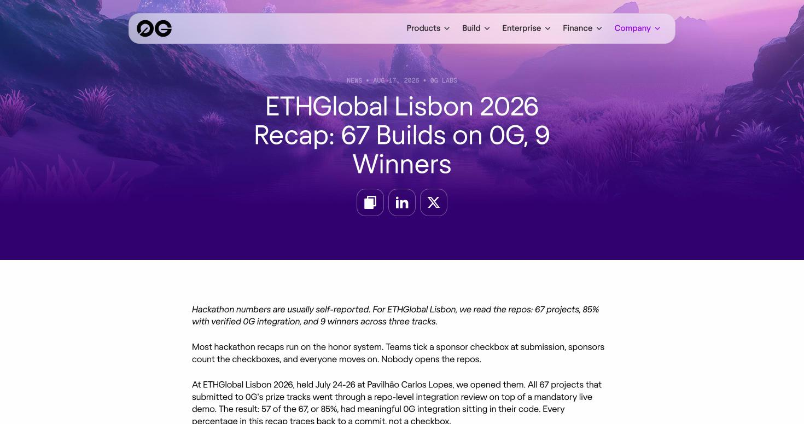
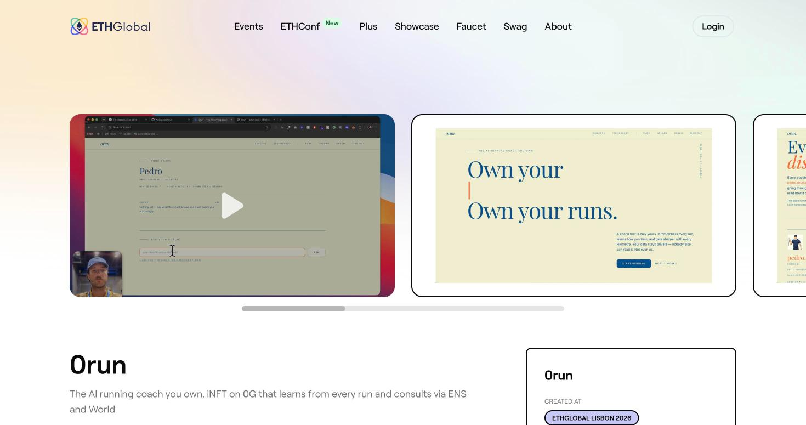
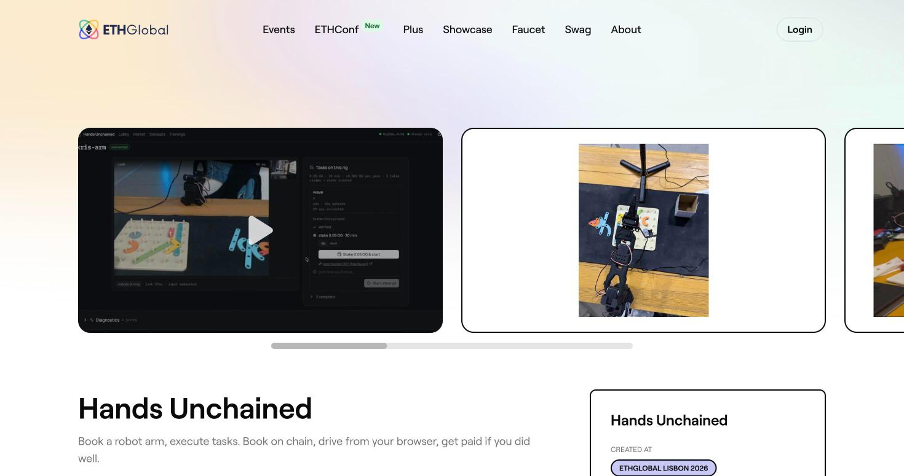
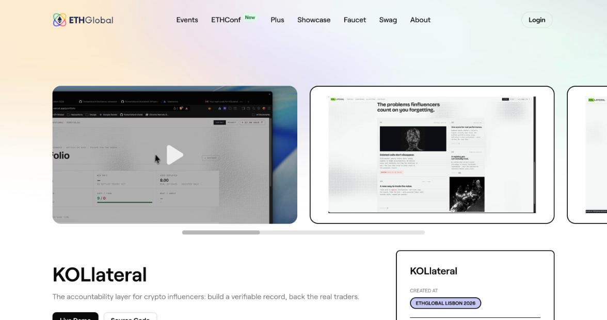
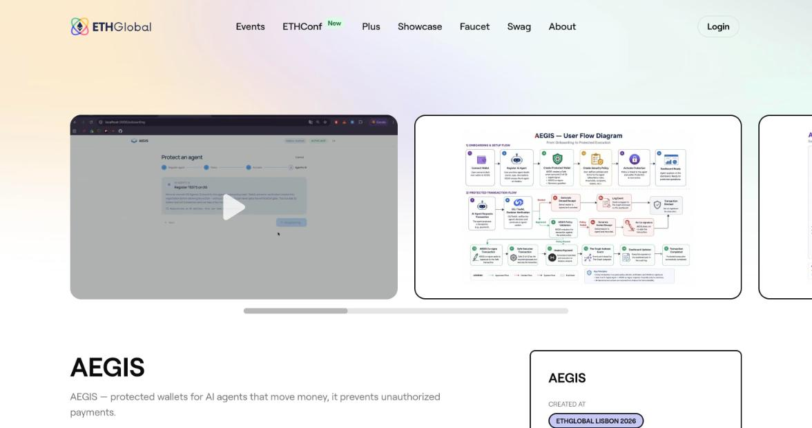
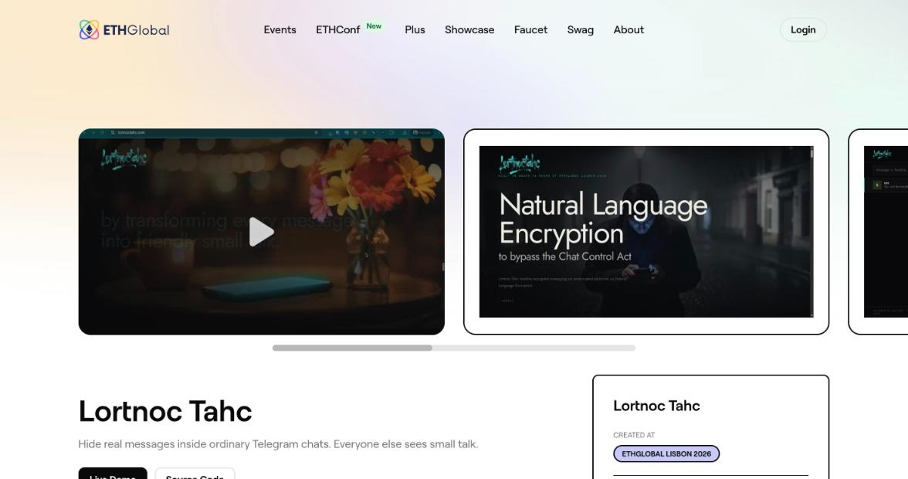
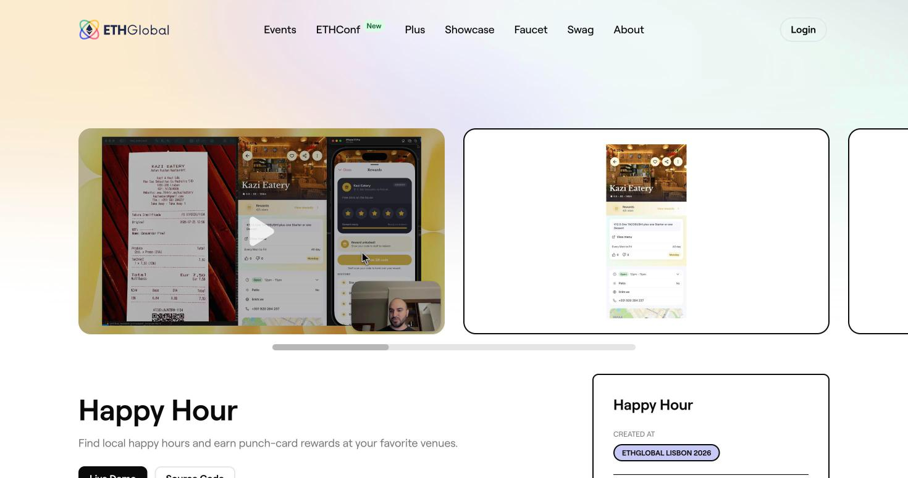

# 10. Who Won on 0G Before Us, and How

> [!STORY] The auditor's afternoon
> Lisbon, late July 2026. Sixty-seven projects have entered 0G's tracks. Most sponsors would read the forms and tick boxes. 0G's judges do something unusual: they open every repository and read the code the way an auditor would, then watch a mandatory live demo. Fifty-seven of the sixty-seven turn out to have real 0G integration in their code. Nine win.
>
> When you read what the nine did, a pattern jumps out. Almost none of them used 0G for everything. Each one put a single sealed 0G call at the exact moment where something mattered (money moved, a reputation was decided, a payment was released) and kept a record of it that anyone could check.

The numbers from that recap are the best measurement we have of a 0G room: **67 entries, 115 builders (about 1.7 per team), 9 winners, $15,000 over three tracks.** 49 of 67 gave the live demo. Across all 67, Compute was used by 82%, Storage by 67%, Agentic ID by 46%, Chain by about 43%.

This chapter tells the winners' stories. Each ends with the one thing we take from it.

## Lisbon 2026, Best AI Product

### 0run: the running coach you own (1st place)

**What it is.** Upload a run (a GPX file) and an AI coach reads it against your whole history, remembers it in encrypted memory, and can consult other coaches. You own the coach as a token.

**How it used 0G.**
- **Chain** (Galileo testnet, chain id 16602): they wrote their own minimal ERC-7857-shaped token, because 0G's reference agent-token contract was 24.6 KB, over Ethereum's contract size limit. A registry contract anchors a memory hash after every run.
- **Storage**: each run is encrypted with AES-256-GCM using a key derived from the runner's wallet signature, uploaded with the SDK's built-in encryption option, and its Merkle root is computed locally so the chain record does not wait for the upload.
- **Compute, split in two on purpose.** The friendly narrative report goes through the router on a big model (about 19.5 seconds). The one number someone might dispute, the 1-to-5 effort score, always goes through a small attested model on the Direct path (about 1 second) with a verified TEE signature. The score is then fed into the narrative so the big model cites it instead of recomputing it.

**Where they got stuck.**
- A 658 KB encrypted upload was still "file not found" after **more than 22 minutes**. A second upload call never returned in about 24 minutes, even though its chain transaction landed. Fix: never read memory from Storage on the hot path, cache an encrypted copy, put a timeout on every SDK call (120 seconds for upload, 30 for download), and show the steps to the user.
- The Compute SDK's ES-module build was broken; they loaded the CommonJS build instead, because otherwise the Direct path silently fell back to the router.
- A 20-token output cap on a reasoning model returned empty text.

They wrote all of it down in a "0G reality check" document with measured numbers, for the judges. 0G called 0run the full-stack winner.

> [!PROJECT]
> Copy the split. A fluent model explains, and a small sealed call decides the one thing that matters. For us: 0GM-1.0 explains, laya decides whether to act. And write our own reality-check document with measured numbers.

### Hands Unchained: only graded work gets paid (2nd place, also World 1st and an ETHGlobal finalist)

**What it is.** A remote labour market where verified humans control robot arms over the internet (a real arm or a simulated one) to record training data. An AI grader checks each recording, and only work that passes gets paid.

**How it used 0G.** A small attested model on the Direct path receives the task and sampled motion data and returns a score and pass or fail. They save the chat id, provider address, model, whether the TEE signature verified, and hashes of the request and response. **The grade, not the operator's click, settles the stake.** The market contract runs on both 0G's testnet and Hedera's.

**The creative move.** The enclave signs each answer with a plain Ethereum-style signature. Their Hedera contract re-derives the digest and recovers the signer, checking it against the signer address read live from 0G's registry. **A 0G proof checked on another chain, with no bridge.**

**The trap.** The Storage SDK returns `[value, error]` pairs instead of throwing errors, and "caught us once". And their fallback, a local grader when 0G is down, would be disqualified under Mumbai's safe-stop rule.

### KOLlateral: losing calls cannot quietly disappear (3rd place, also Uniswap 1st and a finalist)

**What it is.** A public, verifiable track record for crypto influencers. Each public call becomes a structured signal priced against real exchange history. Losing calls stay visible, in red.

**How it used 0G.** Only Compute, through the router, with `verify_tee` and the Private header. The model extracts each call (asset, direction, target, confidence) and boils rambling posts down to a thesis. They called the sealed inference "the part we cannot fake".

> [!PROJECT]
> Third place used one 0G service, done properly. Depth of one integration beats a checklist of all four.

## Lisbon 2026, Best Infrastructure and Tooling (10 entries, 3 winners)

**AEGIS** puts an AI agent that moves money inside a 2-of-3 Safe, where AEGIS co-signs only actions inside the user's written policy. It minted an Agentic ID on Galileo with the agent's metadata uploaded to Storage. **Its key finding:** the testnet router's chat ids could not be resolved at the provider's signature endpoint (`chat_id_not_found`), which they called a bug in the testnet router, so they used the Direct broker for verification. It won with its co-signer service still a skeleton, and said so.

**Superpose** is an AI risk manager for a shared-collateral position on 1inch Aqua. Every agent episode and its reasoning is uploaded to Storage as a replayable "learning lineage". Its phrase is worth stealing: **"AI proposes, the guard disposes."** The AI advises, a contract enforces.

**Lortnoc Tahc** ("chat control" backwards) is a Chrome extension that turns your real Telegram message into innocent small talk before sending, and back again for the one reader who should see it. It used 0G in the strangest way in the corpus: as **a sealed judge of which cover sentence sounds most natural**. The model only ever sees the public cover text. Its trap: the Direct path's ledger needs 3 0G to start, while the faucet gives 0.1 a day, so they got a top-up at the 0G booth.

## Lisbon 2026, Keep Building (Continuity, 15 entries, 3 winners)

**Happy Hour** is an existing iOS app for finding happy hours. At Lisbon it added a punch card: photograph your receipt, a small 0G model judges whether it is a real receipt from this venue, and each approved punch stores the request id and the TEE signature. Then the move every reviewer remembered: **an in-app proof sheet**. Tap any punch and the app re-fetches the enclave's signature live from the request id, with no API key, so the customer can audit their own punch. They deployed no contracts at all and said Storage, Agentic ID and Chain were deliberately out of scope.

**Orloj** turns verified smart contracts into typed tools for AI agents, and stores "skill bundles" on 0G Storage, addressed by fingerprint, loaded by agents without a redeploy.

**NpmGuard** puts AI agents between you and `npm install`. Its 0G use is not documented in its write-up or public code, only in 0G's recap. A mature product with users won with a thin 0G slice.

> [!PROJECT]
> The proof sheet is ours to build. Every pointer move in the episode log gets a "verify" button that re-fetches the signature from the request id, in front of the judge.

## New Delhi 2025: a different bar

At New Delhi in 2025, 0G had one track and five places. Four of the five winners used 0G as a chain or an archive, not for inference: **Whale.fun** (a token launchpad run live on stream, 1st), **Melon** (a camera that signs where a photo came from, 3rd), **WEAVE** (a no-code event-listener builder, 4th), **SecGit** (staking for open-source bounties, 5th, whose 0G inference was only "planned"). Only **nebula-sdk** (2nd) wrapped 0G Compute, and its cleverest move was distribution: they opened pull requests into OpenRouter, LlamaIndex, Vercel's AI SDK and LangChain so 0G models showed up in those docs.

**By Lisbon in 2026 that bar had moved.** Winners needed sealed inference with a record per decision. Mumbai's track text asks for the same: request ids, an episode log, a sealed call inside the decision loop.

## What the winners had in common

1. **One sealed decision with consequences, and a record you can check.** Score, grade, verdict, punch. Each stored the request id, provider and attestation.
2. **A named person.** A runner, a robot operator, a trader, a customer. Not "agents" in general.
3. **One 0G path done properly, measured and explained.** Not all four components for the sake of it.
4. **A live product.** Eight of nine Lisbon winners had a live app or a TestFlight build.
5. **A one-line story.** "A coach you own." "Only graded work gets paid." "Losing calls cannot quietly disappear."

> [!LINKS]
> [0G's Lisbon recap](https://0g.ai/blog/ethglobal-lisbon-2026-recap) · [0run](https://ethglobal.com/showcase/0run-420af) · [Hands Unchained](https://ethglobal.com/showcase/hands-unchained-6kdf3) · [KOLlateral](https://ethglobal.com/showcase/kollateral-ho1d1) · [AEGIS](https://ethglobal.com/showcase/aegis-93ox5) · [Superpose](https://ethglobal.com/showcase/superpose-ai0gv) · [Lortnoc Tahc](https://ethglobal.com/showcase/lortnoc-tahc-y1d3j) · [Happy Hour](https://ethglobal.com/showcase/happy-hour-v3o03) · [Orloj](https://ethglobal.com/showcase/orloj-finance-agents-jejoc) · [nebula-sdk](https://ethglobal.com/showcase/nebula-sdk-siygu) · [0run's code](https://github.com/AdCazzum/0run)
