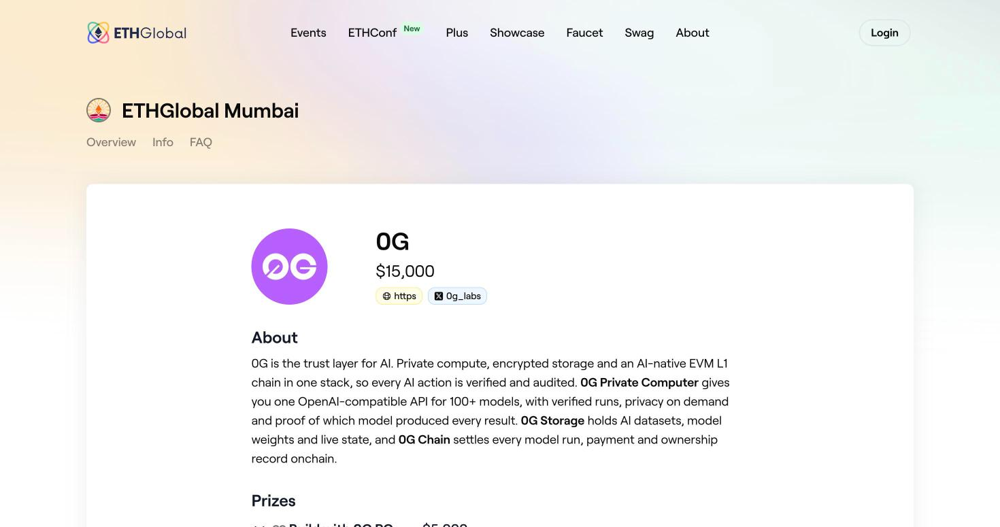

# 13. The Mumbai 0G Tracks, Line by Line

> [!STORY] The examiner's marking sheet
> Every Indian student learns this trick in tenth standard: get the marking scheme. Not the syllabus, the marking scheme. The examiner has a sheet that says "two marks for the diagram, one mark for the unit, one for the final answer", and a brilliant answer that forgets the unit loses a mark.
>
> A sponsor's prize page is the marking sheet. This chapter reads it line by line.

0G pays **$15,000 across four tracks** at Mumbai. The page changed on 30 October; this chapter uses the new version. A 0G workshop runs **Thursday 5 November at 15:30 IST in Workshop Room 1**: "One API, All of AI: Building on 0G Private Computer". Every team gets 0G compute credits to build with.

Remember the ETHGlobal rule: you pick up to three partners at submission, and a partner with several tracks counts as one pick. **One 0G pick makes us eligible for every 0G track.**

## Track 1: Physical AI, Agents with a Body ($5,000)

**Places:** 1st $2,500 · 2nd $1,500 · **best build on real hardware $1,000**.

**The brief:** a robot, drone, wearable or pocket device whose decisions run on 0G. You don't need hardware: simulated builds are eligible for every prize. And the sentence we build the pitch on: **0G is the brain, not the spinal cord: motion stays on the device, while 0G makes the decisions at key checkpoints and keeps the record.**

**The personal-devices lane** asks for an open, verifiable alternative to Meta's Muse assistant, on glasses, a pocket device or a desktop companion, with the user's memory on 0G Storage and sealed inference. That is our lane, almost word for word.

**Not wanted:** a chatbot with a robot avatar, pre-recorded motion, 0G used only for logs.

**Must show**, and how we meet each:

| Must show | Our answer |
|---|---|
| A 0G call inside the decision loop: vision, voice or decision model | **Vision and decision**: 0GM-1.0 sees and thinks, laya decides act or hold. Voice too, if the 0G Whisper switch is on |
| An episode log on 0G Storage with a request id per decision | Every turn appends one encrypted line (request ids, decision, probability, target) and the session log goes to Storage in the background |
| A replayable simulation, or a live hardware demo at the 0G booth | **Both**: the laptop demo live at the booth, plus a replay page that re-renders a session from its Storage log |
| A safe-stop fallback if 0G is unreachable. **A fallback that fakes the decision disqualifies.** | The pointer freezes and the tutor says it cannot see clearly. It never falls back to a local model |

**Submission:** name and description, public repo with README and setup, demo video **under 3 minutes** and a live demo link, contract deployment addresses, team contacts (Telegram and X). Prizes are paid at 0G's discretion, and not every place is guaranteed to be awarded.

> [!GOTCHA]
> ETHGlobal wants videos of 2 to 4 minutes; 0G wants under 3. Cut to between 2:00 and 2:59. And "a body": ask at the booth whether a pointer that moves across the screen counts, and whether a laptop demo counts for the real-hardware prize. The draft question is in our hack-ops notes.

## Track 2: Build with 0G PC ($5,000), new on 30 October

**Places:** 1st $2,500 · 2nd $1,500 · 3rd $1,000.

**The brief:** 0G Private Computer gives you one OpenAI-compatible API for 100+ models, with verified runs and privacy on demand. **Build a consumer app where AI on 0G is the product: something people open, use, and come back to tomorrow.** Creative image, video and voice apps are welcome.

**Not wanted:** generic chat wrappers, and apps where the AI call could be removed without anyone noticing.

**Must show:**

| Must show | Our answer |
|---|---|
| Inference on 0G Private Computer in your main user flow, with request IDs | Every turn of the tutor is Private Computer inference, and every request id is in the log and the proof sheet |
| A working app a judge can try, with a clear reason someone comes back tomorrow | The judge installs the extension and asks it something. The reason to come back: every new tool at work, every confusing page. "Last time you got stuck on the Contract tab" is the memory hook |
| One sentence on what breaks if 0G is removed | Without sealed compute, the tutor cannot see your screen without sending it to someone who can read it |

**Bonus (uncertain):** plug into **iAI**. iAI holders get 1.271 fresh compute credits per staked iAI every day at 00:00 UTC, and unused credits expire. If your app lets users sign in with their 0G account and spend their own daily credits, it scores higher, and standout apps may be invited to discuss a revenue share with 0G. Contract addresses are needed only "if any".

The catch: there is **no documented way for an app to spend a user's credits**. The prize page promises only that the shared sign-in can *read* the balance, and that sign-in works only on localhost ports 3000, 3001 and 5173. The honest path is the user's own key (which draws their credits). Ask 0G at the workshop before spending an hour on it.

> [!PROJECT]
> This track fits a daily-use tutor even better than Physical AI does, and it has fewer must-shows. Physical AI is the stronger story ("the screen is the body"); 0G PC is the safer qualification. One build, both tracks, one 0G pick.

## Track 3: Keep Building on 0G ($3,000, Continuity)

For teams iterating on an existing 0G project. They judge meaningful progress during the Mumbai window, not polish on old demos. **Not ours**: none of our projects is on 0G yet. We asked 0G whether "independent prior work" could mean a non-0G app gaining 0G; until they say yes, we treat this as closed.

## Track 4: Agents That Pay for Themselves ($2,000), new on 30 October

An agent that makes money and pays for its own inference on 0G Compute, with no human topping it up. The recommended path is **comfy**, 0G's token launchpad: register the agent, launch its token, and part of the creator fees lands as compute credit in the agent's account. Not wanted: a token launch with a chatbot attached, "revenue" from the team trading its own token, or an agent whose wallet a human refills. **Not ours.**

## How 0G judges, from their own recap

From Lisbon: a **mandatory live demo**, and a code review that read source code the way an auditor would. Integration was checked in the repo, not taken from the form. Their takeaways for teams: use the full stack where it earns its place, build memory that "survives the demo", and **document your integrations**, because the review found more Storage and Agentic ID use than teams claimed.

One more signal of how 0G scores. Its own robot-hackathon kit (Reachy Mini x 0G) ships a 25-point rubric: **0G integration out of 10** (8 to 10 means "0G is essential"), robot use 5, creativity 5, execution 5, and **a tie goes to the higher 0G score**. The same kit warns that getting API keys is the number one day-of blocker. Mumbai's judges may use a different sheet, but the instinct is clear.

> [!PROJECT] Our answer sheet, in one table
> In the README, a section titled "How this uses 0G", with one row per call: the endpoint, the model, the trust mode, where the request id goes, and one real request id from the demo session. The judge reading our code like an auditor finds it in ten seconds.

> [!LINKS]
> [Mumbai 0G prize page](https://ethglobal.com/events/mumbai/prizes/0g) · [Introducing iAI](https://0g.ai/blog/introducing-infinite-ai) · [iAI docs and terms](https://iai.finance/docs) · [zerobot, 0G's robot SDK](https://github.com/0gfoundation/zerobot) · [Project Floaty, 0G's desk bot](https://github.com/0gfoundation/project-floaty) · [Reachy Mini x 0G kit and rubric](https://github.com/0gfoundation/reachy-mini-hackathon) · [0G's Lisbon recap](https://0g.ai/blog/ethglobal-lisbon-2026-recap)
