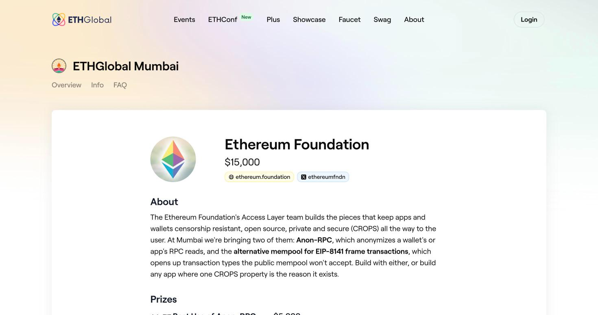
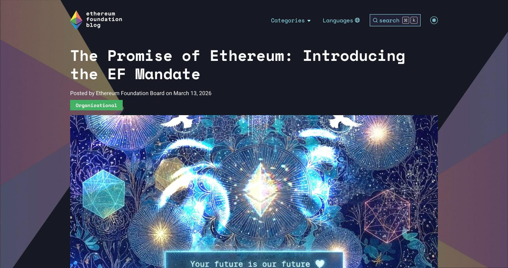
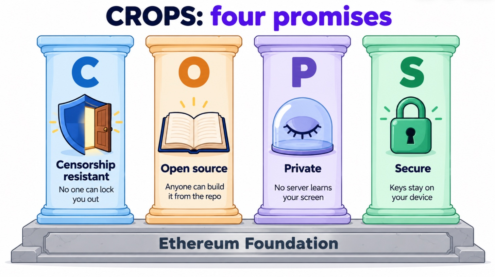

# 14. The Ethereum Foundation and CROPS: Our Second Sponsor

> [!STORY] The four locks on a house in Bandra
> A family in Bandra keeps the same house for three generations. Their grandmother had a rule about it, and she said it as four words. **Nobody can lock us out**: the house must never depend on one landlord, one key-maker, one guard. **Anyone can see how it is built**: the plans are pinned inside the front door, so any mason can repair it. **What happens inside stays inside**: the windows face the courtyard, not the street. **It holds when someone pushes**: the door is strong, and the family knows exactly which parts are strong and which are not.
>
> Builders kept offering to make the house more convenient. A smart lock run by a company. A camera that streams to a vendor. Each one traded one of the four words away for comfort. She always said no.

The Ethereum Foundation has the same four words, and calls them **CROPS**: Censorship Resistant, Open Source, Private, Secure. At Mumbai it pays $15,000 for builds that keep them.

## Who they are

The team sponsoring Mumbai is the EF's **Access Layer** team. They build the parts of Ethereum that sit between a person and the chain: the RPC calls a wallet makes to read balances, the way a transaction gets submitted, the wallet itself, the frontend you click. Their job is to make sure none of those pieces quietly breaks one of the four words.

Their mandate comes from the EF Board itself, published on 13 March 2026, and its central line is that Ethereum must, above all, remain censorship resistant, open source, private and secure. The same post says these must never be traded away for convenience.

## CROPS, letter by letter, with what each one means for a real app

| Letter | The question it asks | A typical way apps fail it |
|---|---|---|
| **C** censorship resistant | If you (the builder), your domain, your server or your RPC provider go away or refuse a user, does the app still work? | the frontend only lives on one domain; the backend is a single server |
| **O** open source | Is it under a free licence, and can a user build and run it from the repo alone? | closed backend; a build nobody can reproduce |
| **P** private | What does each third party (your server, RPC provider, analytics, indexers) learn about the user? | the RPC provider sees every address you look at; analytics scripts |
| **S** secure | How are keys and user data protected, and what are the trust assumptions? | keys on a server; recovery that needs the vendor |

The track's own summary of how apps fail: most apps lose at least one on the way to users. A frontend that only lives on one domain, a wallet you can't recover without the vendor's server, a dapp whose RPC provider sees every address you look at.

## The four EF tracks

| Track | Lane | Money | What it wants |
|---|---|---|---|
| **Best Use of Anon-RPC** | Fresh | $5,000: $2,500 / $1,500 / $1,000 | an app whose RPC reads go through Anon-RPC by default, or a new anonymity worker, or a new harness |
| **Best use of the Frame Transaction Alternative Mempool** | Fresh | $5,000: $2,500 / $1,500 / $1,000 | something only the alt mempool makes possible, developer tooling for it, or breaking its rules |
| **Best CROPS App** | Fresh | $3,500: $2,000 / $1,000 / $500 | an app, wallet feature or dev tool where one CROPS property is the reason it exists |
| **Best CROPS Upgrade** | Continuity | $1,500, one place | add one CROPS property to an existing project, before and after |

**The rule that shapes our entry: one EF prize per project.** You may submit to Anon-RPC, the alt mempool and CROPS, but you are placed in at most one, and EF judges decide where it fits best. Our target is **Best CROPS App**, with **Private** as the lead property.

## How CROPS App is judged, word for word

The judging criteria (marked "tbc: final review pending", so re-read them on 5 November):

- **works end to end in the demo**
- **depth of the lead property: structural (works without you) beats cosmetic (a setting)**
- **the other three still hold, or trade-offs are stated in the README**
- **UX: would someone use it without knowing what CROPS means**
- **could it ship after the hackathon**

The qualification lines:

1. A public repo under a free and open-source licence (MIT, Apache-2.0, GPL, MPL or similar), with a README a judge can run it from.
2. A README section titled **CROPS**, one or two lines per letter: C (what you control that the user depends on, and what happens if it goes away or refuses them), O (the licence, and whether a user can build and run it from the repo alone), P (what each third party learns about the user), S (how keys and user data are protected, and the trust assumptions).
3. **A demo video, three minutes at most, that shows the lead property working end to end, including the moment it matters.** Their examples: you switch off your backend, swap the RPC provider, or show server logs with nothing identifying in them.
4. **No third-party trackers or analytics in the client.** If the project handles keys or personal data, they stay on the user's device, or the README says why not.

Their own list of ideas includes a payment, messaging or social app where your server learns nothing about who talks to whom, and a tool that proves the shipped frontend or extension matches the public repo. Both are close to things we can do.

## What "structural, not cosmetic" means

> [!STORY] The curtain and the wall
> A shop that promises privacy by hanging a curtain is cosmetic: the curtain is a setting, and anyone can pull it aside, including the shopkeeper. A shop that promises privacy by having no window at all is structural: there is nothing to pull aside. It works without anybody's goodwill.

A "privacy mode" toggle that sends your data somewhere friendlier is a curtain. **A design where the builder has no server at all, and the AI that sees your screen runs in sealed hardware, is a wall.** That is the difference the judges score, and it is why the tutor fits.

## What EF paid for before

The corpus has four EF winners, all at New Delhi 2025, on different privacy tracks:

- **zkETHer** (1st, General Privacy): a privacy pool for ERC-20 tokens, with the zero-knowledge proofs generated on the user's phone.
- **Wisk** (2nd): background verification from India's DigiLocker documents, proven in the browser so the raw document never leaves the device.
- **ZeroSurf** (3rd): age verification from an Aadhaar QR code, proven on the device, shipped as an npm button websites can install.
- **AccessFi** (Client-Side Privacy): tap-to-pay event wristbands with private eligibility checks.

The pattern is loud. **The private thing never leaves the user's device, the proof does, and other builders can install it.** India-specific identity documents won twice. Our tutor's version: the screen's pixels never leave the laptop in the default path, only a text outline does, and only to sealed hardware. Chapter 16 puts it into the README section, line by line.

> [!GOTCHA]
> "No third-party trackers" is stricter than it sounds. Google Fonts, Vercel Analytics, Sentry or a hosted RPC key in the client might read as a tracker (our interpretation, not confirmed). Self-host fonts, ship no analytics, and check the network tab before recording the video.

> [!GOTCHA]
> Open question for the booth: must a CROPS App touch Ethereum at all? Our app touches 0G's EVM chain and can route its reads through Anon-RPC. Ask the EF team at the Thursday workshop (17:00 IST, Workshop Room 2) and adjust the README framing to their answer.

> [!LINKS]
> [Mumbai EF prize page](https://ethglobal.com/events/mumbai/prizes/ethereum-foundation) · [The EF Mandate](https://blog.ethereum.org/2026/03/13/ef-mandate) · [Walletbeat: how wallets get rated on these properties](https://walletbeat.eth.limo) · [Kohaku, EF's privacy SDK](https://github.com/ethereum/kohaku) · [Scaffold-ETH 2](https://github.com/scaffold-eth/scaffold-eth-2) · [zkETHer](https://ethglobal.com/showcase/zkether-geppk) · [Wisk](https://ethglobal.com/showcase/wisk-gdvfw) · [ZeroSurf](https://ethglobal.com/showcase/zerosurf-9988k)
