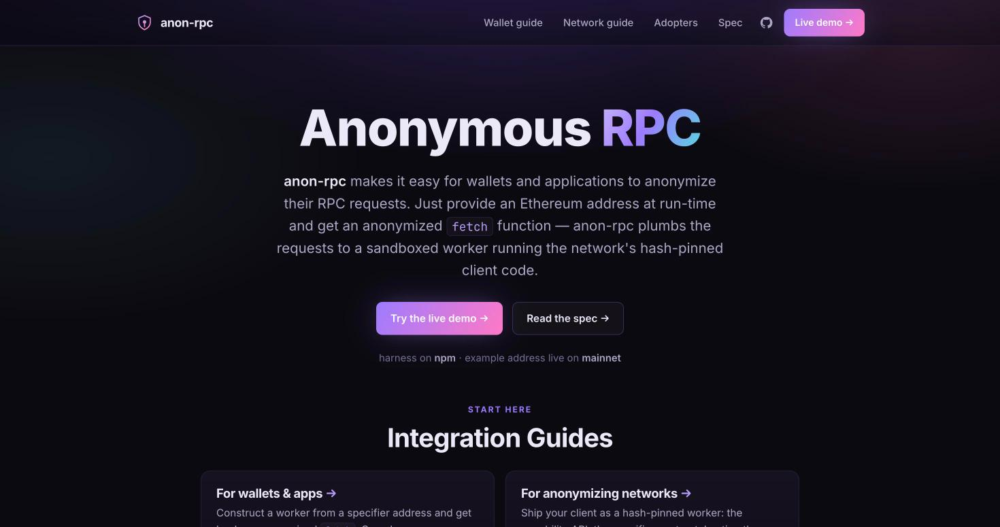
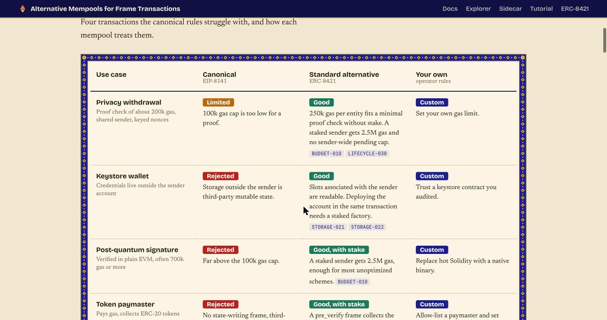

# 15. EF's Two Tools: Anon-RPC and the Alternative Mempool

Even though we enter CROPS, both EF tools are worth understanding: one of them can make our project more private, and the booth conversation will be about them.

## Anon-RPC: reading the chain without saying who you are

> [!STORY] The letter that changes hands three times
> Imagine you want to ask the land registry who owns a plot in Juhu, but you don't want the clerk to know that you asked. So you write the question, seal it, and hand it to a courier. The courier hands it to a second, who hands it to a third, and the third walks in and asks. The clerk sees the third courier. The first courier knew it was you, but not what you asked. Nobody in the chain knows both.
>
> And the couriers themselves are chosen by a rule you can check: the agency publishes a fingerprint of the exact instructions every courier must follow. If a courier shows up with different instructions, you refuse him.

That is **Anon-RPC**. Every time a wallet shows your balance, it asks an RPC provider about your address, and that provider learns your IP and every address you look at. Anon-RPC gives an app an **anonymised `fetch` function**. The request goes through an anonymity network (Tor, Nym, or a newer mixnet called Nox) before reaching the provider.

How it works, in four steps:

1. **The app names a "specifier"**: an Ethereum contract address. The contract stores the **hash** of the worker code for one anonymity network, plus suggested places to download it.
2. **The harness downloads the worker** from any of those places and accepts it only if its keccak256 hash matches. Their line: the hash is the trust; the URLs are merely suggestions.
3. **The worker runs in a sandbox**: a Web Worker inside a sandboxed iframe with no DOM, no cookies, no wallet keys and no host identity.
4. **The app calls `worker.fetch(url, init)`** exactly like normal `fetch`. It drops into viem or ethers as a custom transport.

The live networks on 30 October: **Passthrough** (mainnet; it proves the sandbox and hash pinning, not privacy), **tor-js** (mainnet, needs gateways), **Nym** (mainnet, about an 18 MB bundle and a few seconds to start), **Nox** (Sepolia). Packages: `@anon-rpc/browser-harness` and `@anon-rpc/browser-extension-harness`, both version 0.4.0, published 28 October.

**Judging, word for word:** works end to end in the demo; quality of user experience; how much of the app's traffic goes through Anon-RPC; and a notable line: if you choose to exclude some traffic as an intentional performance or anonymity trade-off instead of implementation difficulty, that can be a good thing, just let us know.

> [!PROJECT] Anon-RPC inside the tutor
> The extension harness is two days old, and no extension has adopted it yet. Our tutor *is* an extension. Its chain reads (checking a provider's signer address on 0G's registry, reading our session-root contract) can go through Anon-RPC, so the RPC provider never learns which sessions a user is verifying. The bolder idea: send the tutor's calls to the 0G router through the anonymised fetch too, so the router does not even learn the user's IP. That costs latency (Tor adds seconds), so it is a stated trade-off: the "paranoid mode" for the demo, off for speed. This is lab work, not a promise.

> [!GOTCHA] Anon-RPC traps
> The tor-js gateway is a demonstration gateway only, with limited capacity, and it may disappear. Hundreds of hackers on one venue network can exhaust it during judging; have Nym as a backup. The first bootstrap read is not anonymised. The extension harness fails silently in several ways: copy its static files with the build script or `worker.ready` never settles; `script-src` must include `blob:`; a host permission with a port number is dropped without warning; Chrome kills an idle service worker after about 30 seconds.

## The alternative mempool: freight that needs a deposit

> [!STORY] The main station and the goods yard
> Mumbai Central's passenger gates are strict. A ticket, a quick check, through you go. Anything that needs a longer inspection (a crate of machinery, a cold-chain container, something with odd paperwork) is turned away. Not because it is bad, but because the gate cannot spend ten minutes on every passenger.
>
> Down the line there is a goods yard. It will take the heavy crate, inspect it properly and load it. Its condition is a deposit: put down money and keep a clean record. Send junk and your reputation drops and they stop taking your crates.

**EIP-8141 frame transactions** bring native account abstraction to Ethereum: your account's own code decides what is valid. A frame transaction can carry up to 64 "frames", each one of three kinds: a VERIFY frame that checks whether the transaction is allowed, a SENDER frame that acts as the account, and ordinary frames. The **public mempool** is the passenger gate: it only accepts the simple ones, with at most 100,000 gas of verification and strict limits on which storage the check can read.

The **alternative mempool, ERC-8421**, is the goods yard. It takes the heavier ones, priced by **stake and reputation** instead of banning whole features. Their landing page's table shows what that unlocks: privacy withdrawals (about 200,000 gas), keystore wallets, post-quantum signatures (700,000 gas or more), token paymasters.

The prize asks for one of three things: something only an alt mempool makes possible, developer tooling (a viem or ethers SDK, an admission simulator, mempool monitoring), or breaking the rules (DoS vectors, simulators, fuzzers). The team, including Alex Forshtat, the ERC's author, will be on site, and multiple devnets with a faucet run during the event.

We validated a frame-transaction SDK idea and killed it: a new transaction type and a new mempool's rules, with no prior experience, in 36 solo hours, failed the velocity gate. It is still the best tooling opportunity at the event for someone who has studied it.

> [!LINKS]
> [Anon-RPC](https://ethereum.github.io/anon-rpc/) · [Anon-RPC wallet and app guide](https://ethereum.github.io/anon-rpc/wallets/) · [Anon-RPC adopters](https://ethereum.github.io/anon-rpc/adopters/) · [Anon-RPC on GitHub](https://github.com/ethereum/anon-rpc) · [The EF post that introduced it](https://reads.ethereum.foundation/blog/anon-rpc/) · [Alternative mempools](https://www.altmempool.wtf/) · [EIP-8141](https://eips.ethereum.org/EIPS/eip-8141) · [ERC-8421 discussion](https://ethereum-magicians.org/t/erc-8421-frame-transaction-alternative-mempools/29800) · [The workshop repo](https://github.com/forshtat/mempool-workshop)
