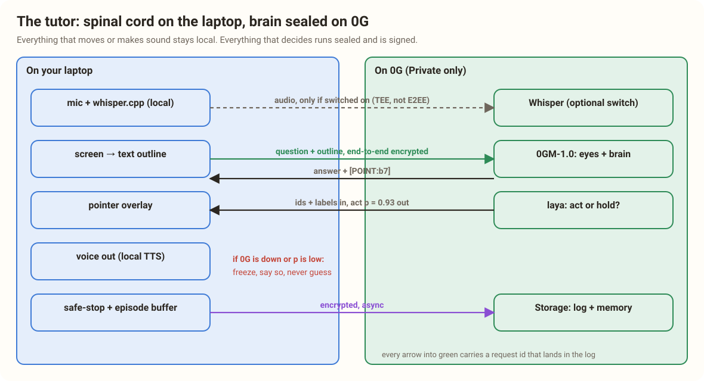
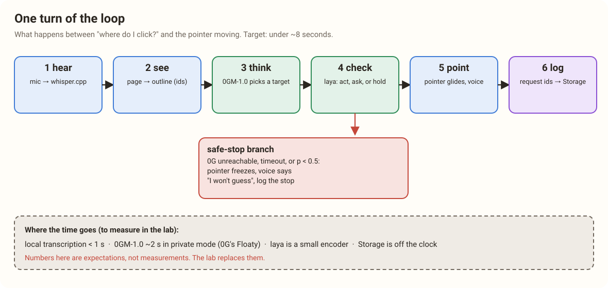
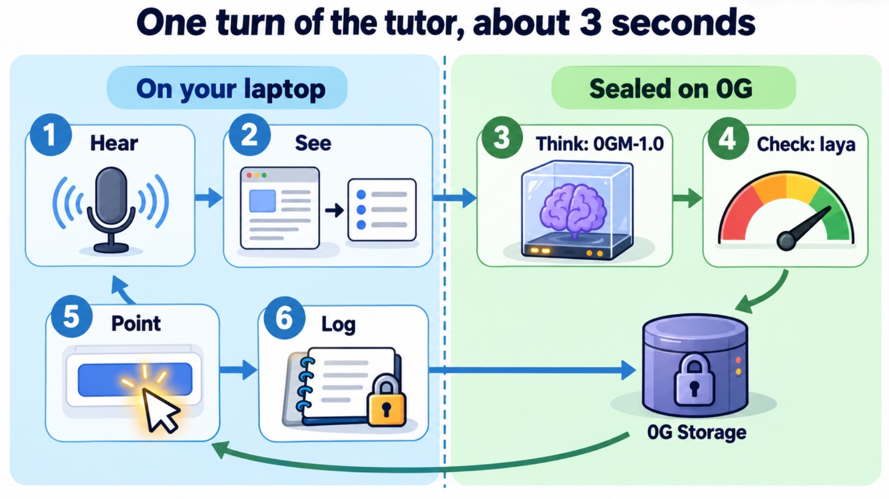
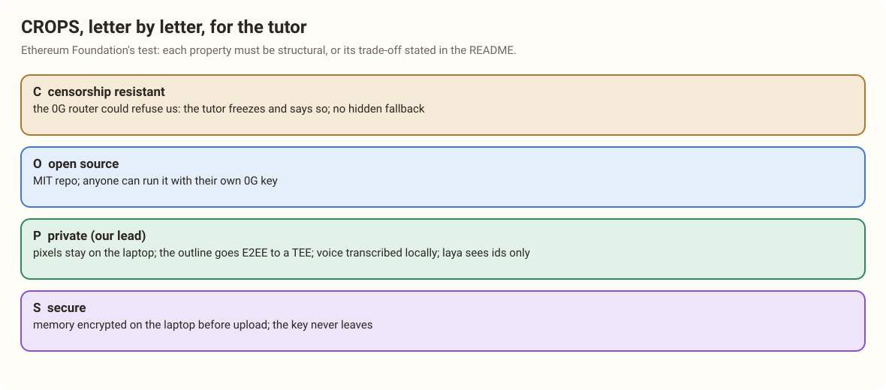

# 16. Our Project: The Tutor That Points and Keeps Your Secrets

> [!STORY] Friday afternoon at the 0G booth
> A judge walks up. You don't start with blockchains. You open Etherscan's "Verify & Publish" page, hold a key and say: "How do I verify my contract?" Four seconds later a soft glowing pointer slides across the screen and stops on the right tab, and a calm voice says "Open Contract, then this button". You click. It points at the next field.
>
> Then you turn the Wi-Fi off and ask again. The pointer stops where it is. The voice says: "I can't see clearly right now, so I won't guess." The judge laughs. You turn the Wi-Fi back on, click "how do I know?" under the last pointer move, and a small card shows the request id, the model, the enclave's signature checked live, and a line: your screen was read only inside sealed hardware.
>
> Thirty seconds. No slides yet.

## The idea in one sentence

**A tutor that watches your screen and teaches you any tool by pointing at it, where every look, every thought and every decision runs inside sealed hardware and leaves a record you can check.**

## A name

We are not calling it screen-tutor. Five candidates, none used by any project in the corpus:

- **Ishara**: Hindi and Urdu for a gesture, a hint, a pointing. "Ishara points; nobody else sees." Short, Indian, and it is literally what the product does.
- **Tarjani**: Sanskrit for the index finger, the pointing finger.
- **Drishti**: sight, vision, focused gaze.
- **Mudra**: a gesture with meaning.
- **Sightline**: English, plain, a little generic.

**Ishara** is the recommendation. It is the one a judge remembers on the walk back to the next booth.

## The design on one page

The rule that organises everything is 0G's own sentence: **0G is the brain, not the spinal cord.** Everything that moves or makes sound stays on the laptop. Everything that decides runs sealed and is signed.

**On the laptop (the spinal cord):**
- **Push-to-talk mic and on-device transcription.** Hold a key, speak, release. whisper.cpp turns the clip into text on the laptop, so the audio never leaves it (0G Whisper is a switch for better accuracy, chapter 5).
- **Screen to text outline.** In the browser, the page's DOM: every clickable element gets a short id like b7 and a label like "Verify & Publish". Screen-tutor proved this works and stops the model inventing targets.
- **The pointer overlay.** A glowing pointer that glides to an element's real coordinates. This is the body.
- **The voice.** Spoken on the laptop (the browser's speech, or a local voice), because none of 0G's speech-synthesis models is Private and the voice is spinal cord anyway.
- **Safe-stop and the episode buffer.** The freeze rule, and the log of every turn kept locally until it is uploaded.

**On 0G (the brain, all Private):**
- **Whisper Large v3** (optional): better ears, at a stated privacy cost.
- **0GM-1.0-35B-A3B**: the eyes and the brain, and the only call that ever carries the screen, end to end encrypted. Reads the outline (and a screenshot when the outline is not enough) and answers with a sentence and a target, like "Open the Contract tab [POINT:b3]".
- **laya**: the checkpoint. Act, ask or hold, with a probability.
- **Storage**: the encrypted episode log and the learner's memory.
- **Chain** (optional): a tiny contract recording each session's root hash.

## One turn of the loop

1. **Hear.** The clip is transcribed on the laptop (or by 0G Whisper, if switched on).
2. **See.** The outline is compiled (in parallel with step 1, chapter 18 explains why).
3. **Think.** 0GM-1.0 gets the question and the outline and returns an explanation plus a target.
4. **Check.** laya is asked which of the top candidates the request is about, or none of them. If it names the same element as 0GM-1.0 with a probability of at least 0.45, act. If they disagree, ask. If laya says none, ask in words. On any failure, hold.
5. **Point.** The pointer glides and the voice explains.
6. **Log.** One line: the request ids, the decision, the probability, the target, a hash of the outline, and the provider's signature, fetched in the background within its 20-minute window (it takes about 130 milliseconds). Encrypted on the laptop, uploaded to 0G Storage in the background.

## Which piece of 0G does which job

| Job | 0G piece | Why this one |
|---|---|---|
| Hear the question | on-device whisper.cpp by default; Whisper Large v3 on 0G as a switch | On-device keeps audio off every server; 0G Whisper is TeeML but not E2EE (chapter 5) |
| Read the screen and decide what to show | 0GM-1.0-35B-A3B, Private, E2EE | The only sealed model that takes images, and one of four that are end to end encrypted |
| Decide whether to act | laya, Private, free input | Calibrated probabilities make the safe-stop a rule; nobody has used it. Not E2EE, so it sees only ids and labels |
| Spot private data before it is sent (stretch) | Vela 2.0 9B, Private | Its "span" questions mark personal information in text |
| Remember the session, prove what happened | 0G Storage, log layer, encrypted on the laptop | Episode log with a request id per decision, a Physical AI must-show |
| Remember the learner (stretch) | 0G Storage, log layer (a small encrypted memory file per user) | The KV layer would fit better, but reading it needs our own KV node: the documented one timed out on 30 October |
| Make the log tamper-evident in public | 0G Chain, one small contract | Optional for 0G PC, expected by Physical AI's "contract addresses" |

## How this meets CROPS (the Ethereum Foundation track)

The draft of the README section the EF requires:

> [!PROJECT] CROPS (draft for the README)
> **C, censorship resistant.** We run no server. The extension talks to 0G directly with the user's own key. If our domain or GitHub disappeared, a user could still load the extension from any copy of the repo. If the 0G router refuses a user or goes down, the tutor freezes and says so; it never silently switches to a non-sealed model. Trade-off stated: the tutor depends on 0G's router being available.
>
> **O, open source.** MIT licence. Anyone can build and load the extension from the repo alone, with their own 0G key. A published build hash lets a user check that the extension they installed matches the repo.
>
> **P, private (the lead property).** The screen's pixels never leave the laptop in the default path: only a text outline does, and only to 0GM-1.0, end to end encrypted to a TEE. Voice is transcribed on the laptop; if the user switches on 0G Whisper, the audio runs in a TEE but crosses 0G's router readable, under its no-retention policy, and the switch says so. laya sees only element ids and labels. The router sees which model, token counts, message sizes and timing. Two enclaves see the outline in plaintext: 0G's gateway and the model's provider. Optional: route calls through Anon-RPC so the router does not see the user's IP. No analytics, no third-party scripts, self-hosted fonts.
>
> **S, secure.** The memory and the episode log are encrypted on the laptop before upload, with a key that never leaves it. The user brings their own 0G key; it lives in the extension's local storage on their machine and is never shipped in the code or the repo (0G's docs warn against shipping keys to browsers; a user's own key on their own device is not shipped). Trust assumptions: Intel TDX, NVIDIA's GPU attestation and 0G's published builds.

**The moment it matters, for the three-minute EF video:** show the network panel while the tutor works. Every request goes to 0G's router and nowhere else, carrying no screenshot in the default path. Then turn 0G off and show the tutor refusing to guess rather than falling back.

## Why this is different from the closest past projects

- **Reboleira** (a browser extension that rebuilds pages through a sealed 0G model) changed the page and had no voice, no decision checkpoint and no live link. The tutor teaches you to use the page as it is, by pointing, and every move passes a sealed checkpoint you can audit.
- **DoomTax** (a sealed coach with stakes) had no way to see what you were doing. The tutor sees the screen.
- **dMemo, Kimayyy** (memory as the pitch) decided nothing. The tutor's memory is a supporting detail.
- **Shrimpy** (a private voice journal) ran Whisper in the browser and won another sponsor. The tutor's voice goes to sealed Whisper on 0G.

## What we are deliberately not building

Screen-tutor and its siblings have much more: pen markers, drawing on the screen, board stories, lifelog and brain-ops pipelines, a full voice persona. All of it is cut. The 36-hour version proves one thing: **a sealed AI can see your screen, decide whether it is sure, and point, and you can check that it did.** Speed improvements, drawing, the whole ops pipeline: those are the "what's next" slide.

> [!WHY] The pitch, in three lines
> Everyone wants an AI that can see their screen. Nobody is allowed to give one. Ishara can see your screen because nobody else can, and it proves it every time it points.
