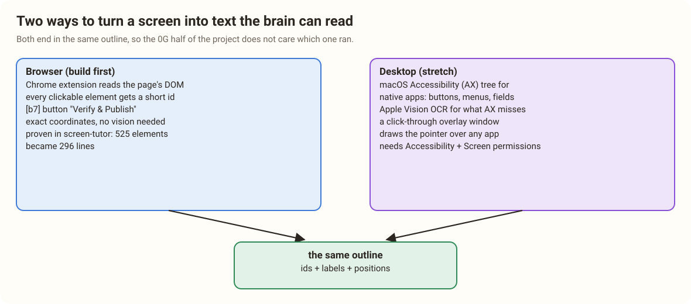
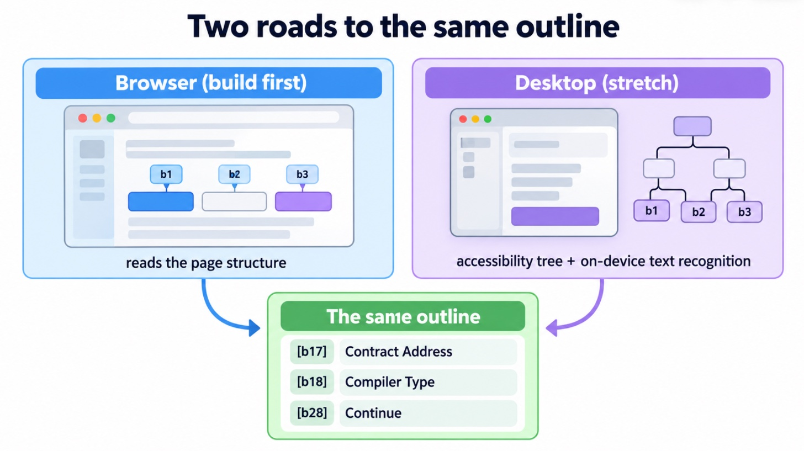

# 17. Browser First, Then the Whole Desktop

> [!STORY] Learning to drive in a parking lot
> Nobody learns to drive on the Western Express Highway. You learn in a quiet lot where the lines are painted and nothing surprising happens, and only when the car feels like an extension of your hands do you go onto the road.
>
> The browser is the parking lot. Every web page tells you, in its own code, exactly what each button is called and where it sits. The desktop is the highway: native apps, menus, dialogs, each built differently, some that tell you nothing at all.

The track says "desktop companion". Our plan is to crack the browser perfectly first, then reach the desktop as a stretch. The trick that makes this cheap: **both paths end in the same text outline**, so the 0G half of the project never needs to know which one ran.





## The browser path (build first)

A Chrome extension (Manifest V3) has three parts, and screen-tutor already taught us how each behaves:

- **A content script** in each page. It walks the DOM, finds every visible, clickable element (buttons, links, inputs, tabs, menu items), gives each a short id (b1, b2, ...), records its label, role and on-screen box, and writes the outline. It also draws the pointer overlay on the page.
- **A background service worker**, which makes the network calls to 0G. Chrome stops an idle service worker after about 30 seconds, so a turn must not depend on it staying alive between questions.
- **An offscreen document** for things a service worker cannot do: recording audio from the microphone, and (if we use it) hosting Anon-RPC's sandbox.

What the outline looks like, for Etherscan's verify page:

```
page: Etherscan - Verify & Publish Contract Source Code
[b1] tab "Transactions"   [b2] tab "Contract" (selected=false)
[b3] button "Verify & Publish"   [b4] input "Contract Address"
[b5] select "Compiler Type"      [b6] select "Compiler Version"
```

**Why this works so well:** the model never has to guess coordinates from pixels. It names an id; the content script knows exactly where b3 is, scrolls it into view if needed, and moves the pointer there. Screen-tutor's measured result: the outline turned 525 elements into 296 lines, and grounding the model in short ids is what stopped it inventing targets. That fix was at the input, not a validator at the output.

**When the outline is not enough** (a chart, a canvas, an image, a PDF), the content script can capture a screenshot of the visible tab and send it to 0GM-1.0, the one Private model with eyes. That is the exception, not the default, because the default path never sends pixels anywhere.

## The desktop path (stretch)

Three macOS pieces do the same job outside the browser:

| Piece | What it does | Permission it needs |
|---|---|---|
| **Accessibility (AX) tree** | Native apps expose their buttons, menus, fields and labels, with positions, through Apple's accessibility API. The same API screen readers use | Accessibility, granted in System Settings |
| **Vision framework text recognition** | On-device OCR for anything the AX tree misses (web views inside apps, images, badly built apps). Runs on the laptop, nothing sent | Screen Recording, to capture the screen first |
| **A click-through overlay window** | A transparent, always-on-top window that draws the pointer over any app and lets clicks pass through it | none beyond running the app |

These turn into the same outline format: ids, labels, roles and boxes. A small native helper (Swift, or a command-line tool the extension's companion app calls) produces it.

> [!GOTCHA] The permission wall
> macOS permissions are where desktop demos die. Accessibility and Screen Recording are granted per app, the grant can be silently ignored after a code-signing change, and a dialog appears the first time at the worst possible moment. Velocity notes rate macOS packaging as Medium for exactly this reason: the failure mode is permission debugging. Grant everything on the demo laptop on Thursday afternoon, and rehearse the desktop demo once with a fresh reboot.

## The plan for the 36 hours

- **Must:** the browser path, end to end, on two or three real sites (Etherscan for the demo; a 0G page; one more).
- **Should:** the screenshot fallback through 0GM-1.0 for one visual case.
- **Stretch:** the desktop helper on one native app (System Settings is a good demo: everyone has it, it has many panes, and it is not a website).

> [!PROJECT] What the lab tries before Thursday
> The lab measures, outside the project repo: how long the DOM outline takes on a heavy page; how big it is in tokens; how long an AX-tree walk takes on a native app; how long on-device OCR takes on a full screen; whether a click-through overlay window draws smoothly. None of that code goes into the submission. The numbers and the decisions do.

> [!LINKS]
> [Chrome extension service worker lifecycle](https://developer.chrome.com/docs/extensions/develop/concepts/service-workers/lifecycle) · [Chrome offscreen documents](https://developer.chrome.com/docs/extensions/reference/api/offscreen) · [Apple Accessibility API (AXUIElement)](https://developer.apple.com/documentation/applicationservices/axuielement) · [Apple Vision: recognizing text](https://developer.apple.com/documentation/vision/recognizing-text-in-images)
