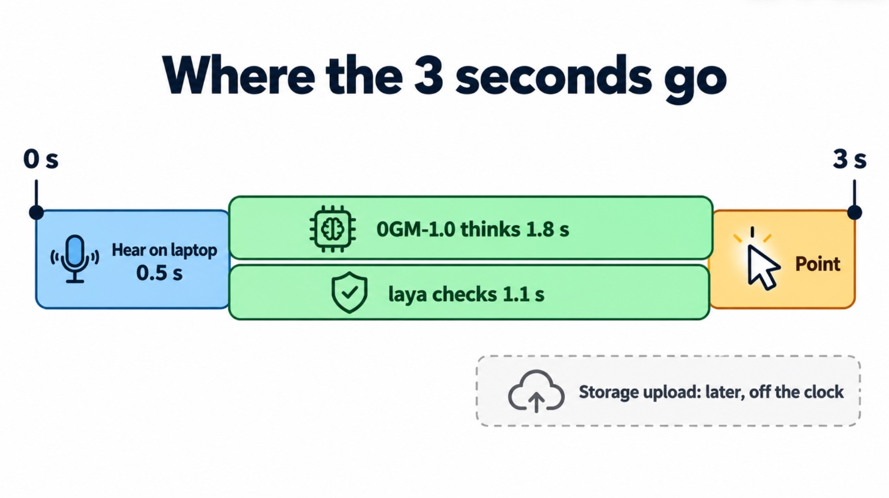

# 18. Where the Seconds Go, and How to Win Them Back

> [!STORY] The tiffin relay
> A dabbawala network delivers two hundred thousand lunches before 1 p.m. with no apps, and it does it by refusing to wait. The tiffin is collected while the train is still coming. It is sorted on the platform while it moves. The next runner is already standing at the next station. Nothing waits for anything that could have happened in parallel.

The tutor has the same problem. A sealed turn has several hops, each with its own delay, and a pointer that takes fifteen seconds to move is a broken demo. The target is **under about eight seconds from releasing the key to the pointer starting to move**, and the lab's first job is to measure where the time really goes.

## The hops, and what each probably costs

These are expectations, not measurements. The lab replaces them. One real data point exists: 0G's own desk robot, **Project Floaty**, runs "Ask Floaty" on 0GM-1.0 in Private mode in about **2 seconds**, and when no enclave is free it waits rather than falling back. That is both a latency hint and 0G using our exact safe-stop pattern.

| Hop | What it is | Expected | Lever |
|---|---|---|---|
| Record and upload the clip | a few seconds of audio | small | short clips, compressed |
| Transcription | whisper.cpp on the laptop (default) or Whisper on 0G | well under 1 s locally; a round trip on 0G | local by default |
| Outline | DOM walk on the laptop | well under a second | pre-compute while the user speaks |
| 0GM-1.0 | the thinking turn | **the big unknown**: thinking is on by default | turn thinking off if allowed; small output |
| laya | the checkpoint | should be fast: a small encoder model | short state; in parallel where possible |
| Storage upload | the log | minutes | never on the clock |

## Ten ways to buy time back

Each is a hypothesis for the lab, not a plan.

1. **Compile the outline while the user is still talking.** The moment the key goes down, the content script builds the outline. By the time Whisper returns, the outline is ready.
2. **Upload audio while the user speaks.** Stream the clip in chunks, or at least start the upload the instant the key is released.
3. **Turn thinking off on 0GM-1.0** for the pointing turn, if the API allows it. Pointing at one of thirty ids is not a hard reasoning problem.
4. **Ask for a tiny answer.** The brain returns a target id and one short sentence, not a paragraph. Fewer output tokens is less time. (But never a tiny token cap on a thinking model, which can return empty text.)
5. **Stream the response** and start moving the pointer the moment the `[POINT:b3]` tag appears, before the sentence is finished.
6. **Speak a filler instantly.** "Let me look." spoken locally the moment the key is released. It is honest (it really is looking) and it makes four seconds feel like two.
7. **Shrink the outline.** Only visible elements, only interactive ones, truncated labels. Fewer input tokens is less time and less cost.
8. **Run laya in parallel when the target is obvious.** If the outline has one element whose label matches the question's words, ask laya about it while the brain is still thinking, then confirm.
9. **Keep connections warm.** A small keep-alive call on page load so the first real question does not pay for the TLS handshake into the enclave.
10. **Pick providers by latency.** The router accepts `X-0G-Provider-Sort: latency`.

## What we do not trade away for speed

- **No non-Private model, ever, for anything that sees the screen or hears the voice.** A faster Verified model would break the one promise.
- **No local fallback that decides.** If 0G is slow, the tutor says "still looking", then freezes at a timeout. It does not guess.
- **No skipping laya.** The checkpoint is the safe-stop and the sealed decision judges want to see.

> [!PROJECT] The decision rule from the validation
> If a sealed screenshot-to-answer round trip (or outline-to-answer) comes in under about 8 seconds in the lab, we build the 0G tutor. If it does not, and none of the levers above closes the gap, we switch to the runner-up idea (the Whitechain payments SDK) on Tuesday 3 November, before travelling. The number decides, not the excitement.

> [!TRY] The lab's benchmark, exactly
> Ten questions on three pages. For each: key-release to Whisper text; outline compile time and token count; 0GM-1.0 time with thinking on and off; laya time; total to first pointer move. Report the median and the slowest of ten. Repeat once from a phone hotspot, because the venue's network will be worse than home's.

> [!NOTE] What the lab measured, 30 October
> On home Wi-Fi, key release to pointer took about 3 seconds: half a second to hear on the laptop, then 0GM-1.0 and laya together in 2.1 to 2.6 seconds. On an iPhone hotspot, the same turn took 2.2 to 2.5 seconds, so mobile data is not the problem. Two things were. A brand-new connection to the router took 3.6 seconds before the first byte, so the tutor opens its connection when the session starts and keeps it open. And laya stalled twice in forty calls on the hotspot, once for 12 seconds and once for 30. So every call gets a timeout: if laya does not answer in 4 seconds, try once more, then ask instead of pointing; if 0GM-1.0 does not answer in 8, hold still and say so. The numbers say build it.
