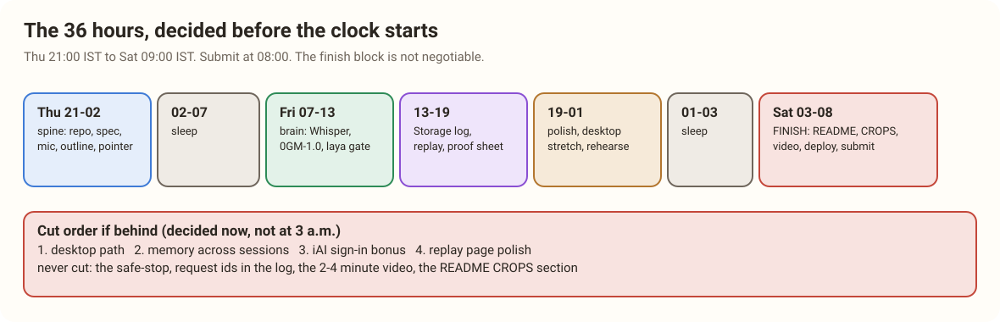

# 19. The 36 Hours, Decided Before the Clock Starts

> [!STORY] The cricket captain's plan at the toss
> A good captain does not decide at the 40th over who bowls the death overs. He decided it the night before, with the team, when he was calm. At the 40th over, with the crowd screaming, he just follows the plan, and the only thinking left is the thinking nobody could have done in advance.

Hacking opens **Thursday 5 November at 21:00 IST**. Submissions close **Saturday 7 November at 09:00 IST**, and we submit by **08:00**. Judging starts Saturday at 09:30.

## The blocks

| When (IST) | Block | Done means |
|---|---|---|
| **Thu 15:30 and 17:00** | 0G workshop (Room 1), EF workshop (Room 2) | booth questions asked, team credits in hand |
| **Thu 21:00 to 02:00** | The spine | new public repo, spec committed, extension loads, push-to-talk records, outline compiles, pointer glides to a hard-coded id |
| 02:00 to 07:00 | Sleep | five hours, not optional |
| **Fri 07:00 to 13:00** | The brain | Whisper text in, 0GM-1.0 target out, laya gate deciding point, ask or hold, safe-stop on a pulled network |
| **Fri 13:00 to 19:00** | Proof | encrypted episode log uploaded in the background, replay page, the "how do I know?" proof sheet, the session-root contract |
| **Fri 19:00 to Sat 01:00** | Polish and stretch | the desktop helper on one native app if the browser path is solid; rehearse the 30-second demo five times |
| 01:00 to 03:00 | Sleep | two hours |
| **Sat 03:00 to 08:00** | **The finish** | README (with "How this uses 0G" and "CROPS"), the video (2:00 to 2:59), a live link, submission with all three partners selected |

## The cut order (decided now, not at 3 a.m.)

If the build falls behind, cut in this order:

1. the desktop path
2. memory across sessions
3. the iAI sign-in bonus
4. polish on the replay page

**Never cut:** the safe-stop, request ids in the log, the video, the README's CROPS section, the live link.

## The rules that cost prizes if you forget them

- **Fresh means fresh.** Create the repo after 21:00 Thursday. Commit small and often: a large single commit or a missing history can disqualify.
- **Document AI use.** ETHGlobal allows AI tools with attribution. If we work from a spec, the spec files, prompts and planning artifacts go in the repo.
- **The video:** 2 to 4 minutes for ETHGlobal, under 3 for 0G, so 2:00 to 2:59. At least 720p, no speeding up, no AI voiceover, no music with text instead of speaking, not recorded on a phone. Recordly records it; medit cuts it.
- **Partner prizes:** pick **0G** and **Ethereum Foundation** at submission (up to three allowed). For each one, explain how you used their tools and give feedback.
- **Finalist judging:** opt in. A finalist session is 4 minutes of demo and 3 of questions.
- **Submit by 08:00.** The deadline is 09:00 and the platform lags at the end.

## The demo, rehearsed

The 30 seconds from chapter 16, in order: ask on Etherscan → the pointer moves within about 8 seconds → Wi-Fi off, ask again → "I won't guess" → Wi-Fi on → open "how do I know?" on the last move → request id, model, signature verified. Then, if there is time, the network panel showing no screenshot left the laptop.

> [!PROJECT] The first hour checklist (Thursday 21:00)
> Create the repo (MIT licence). Commit the README skeleton with the two required sections as empty headings. Commit the spec. Load an empty extension. Make one 0G call with the trust-mode header and print the request id and `tee_verified`. If that one call works by 22:00, the night is on track.
