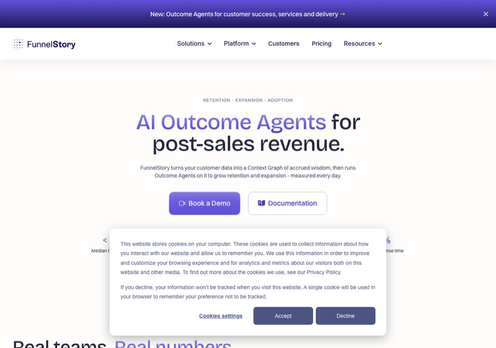
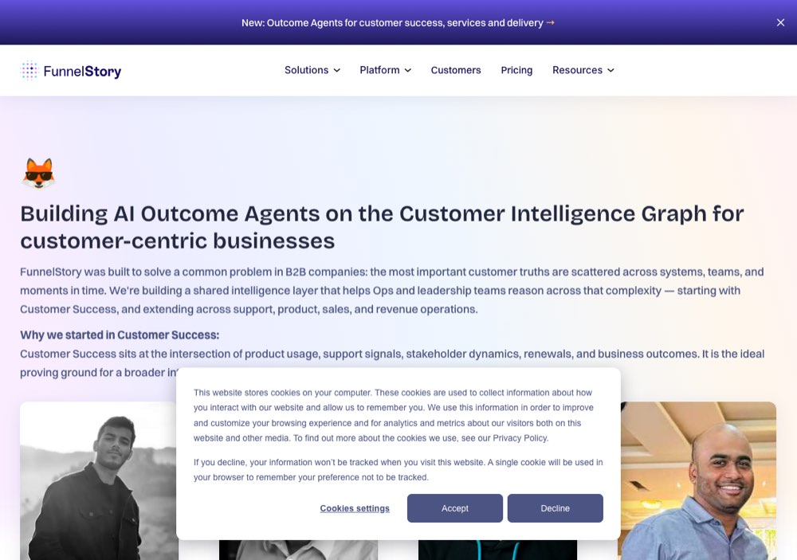
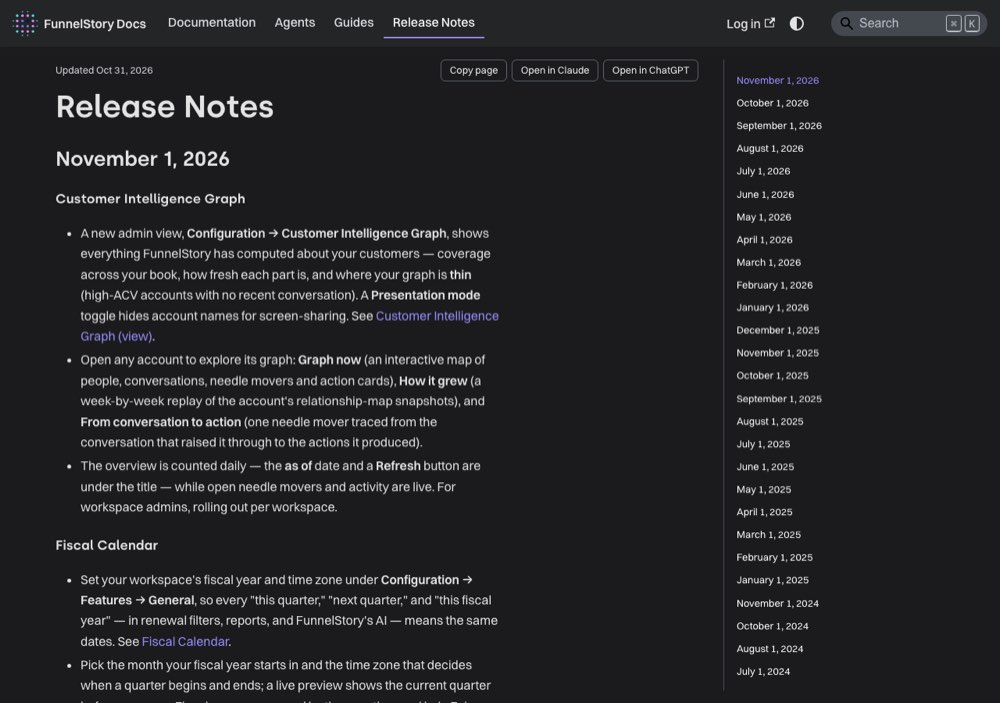

# What FunnelStory sells, and why you are there

> [!STORY] The Saturday
> Picture Mahima, a project manager at a company that builds warehouse robots. She builds the go or no-go deck by hand, from a project tracker, slide by slide. Nobody asked her to do it that way. It is just the only way the data could reach the people who decide. (The Saturday is a figure of speech from the repo's own notes, not a measured number.)
> Now picture two other people at the same company, Jaspreet and Vivian. Every day they fill a spreadsheet with a health score for each customer site. They use their own judgment and their own rules. When someone asks why a site got a 6.5, the answer is "because we looked at it".
> FunnelStory is not filling a gap in these people's lives. It is replacing their Saturday.

## The buyer, before the product exists

FunnelStory sells to the teams that look after customers after the sale. The job title is usually **Customer Success**, but the same product also reaches Support, Product Ops and Sales Ops. A typical customer is a software company with a few hundred to a few thousand paying accounts. For that company, **renewals are the revenue**. If an account does not renew, the money is gone.

Before FunnelStory, the buyer's week looks like this:

- A health score lives in a spreadsheet, or in a tool like Gainsight or Totango. Nobody fully trusts it.
- A customer success manager owns 40 to 80 accounts. They read a handful properly and guess at the rest.
- A renewal surprises someone. The warning was in an email thread three months ago. Nobody read the thread.

## What they actually buy

FunnelStory's own positioning line, worth saying word for word:

> Think Gainsight-category, not CRM or warehouse: the customer's systems stay the source of truth, we build account context on top, and write actions back out.

Three clauses, three promises.

1. **The customer's systems stay the source of truth.** FunnelStory is not a migration. Salesforce stays Salesforce.
2. **We build account context on top.** A fused picture of each account, from every source, is the thing being sold.
3. **We write actions back out.** Into HubSpot, into ClickUp, into an inbox, into a task list.

## The differentiator: leading indicators

Everyone sells a health score. FunnelStory's bet is different. It looks for **needle movers**: a specific, named, quotable thing that will move the number, found three to nine months before renewal, with the sentence from the call that proves it.

Not "this account is at 42". Instead: "this account's champion left in March and nobody replaced them. Here is the email."

That kind of signal lives in conversations: emails, calls, Slack threads, support tickets. A data warehouse cannot see it. Turning conversations into structured, searchable, source-cited facts is the core job of the whole company. The next two chapters and all of Part 2 are about how.

## Why an FDE seat exists

FunnelStory has a small number of large enterprise customers, not thousands of small ones. Helen's phrase, from the first week: "a handful of large enterprise customers, not volume."

That one fact explains your job. When ten customers each pay enterprise money, it is worth paying a person to build things by hand for each of them. When ten thousand customers each pay a little, it never would be. So the FDE, the forward-deployed engineer, does two things:

- **Maps a vague customer ask onto what the product can already do.** The customer asks for a faster horse. You work out what the horse was for and build the car.
- **Builds the missing tenth by hand.** When the product does nine tenths of what they need, you write the rest: a flow, a report, a sync, a data app.

Arun introduced you as the company's first FDE. If you fail at something, it comes back to the product team as a requirement. You are the buffer between a customer's ask and the roadmap.

## The company in four moves

FunnelStory was founded in April 2022. It is small, roughly ten to fifty people depending on who is counting, with three founders in the US and most of engineering in India. It has changed what the product is more than once, and expects to again.

1. **2022:** funnel analytics and product-usage reporting for customer success. The first version was written in Go with SQLite and YAML.
2. **2023 to 2024:** health scores, churn and renewal predictions, adoption reports.
3. **2025:** needle movers, the semantic database, many more connectors.
4. **2026:** the agent era. A flow builder, an MCP server, Outcome-Based Agents, the Account Dossier.

Aadarsh's description of the pace: every two months something revolutionary appears, and everyone wants to adapt very quickly. That is the founders' own description. So read the current month's release notes before any customer call. At this company, the easiest way to look foolish is to not know that the thing the customer is asking for shipped three weeks ago.

## Traps

- **Do not lead with "AI".** Every competitor says it. The customer's problem is a renewal they did not see coming and a manager who cannot read 80 accounts.
- **Do not say "we replace Gainsight".** FunnelStory reads from Gainsight and Totango. The incumbent is a data source and a sales motion at once.
- **Do not repeat the marketing numbers as facts.** "90 percent less surprise churn", "triple the productivity", "80 percent less busywork": these are the company's claims. Say them as theirs.

> [!PROJECT] Where you see this in your week
> GreyOrange's weekly status deck is Mahima's Saturday, automated. The Trellix renewal report is a human not having to read 1,400 renewals. The gStore SLA report is a team not building a spreadsheet by hand. Whenever you build something, ask: whose Saturday is this replacing?

## Check yourself

1. In 60 seconds, without saying "AI", "platform" or "intelligence": what does a customer buy, and what were they doing the week before?
2. What are the three clauses of the positioning line?
3. Why does having few, large customers lead to an FDE seat?
