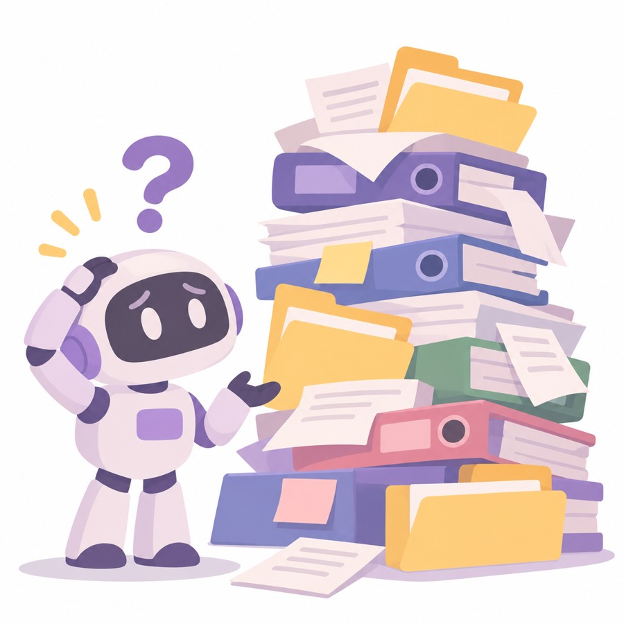
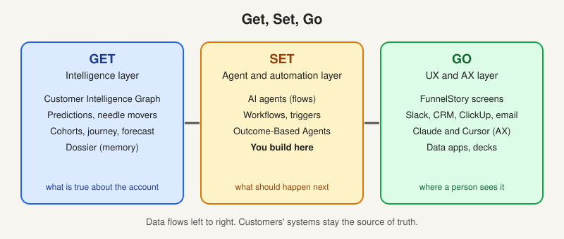
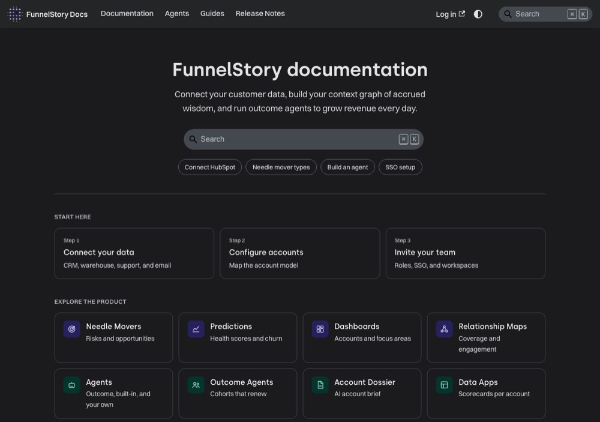
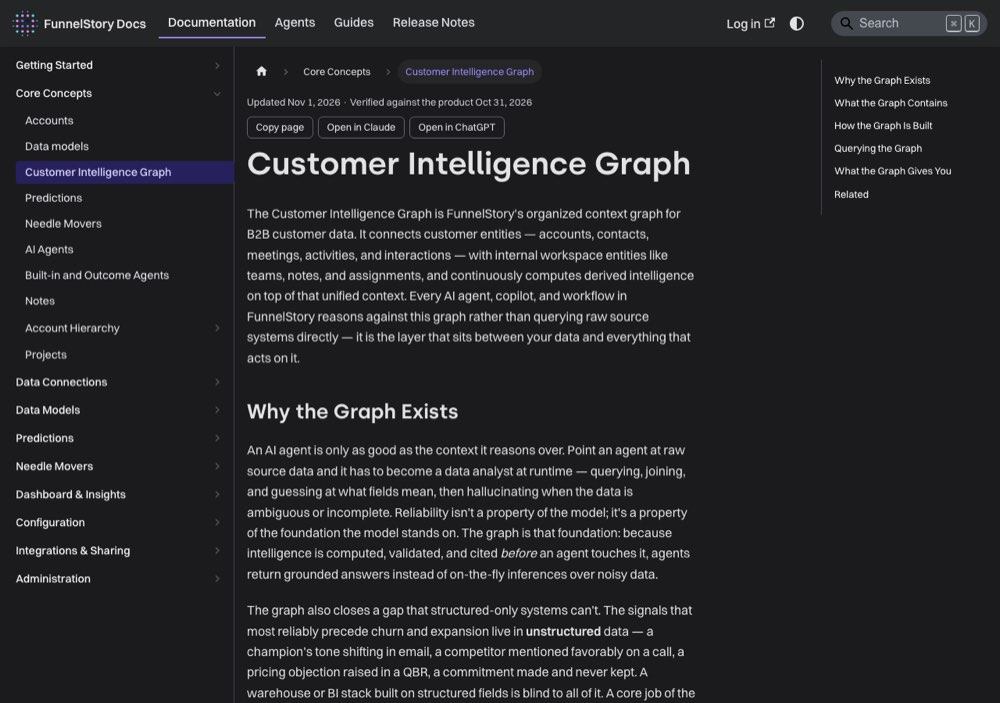

# The big idea: give the agent a foundation

> [!STORY] The analyst at runtime
> Imagine you point an AI agent straight at a customer's Salesforce and ask: how is Luxottica doing? The agent has to become a data analyst on the spot. It must find the right tables, guess what each field means, join things that were never meant to be joined, and answer with confidence even when the data is half missing.
> At GreyOrange the data models really did this, for weeks. They run two Salesforce orgs, one for Sales and one for Customer Success. Same account names, different account IDs. FunnelStory's models were reading the Sales one while the customer's own numbers came from the Customer Success one. A raw agent would have answered confidently from the wrong org for weeks.
> FunnelStory's answer is to not let the agent do that. Do the hard work once, early, in one place, and let every reader see the same account.

## Their argument, nearly word for word

> An AI agent is only as good as the context it reasons over. Point an agent at raw source data and it has to become a data analyst at runtime, querying, joining, and guessing at what fields mean, then hallucinating when the data is ambiguous or incomplete. Reliability is not a property of the model. It is a property of the foundation the model stands on.

This is the company's whole thesis in one paragraph. Their engineering post is titled "We Built a Database for Agents".

## The Customer Intelligence Graph

The foundation is called the **Customer Intelligence Graph**. It fuses four kinds of data, which the docs call the four pillars:

- **Usage:** what customers do in the product.
- **CRM:** deals, contacts, contracts.
- **Conversations:** calls, emails, Slack, tickets.
- **Business Intel:** the warehouse and everything countable.

Fusion happens at **ingestion**, not at query time. More than 37 connectors are normalised into one object schema before anything reads them. Their phrase is "patent-pending information fusion". Quote it. Do not vouch for it.

Why ingestion and not query time? Because at query time every agent would have to redo the join, redo the guessing about field meaning, and re-invent what "this account" means. Do it once at ingestion and the score, the dossier, the agent and the Claude client over MCP all see the same account.

## Three layers inside it

1. **Knowledge layer.** Raw and cleaned facts: accounts, contacts, interactions, usage events, tickets, conversations, meetings, emails, signals. Provenance is kept even on bad data, so you can see where a wrong value came from, not just that it is wrong.
2. **Derived intelligence.** Sentiment, event detection, predictions, needle movers, relationship intelligence, cohort comparisons. All computed before any agent asks.
3. **Accrued memory.** The Account Dossier. Long-term account context that outlives the 90-day window and updates as new conversations land.

## Get, Set, Go

The company explains the whole architecture in three words.

| Layer | Name | What is in it |
|---|---|---|
| **GET** | Intelligence layer | The graph, plus precomputed predictions, needle movers, journey, cohorts, revenue forecast |
| **SET** | Agent and automation layer | AI agents, workflows, triggers. The control plane |
| **GO** | UX and AX layer | The FunnelStory screens, external apps like Slack and CRMs, and AX |

Two words worth having exactly right:

- **AX** means agent experience. It sits next to UX as a first-class delivery surface. When the team says something ships "for AX", they mean it is reachable from Claude or Cursor over MCP, not from a screen.
- **Time-travel discovery** means reasoning over the history of an account, not just its current state, because the graph maps every interaction since the first touchpoint.

## The two stories that prove the point

**The account that was in two places.** The GreyOrange two-org story above. When the identity was wrong, it was wrong in exactly one place and fixable in one place, because identity is resolved once at ingestion into an internal id called `account_fs_id`.

**The complaint that was counted five times.** Showpad's email feed was labelled by a model that ran on the raw email body, including the entire quoted reply chain. Every reply re-labelled the messages quoted beneath it, so one complaint became five. An agent reading raw email would have counted it five times. The fix existed because the bad value kept its source. That is "provenance even on bad data" doing real work.

## Traps

- Calling it a graph database. It is not. Underneath, it is Postgres, with a SQLite virtual-table layer on top that answers queries. "Graph" describes the shape of the fused context, not the storage. Chapter 2.6 explains.
- Saying "we ingest everything". They ingest what the connectors and models map, on a polling schedule with watermarks. A feed can die silently for six weeks, and one at Showpad did.

> [!PROJECT] Where you see this in your week
> Every time you are asked "why does this number disagree with that number", you are looking for a place where two systems were not fused into the same account. The Trellix problem of four screens giving four answers is exactly this.

## Check yourself

1. Why does fusing data at ingestion beat fusing it at query time?
2. Name the three layers of the graph, and say which one survives past 90 days.
3. Tell the two-Salesforce-orgs story in four sentences.
