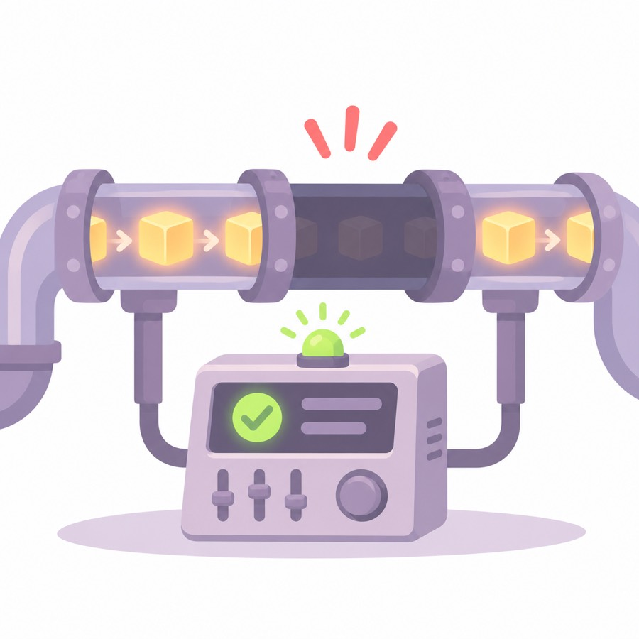
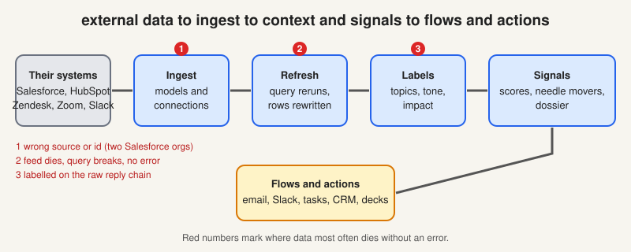
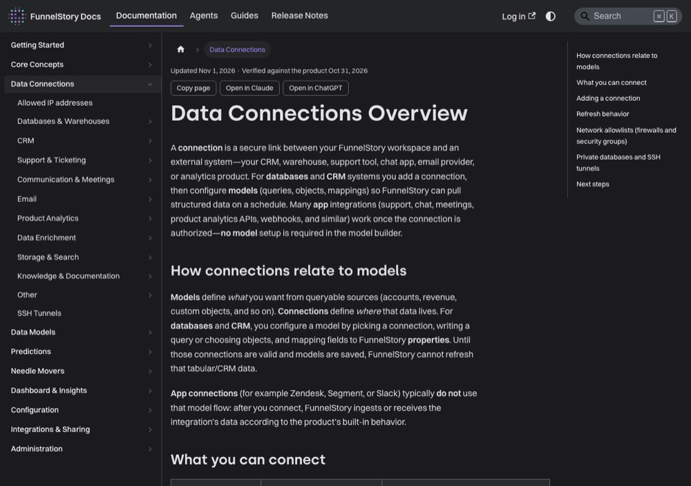

# From their systems to a signal

> [!STORY] The six silent weeks
> Showpad is a sales enablement company. FunnelStory scores its accounts partly on product usage, from two data feeds called SP Content and SP Coach. On 4 May both feeds stopped. Nothing errored. The pipeline stayed green. For about six weeks nobody noticed.
> Meanwhile the prediction model scores usage over the last 30 days. For every account that held only Showpad products, the answer became "no usage data for the last 30 days". That scores as neutral. 1,058 accounts holding about $74.5M slid into the neutral band, with low confidence, and every one of those accounts looked fine.
> Nothing was broken. The picture was just wrong. That is the most dangerous kind of failure in this product, and this chapter is about the road the data travels so you know where it can die quietly.

## The one-line path

From the back-end's own architecture file:

> external data → ingest → context and signals → flows and actions

Everything in Part 2 is "ingest" and "context and signals". Everything in Part 3 is "flows and actions".

## Two ways in

- **Data Models.** The customer defines structured data with SQL against their own warehouse or CRM. The query's columns are mapped into FunnelStory's object schema: Accounts, Users, Contacts, Activity, Subscriptions, Plans, Products, Usage, Support Tickets, Conversations. This is the general path, and where an FDE spends most configuration time.
- **Connections.** A known provider (HubSpot, Zendesk, Zoom, Slack, ClickUp and so on) with a built-in translation that syncs and indexes directly. There are 26 integration packages in the code: apollo, attio, clearbit, clickup, devrev, fathom, freshdesk, gainsight, gong, google, highcharts, hubspot, intercom, jira, msteams, nylas, pdl, perplexity, postmark, pylon, salesforce, slack, stripe, zendesk, zohodesk, zoom.

Both poll for changes, remove duplicates, and use cursors and watermarks so they can resume where they stopped. A few events use webhooks. There is **no external job queue**. Durable work lives in PostgreSQL, which also does pub/sub and most locking.

## Datasets

A **dataset** is a named, saved result, either from a query or from records, that other things can read. Two uses to know:

- **Wrapping a connection.** GreyOrange's Accounts model sits on a different Salesforce instance wrapped in a dataset.
- **Managed datasets.** The data-app code owns two of them (entries and snapshots) and blocks flow functions from writing to them.

## Model refresh and the four ways it fails

A **model refresh** reruns a model's query and rewrites its records. It is the thing that most often breaks a customer quietly. The record has one example of each failure.

1. **The customer changed their schema.** Cyera removed the active ARR column. Their account status was broken for 25 days.
2. **The query became invalid.** Descope had a duplicated adoption-score join, one copy containing SQL that BigQuery could not parse. The next refresh returned zero rows.
3. **The connection died.** Nirmata's database tunnel broke, recovered for four days, then broke again and stayed down eight days, with 220 to 240 failures a day.
4. **Nothing failed and the feed just stopped.** Showpad. No error anywhere. Just a wrong picture.

The fourth is the answer to the hard question, "where does it stop silently?" A healthy-looking pipeline with a dead upstream feed, because the scoring window is relative and a missing signal scores as neutral instead of as missing.

## Identity: the thing that actually breaks

- `account_id` is the external, customer-facing account id, the one in their Salesforce.
- `account_fs_id` is FunnelStory's own internal UUID.
- Anything ending `_fs_id` is always an internal UUID. Mix them up and the query runs, returns nothing, and looks fine.

Other identity facts worth knowing:

- **Parents then children.** Parent accounts are created first, then children. Photon asked for three levels (super account, account, sub account). The product supports two.
- **Matching by email domain.** Contacts are matched to accounts by domain. A free-mail domain such as gmail.com would pull thousands of unrelated contacts and burn a huge model budget. Filter those out first. It is a live gotcha.
- **Old IDs.** GreyOrange's Zendesk and Zoom models were filled with account IDs from an old Salesforce instance. Domains matched, IDs did not, so tickets and meetings linked to nothing.

## Runners, and their one hard rule

Background passes are scheduled by `internal/runner/`. The rule from the code charter:

- The **runner decides when and how much.** The owning package decides what and how. A runner does not run queries, hold database handles, or make domain decisions.
- **Every runner must bound the work it does per tick.** A pass that handles everything for one customer will eventually stall the tick for everyone else. This once happened for real (issue #4103).

The team pokes runners by hand in Slack all the time with a small fetch call. You do not do that in a customer workspace.

## Traps

- Assuming a missing signal is neutral. In this system it scores as neutral, and that is the bug.
- Assuming "no error" means "working".
- Reading `account_id` as the internal id. It never is.

> [!PROJECT] Where you see this in your week
> Whenever a customer says "this number looks wrong", walk the path left to right: am I reading the right source, is the feed alive, did the model refresh, is the account identity the one I think it is. Chapter 4.0 turns this into a five-step routine.

## Check yourself

1. Trace one row from a customer's Salesforce to a needle mover, naming each stage and the place it most often stops silently.
2. What are the four ways a model refresh fails, and which one is silent?
3. Which id is external and which is internal, and what happens if you mix them?
