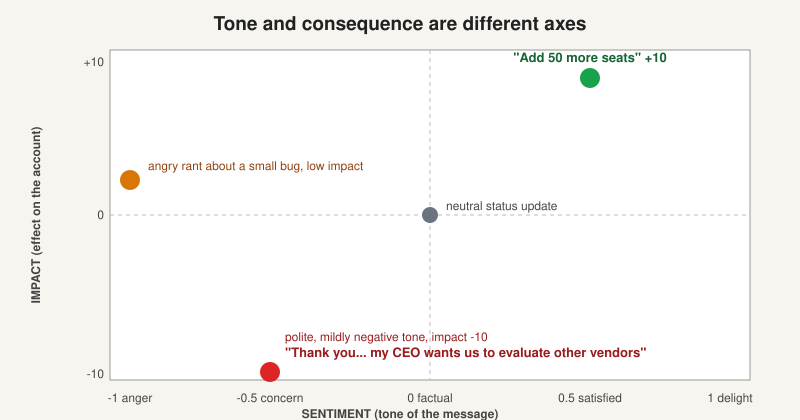

# Labels: topics, sentiment and impact

> [!STORY] A polite sentence that ended an account
> Someone at a customer writes: "Thank you for the information, appreciate the response. After reviewing the pricing and the limited room for adjustment, my CEO has requested that we evaluate other vendors."
> Read it fast and it is friendly. Thank you. Appreciate. A simple model would score the tone as mildly positive.
> FunnelStory scores it two ways. The tone, sentiment, comes out slightly negative: minus 0.5. The effect on the relationship, impact, comes out at minus 10, the worst possible. A polite message just told the vendor the CEO is shopping around.
> That pair of numbers, tone and consequence kept apart, is the whole idea of this chapter.

## What a content label is

Every conversation that lands (an email, a Slack thread, a call transcript, a ticket, a CRM note) is run through a language model that returns **topics**. A topic is one separate signal found in that text. The row it creates is a **content label**, and it is the atom everything else is built from: needle movers, prediction factors, themes, the dossier.

Two things to hold on to.

- **Predictions read straight from raw content labels. Needle movers are generated afterwards from the same labels.** Two consumers of one source. Pulkit found about 58,000 Showpad labels that had never been turned into needle movers. So a conversation could pull a score down with no needle mover anywhere in the screens to explain it. His conclusion: reconcile the two, and point predictions at needle movers only. Not done yet.
- A label carries `excerpts`, the exact quoted lines. That is what makes the product source-cited rather than a feeling.

## The six topic types

These never change from customer to customer.

- **pricing:** costs, quotes, contracts, budgets, renewals, upgrades and downgrades, payment, cancellation including non-payment or business closure.
- **competitor:** a competitor's product, or a decision to switch.
- **personnel_change:** a champion, decision maker or key user leaving or changing role. Includes downsizing.
- **feature_request:** a request or interest in a new capability.
- **task_issue_bug:** a bug, failure or operational problem. The product is not working.
- **action_item:** a specific follow-up for either side, like "schedule a demo" or "send docs".

Six, always. The types do not change. Their **definitions** do, per customer. That is the knob.

## Two scores, and why they are separate

**Sentiment** runs from minus 1 to 1 and measures the emotional tone of that topic. Minus 1 is anger, minus 0.5 concern, 0 factual, 0.5 satisfaction, 1 delight.

**Impact** runs from minus 10 to 10 and measures the potential effect on the business relationship.

- **Minus 10, critical churn event.** "We are switching to CompetitorX." "My CEO has requested we evaluate other vendors."
- **Minus 5, high churn risk.** "This bug is blocking our entire deployment pipeline."
- **Minus 3, moderate risk.** "Our champion is leaving." "The quote is higher than we budgeted."
- **0, neutral.**
- **Plus 1, positive signal.** "Let's schedule training for our new team."
- **Plus 10, critical growth event.** "We're ready to sign the three-year renewal." "Add 50 more seats."

### Guiding principle one

**Definitive statements override tone.** A clear statement of negative intent dictates the impact, even if the language is polite. Score it minus 10.

The worked example above is from Workstream's real prompt, and it is exactly the sentence in the story.

### The other two principles

2. **Focus on the core message.** Ignore polite filler.
3. **Be conservative.** An empty list is a valid answer. Workstream's prompt ends with an example that exists only to teach the model to return nothing: "No team changes recently. Our admin and champion users remain the same." Aviz's prompt says the same: only label genuinely meaningful signals.

## Why the prompt is written for each customer

The prompt is called `label_analysis_system`. It is one of four prompt fields in a customer's workspace defaults. Its shape is the same everywhere:

1. **About the customer.** A real description of what they sell. Workstream's has eight numbered feature families. Docyt's is a full product teardown.
2. **The six types, redefined in the customer's language.**
3. **The two rubrics.**
4. **The three guiding principles.**
5. **Ten to twenty worked examples**, each with its reasoning before the answer.

The clearest example is Popmenu, which sells digital presence to restaurants. Their live prompt says:

- `pricing` is about Popmenu's own pricing or fees. **Not regarding menu prices.**
- `feature_request` is a request for a new feature in the Popmenu product. **Does not include website or menu changes.**

Without those two clauses, every chat about a restaurant's own menu prices becomes a pricing signal, and the churn model learns garbage. Workstream's examples are Workstream-shaped for the same reason: e-Verify cancellation, job-posting sponsorship, downgrading a plan, month-to-month. Their churn looks like that, so the examples teach that.

## Content themes: the newer layer

Where a label is one signal in one message, a **theme** is a pattern that shows up across many messages. The system discovers themes, catalogs them, measures them, and feeds them into the needle mover pipeline. It shipped in beta in August 2026. Preetam's list for it: self-serve themes, a better weights screen, custom theming, experiments, MCP access.

## Relabelling is dangerous

Relabelling is routine, and so is purging. What it costs:

- Vivek planned to purge Showpad's needle movers a week at a time, reprocess that week, and continue, so scores would not drop in one visible jump.
- A customer noticed anyway: everything seems reset, the assignee column is blank.
- Preetam's rule after that: do not touch needle movers that have been assigned or commented on.

A relabel is a customer-visible event. Their assignments, comments and scores are in it.

## Traps

- Treating sentiment as impact. A polite minus 10 is the whole point.
- Adding a seventh topic type. Six are stable. Definitions are the dial.
- Forgetting `fs_sanitize`. Showpad's mapping used `fs_analyze` alone, so the labeller ran on the raw body including the quoted reply chain.
- Assuming a label produced a needle mover. Often it did not.

> [!PROJECT] Where you see this in your week
> When you configure a new customer, the most valuable hour is reading their real conversations and writing the definitions and examples that make their labels right. This chapter is that craft. Chapter 3.5 shows where it sits in a whole configuration.

> [!TRY] Try it
> Take one sentence from a real customer email. Say out loud: type, sentiment, impact, and why. Then say how it would be labelled for a different customer. If the answer changes, you understood the chapter.

## Check yourself

1. Label a real sentence out loud (topic, sentiment, impact) and give your reasoning.
2. What is guiding principle one, and which sentence demonstrates it?
3. What are Popmenu's two disambiguation clauses, and why do they exist?
