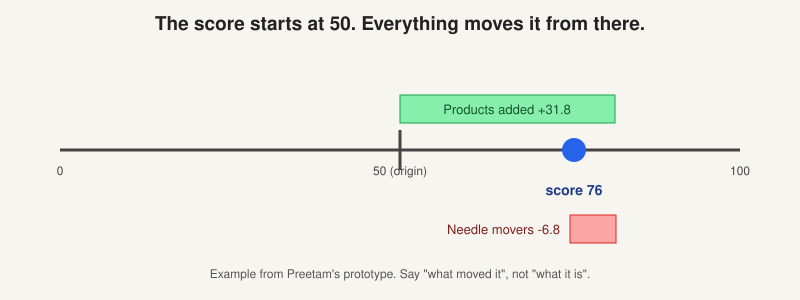

# Prediction: how a score is made, and why it can be zero on a happy account

> [!STORY] Six renewals and six zeros
> In the Trellix deployment channel, Arun listed six accounts. Every one had a confirmed renewal. Every one had a score at or near zero. A confirmed renewal is about as good as news gets, and the product was calling these accounts dead.
> Two completely different things can produce that picture. One is a feed that stopped. The other is a score reading different evidence from the human who is looking at it. Telling them apart is a skill, and it is the skill this chapter is about.

## Two kinds of "tag"

Two different things in the product are called tags. Mixing them up is a real error.

- **Content labels** (chapter 2.2): per-message topics with sentiment and impact.
- **Retention tags**: a label on a whole account saying this one churned, or this one retained. These are the **training labels**, configured per workspace.

The mechanism is **audiences**. A workspace has hidden audiences named Churn and Retention, each holding the account ids that match. Training reads them. Aadarsh lists retention tags alongside data models, journey funnel, needle movers, notes and grounding when he says a workspace is "configured".

## How the model is trained

Training is a pair of calls to the back-end, one for churn and one for retention, followed by an update of the scores for all accounts. The settings Preetam handed the team: five trees, tree depth 50, learning rate 0.1, 100 iterations, ridge regularisation, and an ensemble of **logistic regression and random forest, half each**. Not a neural network, and deliberately explainable.

His instruction on picking the training sets is the whole labelling ritual: for each product, find three great accounts and three poor accounts. All the great ones go into retention. All the poor ones go into churn. Hand picked, per product, by a human who knows the accounts.

## What the model reads: factors

A **factor** is one input the model scored. Names show the shape: `activity:6_mo_cutoff:Had Online Orders`, `trait:open_churn_case=true`, `property:last_month_impressions`. Four families feed it:

- **Product usage**, scored on the **last 30 days**.
- **Conversations**, through content labels, weighted by `conversations_prediction_weight`.
- **Account metrics and properties:** ARR, contract state, ticket counts.
- **The relationship map**, added in 2026, with its own workspace weight.

Three human overrides exist: known positive factors, known negative factors, and excluded factors. They exist because a model will otherwise learn something true and useless.

## Rollups: product, then child, then parent

Scores are computed per product, rolled up to the child account, then to the parent. Three consequences, each of which has bitten the team:

- **Rollups should not show factors.** A parent's score is an aggregate. Showing it factor by factor implies a cause that is not there. Two fixes shipped in response.
- **Child-level conversations do not reach the parent score.** Mamta's observation. It is why a parent can look fine while a child is on fire.
- **Child accounts can be skipped from scoring entirely**, per a design doc.

## The hard question: a confirmed renewal scoring zero

There are two main causes. You must be able to tell them apart.

**Cause A: the signal is absent, and absent scores as neutral.** The Showpad story from chapter 2.1. The model scores product factors on the last 30 days. With the feeds dead, every Showpad-only account reported "No usage data for the last 30 days", every product contribution was exactly 0, and confidence dropped to low. Nothing was broken. The pipeline was green.

**Cause B: the score is not reading what the human is reading.** Pulkit named this one and refused to fix it in the room. Scores use conversations and notes, not needle movers. Also, needle movers close at 90 days while conversation impact decays over a year. So a human looks at the account, sees open needle movers all neutral, notes saying renewal expected and usage fine, and the score disagrees. The score is reading a different set of things over a different window. His words: not something we can decide in two minutes.

Two variants worth knowing:

- **A second active prediction model in the workspace.** Preetam: "looks like there is a second active account model that is messing things up." Descope had a duplicated adoption-score join for a similar reason.
- **Account metrics missing from the model weights.** Aadarsh, migrating the Trellix workspace: the scores do not match because we are not including account metrics in the model weights.

## Explainability became a decision in 26 hours

The 30 August standup decided the dossier had to explain its score. By the next morning at 11:02 Preetam had posted a prototype in the dev channel: "Why this score is 76. The score starts at 50. The distance from 50 shows the account's direction. Opening it shows which signals moved it." Then: "What moved the score: products added 31.8 points, needle movers gave 6.8 back", with a bar per topic type.

Hold the mental model: **50 is the origin and everything is a displacement from it.** It is also the honest answer when a customer asks "why 22?" Say what moved it, not what it is.

## Confidence, said out loud

Low confidence is a real output, not a footnote. An account with no live product signal gets a neutral score and low confidence. The second half is the honest part. Report the confidence with the number, always. It is the same habit as bringing the denominator with the recall.

## Traps

- Presenting a score without saying which window it read.
- Treating neutral as "fine". Neutral often means "we cannot see anything", which is worse than bad.
- Retraining a customer's model on hand-picked accounts and reporting the resulting accuracy. That is the exact thing Alok took apart.

> [!PROJECT] Where you see this in your week
> The Trellix evaluation sheet, where the customer went account by account saying whether FunnelStory's prediction matched their belief, is this chapter applied. So is every "why is this score X" question from DocuSign's users.

## Check yourself

1. Explain how an account with a confirmed renewal can score near zero, and name two different causes.
2. Which two model families make the ensemble, and what are the weights?
3. What does "the score starts at 50" mean, and why is it the honest way to explain a score?
