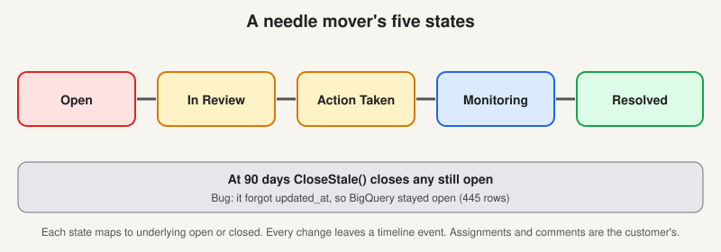
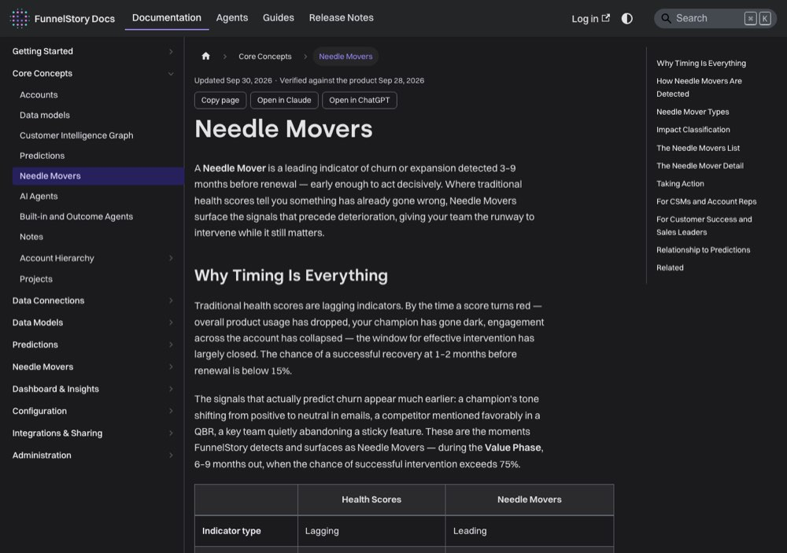

# Needle movers: the early warning, and its life

> [!STORY] 445 movers that were open and closed at once
> FunnelStory keeps a copy of its data in BigQuery for reporting. One day somebody noticed that 445 needle movers said "closed, expired" in FunnelStory and "open" in BigQuery.
> The cause was a one-line omission. A routine that closes movers after 90 days updated the state and status, but not the `updated_at` timestamp. The BigQuery export only picks up rows whose `updated_at` changed. So the export never heard the news.
> The fix merged in back-end PR 3949, and every old row still had to be re-synced by hand. A tiny forgotten column, 445 liars.

## What it is

A **needle mover** is a leading indicator of churn or expansion, detected three to nine months before renewal. Not a score. A named, quotable thing that will move the score, early enough to act on, with the sentence from the call that proves it.

Every competitor sells a health score. This is the differentiator, and the code for it is about 13,000 lines (version 2 is the live one).

## Two families

**Content-derived** movers come from content labels. Pricing, competitor, personnel change, feature request, task or bug. A model groups related labels into one mover using a `parent_key`. When Showpad's source, Salesforce Task for outreach email, had no parent mapped, Vivek had to invent `account_id|subject` as the key or every reply would create a duplicate mover.

**Relationship-derived** movers are new in 2026. They are computed from the account's **Relationship Map**, not from conversation content. Two live types:

- `single_threaded_relationship`: the account depends on too few people. A workspace setting called `MinTeamThreads` governs it, and it is 2 at Trellix.
- `relationship_drop`: engagement fell.

## The lifecycle

Five states since August 2026: **Open, In Review, Action Taken, Monitoring, Resolved**. Each maps to an underlying open or closed state, and every change leaves a timeline event. Movers can be assigned to a person and commented on, which is why a purge is visible to the customer.

Movers also auto-close. A routine called `CloseStale()` closes them at 90 days. Two real bugs came from it:

- The one in the story above: `updated_at` was not touched, so BigQuery stayed open.
- A bulk close moved `updated_at` on everything, so the screen showed every mover as closed on 18 to 19 August, while the created date (May) was not displayed at all. Brent saw it live.

## The 0 to 0 question

Mamta wrote the cleanest problem statement anyone at the company has written about a product question. In plain words:

Right now `relationship_drop` behaves like an **active drop detector**. It opens when it sees a drop like 3 to 0. It closes when the next evaluation no longer sees an active drop, which can be at 0 to 0. That is consistent if the meaning is "show me accounts that are dropping right now."

But a user could also read an open mover as "this account dropped and has not recovered." Under that reading 3 to 0 opens it, 0 to 0 keeps it open because the account is still dark, and only a recovery like 0 to 2 closes it.

So the question is whether the mover represents **a current active drop** or **an unresolved engagement problem**.

Both readings are defensible. What is not defensible is a screen that says one thing and code that does the other. Pick a reading, then say what the label and empty-state text would have to say for it to be honest. Note that the current screen filters to open movers only, so under reading one the list quietly empties on the darkest accounts.

## What actually goes wrong

- **Reprocessing is constant and expensive.** Trellix's movers were processed from 1 March, then again for the last three months without the fast processor so the model matching would be correct. About 1,200 movers.
- **Fast processor versus full processor** is a real distinction. On 31 August nobody could say immediately which had been used on Trellix.
- **Movers fire on rising activity.** Arun's validation found engagement-gap movers on accounts whose activity was increasing, because average people per meeting had fallen. By design, since either parameter dropping is enough.
- **Titles do not vary by risk type.** An account with 2 team members and 3 contacts got a single-threaded mover whose detail page said "thin coverage". Nobody could explain it live.
- **Noise control is an ongoing prompt problem.** There are commits to stop how-tos and logistics counting as noise, and to stop personnel-change titles being inferred from role lists in notes.

## What a mover is for

Since August 2026 the first Outcome-Based Agent turns an unactioned open mover into an **autosuggested Action Card**: evidence, reasoning, next steps, and an optional draft email. Off by default.

And here is the number that matters, measured on 3 September 2026. **22 agent-created tasks exist across four workspaces, and humans have closed zero of them.** A perfect early warning that nobody acts on is worth the same as no early warning. Hold that next to chapter 3.7.

## Traps

- Saying "needle mover" when you mean "content label". One is derived from the other, and they can disagree.
- Assuming an empty mover list means a healthy account.
- Purging without warning anyone. Assignments and comments are customer work.

> [!PROJECT] Where you see this in your week
> The action-card testing with Aadarsh (staging runs against 320 accounts) and the DocuSign needle-mover pilot are this chapter. So is every customer question beginning "why did this mover close?"

## Check yourself

1. Name the two families of needle mover, and say which one has no conversation in it.
2. Explain the `CloseStale` and `updated_at` bug in one sentence.
3. Give Mamta's two readings of the 0 to 0 case, say which you would pick, and what the screen must say for that reading to be honest.
