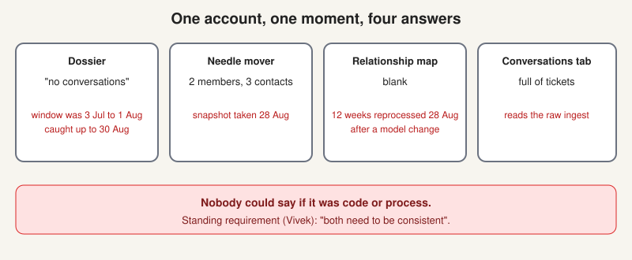
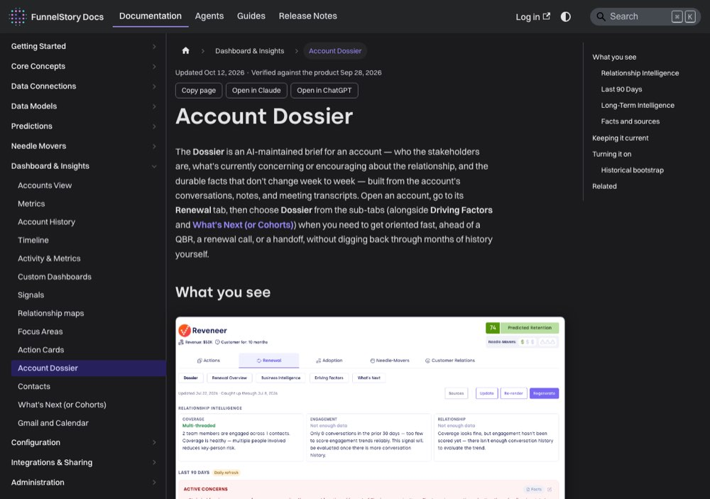

# The Account Dossier: the product's memory

> [!STORY] One account, four answers
> Brent at Trellix opened one account and looked at four screens. The dossier said "no conversations". The needle mover said 2 team members and 3 contacts. The relationship map was blank. The conversations tab was full of Service Cloud tickets.
> Four screens, one account, one moment, four answers. And nobody on the call could say whether the gap was a code problem or a process problem. Vivek's standing requirement came out of it: both need to be consistent.
> It is the clearest picture of why an intelligence product is hard, and the story to be able to tell cold.

## Where it sits

The dossier is the third layer of the graph: **accrued memory**. Durable long-term account context that persists past the 90-day window and updates as new conversations arrive. The code package is `internal/accountprofile`, about 13,800 lines, and it is the code charter's own reference package for how a package should be built.

Its table `account_profiles` carries two watermarks that tell you exactly how it works. Vivek pasted a snippet into Slack to force a rebuild:

- **`bootstrapped_at`** is the one-time historical backfill (three years since a change numbered 4007).
- **`last_synthesized_at`** is the incremental re-synthesis.

Set both to null and the background refresh starts over.

## What is in it, and what makes a claim trustworthy

The dossier is a synthesised narrative: who the account is, what it holds, what has happened, where the risk is. **Every fact carries provenance.** August 2026 shipped a pinnable per-fact provenance drawer.

So a dossier claim is trustworthy when you can open its citation, land on the actual conversation, and read the sentence. A claim with no source is not a weaker claim. It is a different kind of object, and the product's position is that it does not ship those. When the citation breaks, the product says so. The live bug showed dossier facts reading "Conversation unavailable".

## What "stale" means mechanically

Not "old". Three separable things, all of which have happened:

1. **The synthesis has not run.** `last_synthesized_at` is behind. The fix is the reset above.
2. **It ran over a window that excludes what you are looking at.** Brent's dossier was "caught up through 30 August" but its conversation window was 3 July to 1 August. So it said "no conversations" while the conversations tab was full. Freshness and coverage are two different claims and the screen blurred them. Issue 4121.
3. **It was rebuilt destructively.** Issue 4137, a P0: dossier regenerate deletes before rebuilding. Issue 4215: regenerate produces an empty dossier. Regenerating in front of a customer is not a safe operation.

There is also a standing constraint, issue 4180, a P0: the long-term profile is limited to 90 days. The layer whose whole purpose is to outlive the 90-day window is currently bounded by it.

## The newest layer: facts, then cases

Shipped in late August 2026, in `internal/ai/knowledge`. One pass today: sources to facts.

- **`facts`** extracts observations from meetings, emails and notes. One source holds one reading. A re-extraction replaces what that source recorded before, in the same transaction. A stricter prompt therefore removes facts a looser one recorded. That is the intent, not a bug. There is no version column and no read filter: every row in `facts` is current.
- **`account_inferences`** stores anything derived per account from the fact log. The one kind built so far is **`case`**: a single concluded commercial episode written as **STAR-L**, which is situation, task, action, result, learning. A commitment ledger will be the second kind.

Nothing reads facts yet beyond the `facts` semantic table. The package's own notes say so explicitly, so nobody goes looking for a reader that is not there. That honesty is worth copying.

## Parent rollup is a product judgment

Pulkit, on combining child dossiers at the parent: he uses a model to write the top-level summary, then adds two or three points from each child, because putting all the child text at the parent would be too much to read. That is a product judgment, not a technical one, and exactly the kind of call an FDE is asked to make in front of a customer.

## Traps

- Regenerating a dossier to "refresh" it during a demo. It deletes first.
- Reading "caught up through" as "covers up to". It does not.
- Assuming facts accumulate. They are replaced per source, on purpose.

> [!PROJECT] Where you see this in your week
> DocuSign's users like the dossier tags better than their own Salesforce, which has effectively one tag. Their one requirement is provenance: a way to tell a FunnelStory-determined tag from theirs. That is this chapter, spoken by a customer.

## Check yourself

1. What makes a single dossier claim trustworthy?
2. Say what "the dossier is stale" means mechanically, in three ways.
3. What does each of the two watermarks mean, and what is STAR-L?
