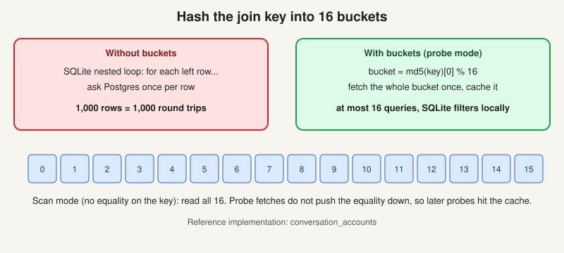

# The semantic database: SQL that returns nothing

> [!STORY] The query that was right and empty
> You write a query. It reads correctly. The joins are sensible, the column names match, the syntax is clean. It returns zero rows.
> Nothing is wrong with the syntax. Two things could be wrong with the world. Either you joined on the wrong kind of id, so the two sides never meet. Or the person running the query is not allowed to see those accounts, so the system quietly hides them.
> Aadarsh set the bar for this job in one sentence: AI does a very good job at writing SQL, but verifying and validating that it is right is a very important characteristic we look for. This chapter is the layer that SQL hits, and why it can lie to you politely.

## What it actually is

The code lives in `internal/semantic`, about 15,800 lines with 46 virtual-table files. It is **SQLite virtual tables that project Postgres and workspace config into one queryable surface**, used by the query generator, by agents, and by MCP.

- It is **not a graph database**. It is Postgres underneath, with a short-lived SQLite layer on top of it for each query.
- Building the back-end needs `CGO_ENABLED=1` precisely because of these tables.
- The dialect is **SQLite**, not Postgres. So `json_each`, `json_extract`, `pragma_table_info` and window functions. The team's own skill pack is full of JSON-column footguns that fail silently.

## How a virtual table is built

Most are declarative: a `TableDef` that describes the schema, plus a `Source` that supplies rows through a function called `NextBatch(ctx, constraints)`. The constraints are whatever SQLite decided to push down to the source.

## Bucketing: the fix for the nested-loop join

This is real code, and the one idea in the architecture you should be able to draw.

**The problem.** SQLite runs a join as a nested loop. For each row on the left it probes the right. If the right side is a virtual table backed by Postgres, that is one network round trip per row, and the query explodes.

**The fix.** Hash the join key into 16 buckets.

- **Probe mode** (there is an equality on the join key): compute `bucket = md5(key)[0] % 16`, fetch the whole bucket, cache it, and let SQLite filter locally. One Postgres query per unseen bucket, not per row.
- **Scan mode** (no equality): go through all 16.
- Probe fetches deliberately do not push the equality down, so a later probe into the same bucket is a real cache hit.

The reference implementation is `conversation_accounts`.

## The two id namespaces: cause one

- `account_id` is the external, customer-facing id. The one in their Salesforce.
- `account_fs_id` is FunnelStory's internal UUID.
- Anything ending `_fs_id` is always an internal UUID.

Join on the wrong one and the query runs, returns nothing and looks fine. It is the silent wrong answer Aadarsh warned about, and it will happen in front of a customer sometime.

## Visibility: cause two

Normally the API enforces who can see what. Semantic queries enforce the same rule in the query and virtual-table layer instead. Different enforcement point, same rule. So a query can return zero rows because **the caller cannot see those accounts**, not because the data is missing. The design docs are about visibility and role-based access. A real bug: managers and data admins lost the "All Accounts" view and it had to be restored.

A third cause, worth naming even though the question asks for two: a **time-window source** whose window excludes the rows. It is the same mechanism that made the dossier say "no conversations".

## Where the SQL comes from and where it goes

- `query_semantic_db` is the tool the agent calls.
- `query_generator_additional_instructions` is the fourth workspace-default prompt field. It exists to steer the SQL the agent writes.
- Non-warehouse connections do not speak SQL. So FunnelStory wraps them with **BlocksQuery**: provider-specific blocks embedded inside the SQL (Salesforce SOQL, HubSpot, MongoDB queries, Gainsight, Elasticsearch, Attio), exposed as a SQLite virtual table. That is why "can we support SQL on Attio" was a real customer question with a real answer.

## How you validate SQL (the habit the job wants)

You will often have a model write the query. Your job is to verify it. The habit:

1. Run the validate endpoint before the preview, never skip it.
2. Check row counts against something you know. If you expect about 300 accounts and get 0, 3,000 or 1, suspect ids and visibility first.
3. Check that the ids on both sides of a join are the same kind.
4. Check that the time window includes the rows you expect.
5. Say out loud what it will do wrong, not just what it does.

> [!GOTCHA] One more silent trap
> JSON columns in SQLite fail silently when you read the wrong path. A path that does not exist returns null, not an error. A condition on null drops the row. The team found a related platform bug: a condition step drops comparisons, and the value 0 is treated as truthy. Verify the result, not the syntax.

## Traps

- Calling it a graph database.
- Trusting a query because it reads well.
- Forgetting that the caller's visibility changes the answer.

> [!PROJECT] Where you see this in your week
> Every data model you write for a customer, every `semantic.query` step in a flow (240 of them in the four workspaces you measured), and every "the dashboard is empty" message is this chapter. Aadarsh's statement about the role is this chapter's reason to exist.

## Check yourself

1. Why would a query that reads correctly return zero rows here? Give the two most likely causes specific to this system.
2. Draw the bucketing idea: what is the problem, what is the fix, what is one query per?
3. What is the dialect, and why does the back-end need CGO?
