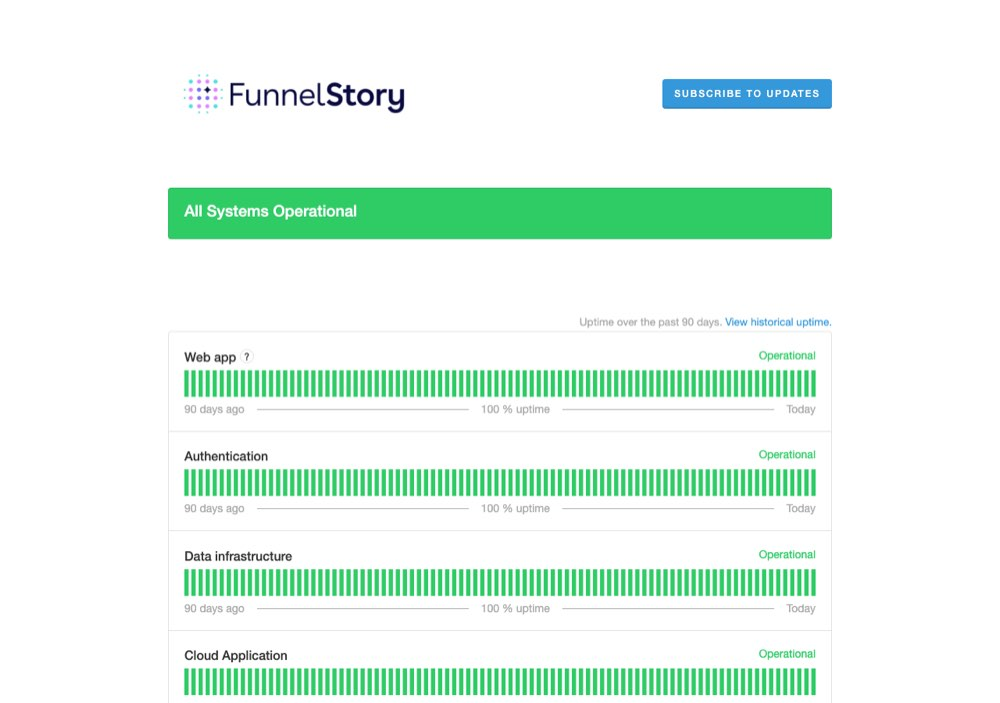

# The codebase, and the law that governs it

> [!STORY] The value that was missing
> You are reading some code and you notice a value is missing in a table. The natural thing to do is write it from where you noticed it. You add an UPDATE in the package you are working in. It works.
> It is also the rule you are most likely to break by accident. Every table in the back-end has exactly one owner, and only the owner is allowed to write to it. Writing from anywhere else is, in the charter's words, a design error, full stop.
> Why so strict? Because this is a 516,000-line Go back-end that takes about 100 commits a week. If any package can write any table, nobody can reason about anything.

## Sixteen repos, four that matter

- **`back-end`** is Go, 516,000 lines in 2,382 files. This is the product: the HTTP API and the background work, in one container.
- **`front-end`** is TypeScript, about 250,000 lines. The single-page app.
- **`internal-docs`** is 187 design documents from May 2022 to now. The written decision record.
- **`library`** is the internal handbook, built with Hugo. It is the FDE's actual manual.

The others: `ops` (Terraform, Kubernetes, Cloudflare, Grafana, and the AWS to GCP migration), `documentation-v2` and `documentation` (the public docs), `product` (the issue tracker; the four-digit numbers in branch names resolve there), `e2e` (Playwright tests), `playground`, `mvp` (the 2022 original), `funnelstory.ai` and `marketing` (the website), and three public ones: `skills` (an MIT-licensed pack for their MCP server), `expect` and `ptr`.

The back-end takes about 100 commits a week across about 165 remote branches. A plan built on last week's main is already wrong. Fetch before you read anything.

## The architecture in nine lines

From the back-end's own architecture rules:

1. **Multi-tenant.** Workspaces share a database and schema. `workspace_id` is the isolation boundary. Getting this wrong is the highest-severity bug class.
2. **Accounts** are the primary organising context.
3. **One container** runs the API and the background work.
4. **No external job queue.** Durable work is stored and polled in PostgreSQL, which also gives pub/sub and most locking.
5. **Two ingestion paths:** data models and connections.
6. **PostgreSQL** is the store. **Ephemeral SQLite virtual tables** are the unified query engine.
7. **external data → ingest → context and signals → flows and actions.**
8. **Flows** are the newest version of Workflows and the direction for automation.
9. **Production is migrating from AWS to GCP** (issue 4029).

## The biggest packages, which is the fastest map of the product

- **`ai`** (about 81,800 lines): flow 29.6k, knowledge 9k, prediction 6.4k, llmv2 5.7k, tasks 5.7k, dashboard 5k, reports 3.8k, cohort 3.3k, workflow 2.6k, functions 2.4k.
- **`connections`** (33,600): the ingestion side of the 37+ connectors.
- **`funnels`** (18,600).
- **`entity`** (16,900): accounts, contacts, the object model.
- **`semantic`** (15,900): the virtual-table layer.
- **`conversations`** (14,200), including the relationship map.
- **`accountprofile`** (13,800): the dossier.
- **`needlemovers`** (13,000): version 2 is live.
- **`workflows`** (10,000): the old automation path.
- **`table`** (9,500), **`mcp`** (9,200), **`meetings`** (8,800).

## The role vocabulary: these words are load-bearing

The charter gives each kind of code a name, and the names mean something. A review comment that says "this is a Helper" is a rejection.

- **Store:** SQL for one domain.
- **Client:** one external system's API.
- **Processor:** a domain pass in named stages, with no I/O of its own.
- **Runner:** scheduling, intervals, budgets, feature gates.
- **Handler:** HTTP. Parse, validate, authorise, call one owner.
- **Policy:** a pure domain decision, no I/O.
- **Resolver:** turns an identifier or raw row into a domain object.
- **Syncer:** moves records between an external system and the store.
- **Engine:** a capability with interchangeable providers.

**Banned outright:** Manager, Helper, Util, Service, Persister, Orchestrator, Source (overloaded), Consumer and Producer, Collector and Fetcher as shared roles, and anything ending in Registry.

## The rules that will catch you out

- **A Runner decides when and how much. The owning package decides what and how.** Every runner must bound its per-tick work.
- **Only the owning package writes its tables.** Cross-package reads go through a narrow exported reader, never the owner's full accessor.
- **`integrations/*` must not import `internal/`.** The existing violations are debt, not precedent.
- **Add an interface only when a test double, a second implementation or a real extension point exists today.**
- **Side effects are interfaces, not function fields.** A mocked interface proves the call happened. An inline closure passes silently when never called.
- **Contracts grow by options structs**, not by more parameters.
- **Two things are out of scope for renovation:** `workspace.Accessor` ("do not try to split it, do not add methods to it") and `core`.

## Where the rules live

In `code/back-end/.cursor/rules/`: `charter.mdc` (832 lines, the law), `general.mdc`, `database.mdc`, `references.mdc` (which package to copy), `tests-guide.mdc`, `streaming-guide.mdc`, `recent-changes.mdc` (a rolling 30-day index of merges and live issues), `api.mdc`, `architecture.mdc`, `memories.mdc`, `gotchas.mdc`.

Also `.cursor/memories/<handle>/YYYY-MM-DD.md`: the why behind decisions, per person, in a house format. "The expectation was X. The implementation was Y. Y did not meet expectations because Z. We decided A, B or C, with reasoning and trade-offs."

Several packages have their own AGENTS.md to read before touching them: accountprofile, needlemovers/v2, ai/knowledge, conversations/relationshipmap, cohort, dataapp, play.

## How it runs, and the house conventions

- `make start-test-dbs` starts docker test databases.
- `make go-test-update` runs tests with snapshot updates, race detector and coverage.
- `make go-test` runs again without updating, to prove snapshots are stable.
- `make lint` runs first in CI.
- `go run main.go server` runs the API on port 8000.
- Prefer `make go-test` over bare `go test`, because the Makefile sets `CGO_ENABLED=1`.

Branch names are `<type>/<issue-number>-<short-desc>`, for example `feat/3936-remove-spec-container`. Commits use conventional style with a scope: `fix(semantic): ...`. A PR description goes Summary, then Contract (invariants, algorithms, assumptions, scope), then Breaking Changes and Impact.

Front-end gotchas worth carrying: the Docker CI job is the authoritative TypeScript check, not local `tsc`. Prettier fails the build on formatting alone. Never use a bare `navigate`; use `useNavigateWithSearch(true)`, because `workspace_id` lives in the query string. And never copy file contents over a newer base when restacking. It once wiped a merged fix.

Branches written by agents are normal. `claude/*` and `copilot/*` exist in the back-end. Rename a generated branch to the house convention before working on it.

## Traps

- Writing another package's table from where you noticed the gap.
- Importing `internal/` from an integration.
- Adding an interface "just in case".

> [!PROJECT] Where you see this in your week
> Your own PRs, such as the one that records who started a flow run (issue 4374) and the new PDF step, are written under this charter. The self-review before opening a PR is largely a check against these rules.

## Check yourself

1. Where does a new capability land, and which package is allowed to write its tables?
2. Which charter rule would you break first by accident, and why?
3. Name four roles from the vocabulary and what each owns.
