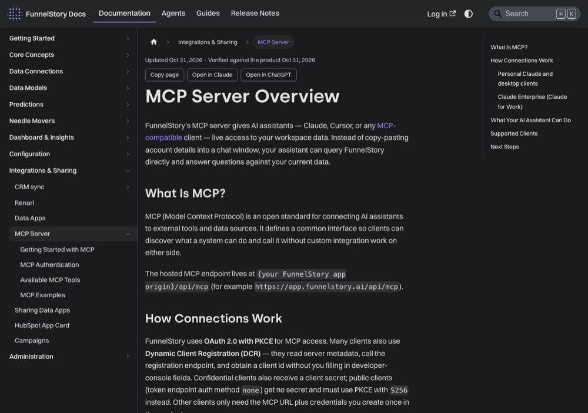

# Two kinds of agent

> [!STORY] Two emails, one hallucinated test
> A colleague was setting up agents for a customer called Brandlight. These agents email the CSM and the head of customer success. He asked Claude to run a test. Claude invented the test-mode setting and did a real run. Two real people at Brandlight got an email. He ran it twice, so each got two.
> His message afterwards: apologies, I should have added my email instead of the actual ones.
> The story is in the book because an agent is not a toy. It is a thing that runs on a schedule, in a real customer's workspace, and reaches real people under FunnelStory's name. Before anything else, learn which kind of agent you are dealing with.

## The word "agent" means two things

| | **Outcome-Based Agents** | **AI Agents** (the flow builder) |
|---|---|---|
| Built by | FunnelStory, pre-hardened | The customer, or the FDE |
| Scope | One specific job | Unlimited |
| Turned on by | A setting | Authored: a trigger and a step graph |
| Pattern | Read evidence, reason, act | Whatever you write |
| Modes | **Assist** (a person triggers it, reasoning visible live) and **Auto** (runs on events) | Trigger-driven |

The first Outcome-Based Agent shipped in August 2026: **autosuggested Action Cards** for needle movers. It drafts an evidence-based card, with reasoning, next steps and an optional draft email, for open needle movers nobody has acted on. Off by default.

Everything from here to the end of Part 3 is about the second kind, the ones you build.

## In the customer's words: "flow" and "agent" are the same thing

You will hear both. In the product a saved, runnable automation is a **flow**. A customer calls it an agent. **Draft** means saved but off. **Active** means running on its schedule.

## The harness: the part no public doc mentions

Aadarsh confirmed on 27 August what the FDE really builds. **Custom scripts inside FunnelStory that call external APIs, apply business logic, and trigger actions.** It is the escape hatch for logic too custom for the flow builder.

The canonical example, worth keeping: a hardware company with about 200 travelling employees tracked in ClickUp wanted Google Calendar blocked automatically by travel dates, without paying ClickUp per seat for all 200. The harness reads the ClickUp API, applies the date logic, and sends calendar-blocking emails. The same customer also gets weekly PowerPoint reports out of the same mechanism.

Read that twice. It is not an AI feature. It is an API, a date rule and an email, and the value was a licence the customer did not have to buy. That is the job.

## "Vibe coding" and its two failure modes

The customer can describe the agent in plain English to Claude or Cursor over MCP, and the MCP server writes the flow. Two real failures of the thing being sold:

- Dikshant at GreyOrange used a roughly 400-line prompt and hit "conversation too long".
- Sraboni used a concise prompt and got a working PowerPoint, but Claude skipped creating the flow agent entirely and used its own Gmail connector to send it.

Both mean: describing an agent in English is not the same as shipping one.

## Traps

- Confusing the two kinds. An outcome agent is configured. A flow agent is authored.
- Believing a test is harmless. See the story.
- Trusting that Claude used the tool you asked for.

> [!PROJECT] Where you see this in your week
> The Showpad "BNSK Creation Stalled" work was an outcome agent plus an action agent linked to it. The GreyOrange alert agent, the deck agents and the folder creator are flow agents. Know which is which before you speak.

## Check yourself

1. Name the two kinds of agent and one difference between them.
2. What is the harness, and what is the best example of what it is for?
3. What are the two failure modes of describing an agent in English?
