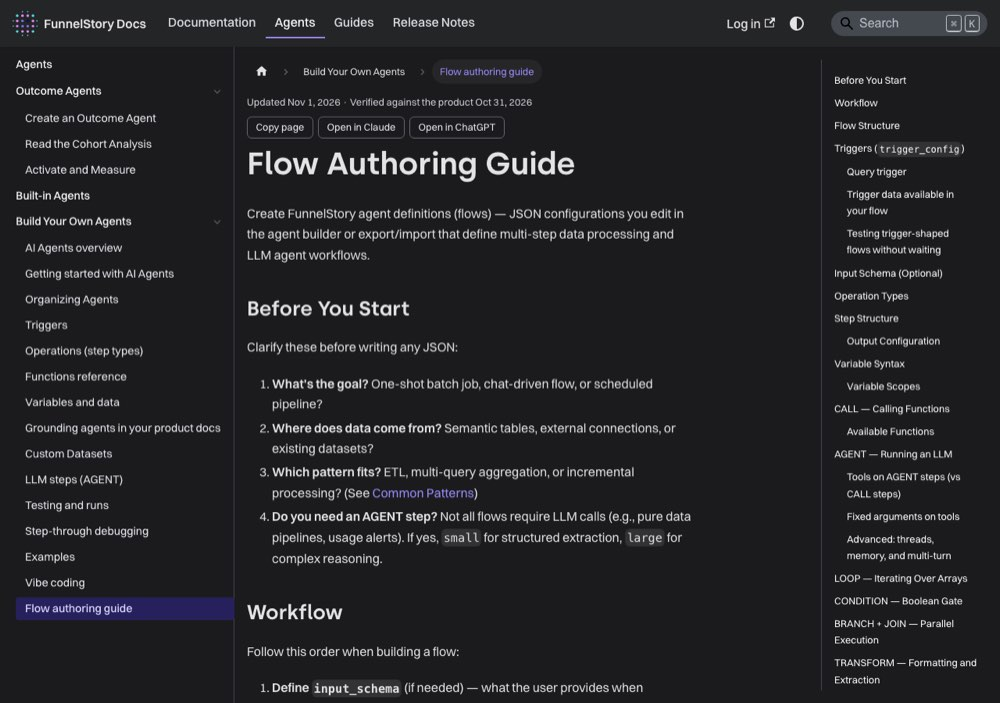

# Anatomy of a flow

> [!STORY] 92 flows, counted
> On 3 September you counted every flow across the four workspaces you can see: 92 in all. Not from the docs. From the data. You wanted to know what agents here actually do, not what people say they do.
> The answer was surprising. The most common step by far was running a script. The second was a database query. Sending an email, the thing the customer sees, appeared in 40 flows, and only 11 of those were live. Creating a task for a human appeared in 10 flows, and in none that were live.
> The shape of real agents: a lot of plumbing, and a thin layer that reaches a person.

## A flow is JSON

A flow is a JSON document: a `trigger_config` plus a graph of steps. The runtime is `internal/ai/flow`, about 29,600 lines:

- **schema:** graph, step, op types, function ids, tool ids.
- **runtime:** the executor. A tick pops one frame from a run queue. State and variable resolution.
- **env:** the environment, the function and variable tools, the variable store.
- **env/functions:** the handlers for each call.
- **sim:** an in-memory simulator with a mock environment and trace capture. The highest-leverage part of the package for an FDE, because you can test a flow without touching customer data.

## The ten op types

`CALL`, `AGENT`, `LOOP`, `BRANCH`, `CONDITION`, `TRANSFORM`, `WAIT`, `SPAWN`, `JOIN`, `REPLAN`.

In plain words: CALL runs a function. AGENT hands a step to a model to reason with tools. LOOP repeats. BRANCH and CONDITION choose a path. TRANSFORM reshapes data. WAIT pauses. SPAWN and JOIN run parallel work and gather it. REPLAN lets an agent change its own plan.

## Triggers

Triggers are separate pieces of code: by query, by activity, by signal, by needle mover, by conversation, by a CEL expression, by account filter. **A flow with `trigger_config: null` never runs on its own.** That single fact is how drafts stay inert.

## The function surface, measured

From your count across 92 flows, 3 September 2026:

- `script.js`: 503 uses, 80 in live flows. Internal work, never value to a person.
- `semantic.query`: 240, live 80. Internal.
- `data_connection.request`: 226, live 3. The escape hatch to an OAuth app like ClickUp.
- `dataset.record.upsert`: 51, live 18.
- `email.send`: 40, live 11. Reaches a human.
- `data_connection.query`: 30, live 9.
- `pptx.create`: 11, live 0.
- `tasks.create`: 10, live 0. Reaches a human, and unused in every live flow.
- `slack.send_message`: 6, live 4. Reaches a human.
- CRM writes (HubSpot, five kinds): 16, live 6.
- `projects.create` 1, `search.web` 1, Salesforce functions 0.

The split that matters is between functions that move data and functions that reach a person. Only 13 of the 26 live agents touch a human at all.

Since then, new steps have appeared, including `pdf.create`, a step you built, which turns HTML into a PDF attachment through Cloudflare's browser rendering.

## Step descriptions

Every step carries a plain, human-readable `description`, one line saying what it does for a reader of the canvas, not how: "Create the PDF file", "Check which accounts were already contacted". The UI now shows them, and the save script refuses a flow with an undescribed step. When a teammate has already written descriptions in the UI, keep their wording.

## Variables: locals and globals

Steps pass data through variables. A step's output goes into a **local** (`out: {set: "x"}`) or a **global** (`out: {set: "@.x"}`). The difference matters enormously, and it is the next chapter.

## The MCP surface, and the stale name

The MCP server is `internal/mcp`, one file per tool. Registered today: `save_flow`, `edit_flow`, `run_flow`, `preview_flow_triggers`, `debug_flow_step`, `query_semantic_db`, `configure_data_model`, `preview_data_model`, `get_data_connection_schema`, `preview_data_connection`, the task and project tools, `list_templates`, `read_template`, `google_sheets_read`, plus an `oauth` area with PKCE and DCR.

`configure_flow` no longer exists. It collapsed into `save_flow` and `edit_flow` in August 2026, and several installed skills still use the old name. **Where a skill and the back-end disagree, the back-end wins.** The closest thing to a maintained spec is `flow_functions.md` and `flow_guide.md` in `internal/mcp/resources/`.

## Traps

- Trusting a skill's function list over the back-end spec.
- Counting a flow as live because its config says so. See chapter 3.7.
- Writing a long flow with no descriptions.

> [!PROJECT] Where you see this in your week
> AGT-013, the filing agent, has 67 steps, the alert agent is one flow that runs daily, and the weekly decks are two flows. All of them use this vocabulary, and when you say "the loop fetches then the script trims" you are using it.

## Check yourself

1. Name five op types and say what each does.
2. What does `trigger_config: null` mean, and why does it matter?
3. What is the difference between functions that move data and functions that reach a person?
