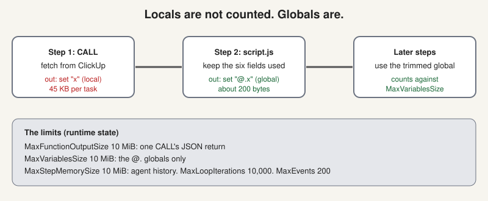

# The size limits, and test mode

> [!STORY] 45 kilobytes of which you need 200 bytes
> A task from ClickUp comes back as about 45 KB of JSON. Most of it, about 25 KB, is `custom_fields`, which repeats the full configuration of every field, including a dropdown with 40 options. The flow only uses six fields, and those six, once trimmed, weigh about 200 bytes. A 99 percent reduction.
> If you hold the raw response in memory for every task, a flow that works for 20 projects dies at an unpredictable project count. If you trim it first, it scales. That single design rule is in this chapter.

## The hard limits

They live in the runtime state code. Three separate 10 MiB ceilings and two counters.

- **`MaxFunctionOutputSize`:** 10 MiB. One CALL step's JSON return. Trips when a single fetch returns too much.
- **`MaxVariablesSize`:** 10 MiB. The `@.` globals only. Trips when accumulated globals get too big.
- **`MaxStepMemorySize`:** 10 MiB. The step memory, summed: the conversation history of an AGENT step. Trips on a long multi-turn agent.
- **`MaxLoopIterations`:** 10,000.
- **`MaxEvents`:** 200 retained run events. Events are deliberately not size-checked, so debugging history can never fail a run.

## The design rule that falls out

`MaxVariablesSize` counts **globals only**. Frame locals live in the run queue and the validator does not check them. So:

1. Send the raw response to a local: `out: {set: "x"}`.
2. Trim it in the very next step.
3. Promote only the trimmed result to a global: `out: {set: "@.x"}`.

Failure looks like `variables size exceeded: 10485.8 KiB > 10240.0 KiB limit`. The run goes to failed. It does **not** silently stop. But nothing pages anyone, so a scheduled flow that fails at 6am is visible only to someone who opens the run list. **Who notices a failed run is a question to answer before publishing, not after.**

A related limit you met: a flow run stops after about a minute of work. Batch write loops, under roughly 20 calls, and verify in the target system.

## Test mode

`run_flow` with `options.test.enabled = true` executes the flow and returns real output. The runtime rejects any non-GET `data_connection.request` in that mode. That is enforced on the server, in `test_functions.go`, not by good intentions.

So there is a supported way to see the true result without touching anything. "I needed to activate it to see if it worked" is never true.

> [!GOTCHA] But test mode still sends mail
> Test mode blocks writes to external apps through `data_connection.request`. It does **not** stop `email.send`. Test-mode email is redirected and marked with [TEST], but it still goes out through the flow's sender, using the `from` grant. In a customer's own mailbox, that lands in their Sent folder. Never test-send from a customer's mailbox. Use your own address as the recipient and a sender that is yours.

## The design docs that explain the runtime

- Dry-run test mode (2026-04-01).
- Agent-wrapped tools and human-in-the-loop (2026-03-30). The draft and approve gate from the inside.
- Long-running reactive agents (2026-03-31).
- Flow state in S3 (2026-05-27).

## Saving: the one rule

A change to a flow is not done until it is **saved**, and saved means `node scripts/flow-save.mjs` printed SAVED. The script checks the flow has not moved since the version you edited, refuses anything but a draft with no trigger (unless a trigger is explicitly staged on a draft), PUTs, re-reads, and compares field by field. It also journals every save in the stream's CHANGELOG and keeps the previous version as the undo.

**Never run an edited graph through `run` with the graph in the request body as a stand-in for saving.** It happened on 11 September and again on 15 September: the save was refused, the run from the body worked, the email looked right, and the saved flow stayed old for anyone pressing Run in the UI. Your words: there was a time when it wasn't saved, and I was not aware of that at all.

If a save fails, the first line of your reply says NOT SAVED, and what the workspace still holds.

Another trap: **activate from a fresh page.** The UI's Activate button re-saves whatever copy that page loaded. If the page is old, it overwrites your newer code. Reload first, then check by reading the flow that your code survived.

## Traps

- Promoting a raw API response to a global.
- Calling a scheduled flow done without saying who notices when it fails.
- Treating "the test run looked right" as "the flow is saved".

> [!PROJECT] Where you see this in your week
> The weekly GreyOrange decks failed on 30 October because ClickUp refused 42 requests made at once, so 24 decks went out with empty sections. The same family: limits and concurrency.

## Check yourself

1. Why does the design rule use locals first, and which limit does it dodge?
2. What does test mode refuse to do, where is that enforced, and what does it still allow?
3. What must print before you say a flow change is saved?
