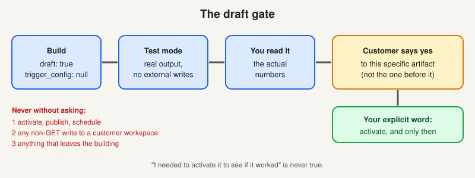

# The draft gate

> [!STORY] The agent that goes and activates the thing
> Aadarsh wrote the FunnelStory skills that Claude uses, and they carry real power to publish and write inside a customer's workspace. When he handed them over, he warned about one specific behaviour: left alone, an agent goes and activates the thing.
> Imagine what an activated agent does in a real customer's workspace. It runs on a schedule. It emails real people at the customer, under FunnelStory's name. Nobody is watching. The failure is not a bad commit that you revert. It is a wrong report arriving in a customer's inbox, on a timer, with nobody looking.
> That is why the hardest rule in the whole work repo is not "be careful". It is a mechanical rule, stated in full.

## The rule

**Every artifact created in a customer workspace is created as a draft, and stays a draft until you say the words.** For a flow agent that means `draft: true` and `trigger_config: null` on save, and it stays that way. Not "draft until it works". Not "draft, then activate once the test passes". **Draft until you have read the real output, sent it to the customer, and the customer has said yes.** Publishing is a separate act, done only on an explicit, unambiguous green light for that specific artifact. A green light for one artifact is not a green light for the next.

## The three things never done without asking

Even when a skill's own safety section allows them.

1. **Activating, publishing or scheduling anything.** `draft: false`, a non-null `trigger_config`, a flow publish, a dashboard share, a model set live.
2. **Any write to a customer workspace.** PUT, POST or DELETE against `/api/*`, or any `data_connection.request` with a method other than GET. Reads are fine. Writes are a conversation with you first, and with Aadarsh where they touch configuration.
3. **Anything that leaves the building.** An email, a Slack message to a customer channel, a task created in the customer's own tracker.

## Why it is written like this

The rule restates, from inside the product, something Arun said: a lot of the product areas do not have an easy undo. GreyOrange, Trellix and the others are enterprises whose own data lives in those workspaces.

It has also already gone wrong once, as in chapter 3.1, and once, activating a cron flow fired eight concurrent runs because the schedule backfills missed slots. One person at a customer got the same email eight times.

## Print every call as it goes out

Aadarsh's skills require a formatted summary before every call: `>> METHOD /path`. That is not decoration. It is what lets you catch a wrong endpoint before it lands. The same goes for MCP calls: say which workspace, which flow, which method, **before** the call, not after.

If a request seems to need a write, the answer is to stop and say so, with the exact call that would be made, and let you decide. Asking costs a minute. The other thing costs an account.

## More rules in the same family

- **No test sends from a customer's mailbox.** Test-mode email still goes through the `from` grant, so a [TEST] mail lands in the customer's Sent folder.
- **No connections of our own in a customer workspace.** Our Slack connection in the Descope Paid workspace pulled channels, and Arun flagged it on 21 October.
- **Do not run FunnelStory's own agents inside a customer workspace.** Arun's reason is commercial, not safety: one day we will say "using agents costs you this much", and if we run our own agents in their workspace the count is polluted. Customers will be metered.
- **Official accounts only** for customer data. Cursor first. Anything else is a conversation.
- **Every write leaves a line.** `flow-save.mjs` journals saves and `ws-write.mjs` journals every other non-GET call, with before and after reads. The journal is tracked and carries counts and ids, never an address.

## The ladder

An agent spec that moves toward a customer goes up a short ladder of rungs, such as the internal demo workspace, staging, the customer's workspace, the customer's own tool (their ClickUp, say), and live. Each rung has a gate out, and a quoted go from a named person. The draft gate is that ladder as a sequence. The `/work-ladder` skill keeps the file that records which rung each agent is on.

## Traps

- Treating "the customer asked for it" as authorisation. Jaspreet had not been asked. The request came through Mahima.
- Confusing "Aadarsh approved the approach" with "the customer approved the artifact".
- Letting a skill's own permissions outrank the gate. They do not.

> [!PROJECT] Where you see this in your week
> AGT-013 is built, tested and still a draft. It stays that way until you say so. The GreyOrange SOP agents went live on 10 September, but only after Dikshant said "this looks perfect, you may enable the rest", and you relayed Pulkit. A specific green light for a specific artifact, from the person who owns it.

## Check yourself

1. What is the one-sentence form of the draft gate?
2. Name the three things never done without asking.
3. Why does your own tooling never run inside a customer workspace?
