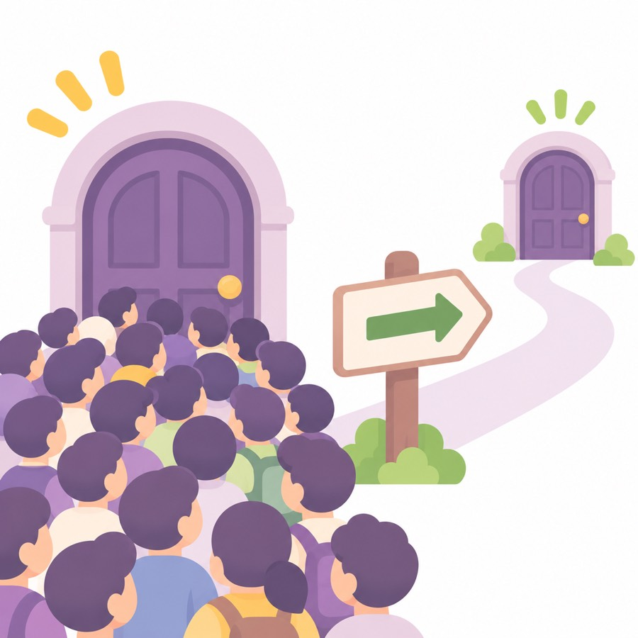
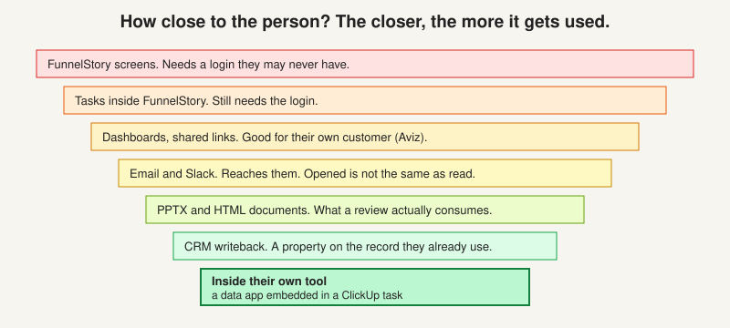

# Where the output lands

> [!STORY] 950 people who will not log in
> GreyOrange has about 950 people. They run their whole delivery organisation in ClickUp: a Stage Gate Tracker, a Consolidated Risk Register, a CHI Tracker, MOM notes, Travel Plans, an Absence Log. Their go or no-go reviews are in PowerPoint.
> They will not log into FunnelStory. Jaspreet, who builds the health scores by hand, does not even have an account, and said so as an objection.
> So: how do you get a health score in front of 950 people who live somewhere else? That is the question of this chapter. And the real answer turned out not to be about technology at all.

## The surfaces, from furthest to closest

- **The FunnelStory screens.** Accounts, dossier, needle movers, funnels, dashboards. Needs a login the customer's users may never have.
- **Email** (`email.send`). A report or alert in an inbox. Opens and clicks are tracked, but landing in an inbox is not the same as being read.
- **Slack** (`slack.send_message`). Into their channel. Needs the channel mapped to accounts.
- **Tasks** (`tasks.create`). A card in a person's list inside FunnelStory. Still needs the login.
- **CRM writeback** (`hubspot.*`). A property on the record they already work in. Can be overwritten by their own sync.
- **Dashboards.** In-product, shareable, embeddable. Aviz's whole ask was a shareable link for their own customer.
- **Data apps.** A declarative JSON app: fields, forms, a ledger, a snapshot, embeddable.
- **Documents.** PPTX and HTML reports. What a QBR or go or no-go review actually consumes.
- **Their own tool.** An embed inside a ClickUp task, or a table pushed into ClickUp. The customer never leaves the tool they live in.

## The GreyOrange case

Three candidate answers.

1. **A native ClickUp table pushed by an agent.** Works. Pulkit's risk register push is the precedent. But it loses the explainability: numbers with no reasoning, no confidence, no evidence, no history.
2. **A data app embedded inside the ClickUp task.** Arun's preference, and his argument is the one to remember: explainability, confidence, evidence, history, audit. "Jaspreet's Excel cannot do what we do." Pulkit built a local demo of exactly this, with custom fields, over a Cloudflare tunnel.
3. **Give them FunnelStory logins.** Rejected by the customer's own economics, and by the fact that Jaspreet does not have an account.

The customer raised the constraint nobody at FunnelStory had raised first. Jaspreet's four objections are the real lesson: he was not aware of the requirement; who validates this end to end; he does not want leadership seeing FunnelStory CHI scores before they are validated; and they have no direct access to FunnelStory today.

Aadarsh invented the mechanism on the spot: a **working-draft mode versus a published score**, so GreyOrange's own people can validate gradually, and leadership never sees a half-baked number.

That is the shape of the FDE job in one exchange. The technical question was "which surface". The real question was "who is allowed to see a number before it is trusted".

## The per-seat trick

Two of the clearest wins in the record are the same trick.

- **Travel Plans to Google Calendar.** GreyOrange tracks travel for 100 to 150 people in ClickUp and wants their calendars blocked automatically. The obvious answer, ClickUp's own calendar integration, is per seat, and most of those people do not use ClickUp. Doing it through FunnelStory avoids buying 150 seats. FunnelStory can read Google Calendar but not write to it. Arun's workaround: send a meeting invite for the duration, and the calendar blocks itself.
- **The 200-employee hardware company** from chapter 3.1. Same problem, same trick.

Neither is an AI feature. Each is an API, a date rule and an email. The value was a licence the customer did not have to buy.

## Four of five end at a person

Look back at the five things you ship. A report, an alert, a dashboard and a sync-into-their-tool all end at a named human. That is the rule behind "who is this for?". Arun: if everything you are doing is to benefit this one person and nobody else knows about it, it is not good for us.

## Traps

- Picking a surface because it is easiest to build.
- Forgetting that the real constraint is who is allowed to see a number early.
- Building for one person.

> [!PROJECT] Where you see this in your week
> The CHI data app in GreyOrange's ClickUp, the weekly decks saved into ClickUp's Weekly Reports folders, and the Slack alerts in project channels are all this chapter. The ClickUp button that launches the data app from a project is the "embed in their tool" choice made real.

## Check yourself

1. For a customer whose users will never log in, pick a surface, defend it against two alternatives, and say how you would know a week later whether it worked.
2. What were Jaspreet's four objections, and what did Aadarsh's mechanism solve?
3. Why was the Travel Plans answer a business answer wearing a technical hat?
