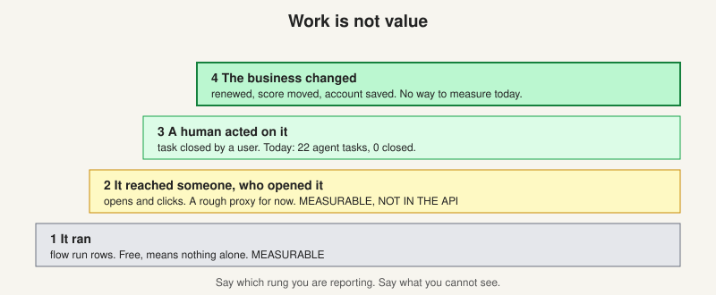

# Did anyone use it?

> [!STORY] 22 cards and not one closed
> On 3 September you measured something nobody had measured. Across four workspaces, the system had put 22 agent-created tasks in front of people over about two months. Humans had closed none of them. In every one of the 22, the last person to touch the task was still the agent, so nobody had even opened it.
> And here is the twist. None of the live agents created tasks at all. The 22 came from a background task-suggester, not from anything you or anyone had built.
> The sentence to be able to say out loud: we put 22 cards in front of people over two months and not one was actioned.
> Arun cares about this more than about anything else you do. His words: it is easy to go to a customer and say I will build you these agents, but if they are not clicking on it, if they are not using it, we need to build what is usable. And your own variable pay is tied to it.

## Work is not value

Building a deck is work. Value is whether it did anything for the person who got it. Four rungs:

1. **It ran.** Flow run rows. Free, and means nothing on its own.
2. **It reached someone, and they opened it.** Opens and clicks in the email action events table. Preetam's own design doc calls engagement "a good enough proxy for value for now". Three hedges in one line: rough, proxy, for now. Not exposed by the product API today.
3. **A human acted on it.** `tasks.created_by.type` can be user, workflow, external or agent. `tasks.state` is open or closed. If an agent made 40 cards and humans closed 31, that means something. An open rate can be argued away as an Outlook preview pane. A closed task cannot.
4. **The business changed.** They renewed, the score moved, the account was saved. No way to measure this today. Saying so is better than pretending.

## "Deployed" and why the obvious definition is wrong

The obvious definition, "not a draft and has a trigger", gave 26 live flows out of 92. Running it against real data:

- Descope: 4 flows, 1 live by config, 1 actually active, 0 dormant.
- Descope Paid: 16 flows, 4 live, 4 active, 0 dormant.
- Showpad: 11 flows, 7 live, 6 active, 1 dormant.
- GreyOrange: 61 flows, 14 live, 4 active, **10 dormant**.
- Total: 92 flows, 26 live by config, **15 actually active, 11 dormant**.

Eleven of the 26 had not run in 71 to 168 days. Their config said live. They were dead. So "deployed" needs a third clause: **has run within a multiple of its own cadence.**

GreyOrange had 61 flows and 46 were drafts. That workspace is where people experiment. Draft count is not a health signal.

Two more signals worth having: the **test-to-real run ratio** (a weekly renewal risk report had 35 real runs and 26 test runs, which means someone is still building it), and `updated_by.type` on a task (created by an agent and later touched by a user is weaker than closed, but still real).

## Two alarms, not one

"Stopped using" is two different failures, and only one is caught today.

- **Alarm A: the agent broke.** Runs are failing. Their alerting catches this.
- **Alarm B: the agent runs fine and the humans stopped engaging.** Green runs, zero opens, zero closes. This is the one Arun actually wants, and failure-only alerting cannot see it.

## How you report it

Bring Arun adoption numbers, not completed tickets. Mark each as verified or assumed. State the definition before the number. This is the same habit as bringing the denominator with the recall (chapter 1.2).

## Traps

- Reporting run counts as adoption.
- Calling a flow deployed because its config says so.
- Building for one person.

> [!PROJECT] Where you see this in your week
> The agent-adoption tooling you built (six datasets and an agent that fills them), the "who started a run" change (so staff runs can be excluded from adoption numbers), and the product knowledge map are all about this chapter. Mahima's questions in early November about the GreyOrange alert agent are the same question from the customer's side: do the project managers read and use the alerts?

## Check yourself

1. Name the four rungs of the value ladder, and say which two can be measured today.
2. Why did the "deployed" definition need a third clause?
3. State Alarm B in one sentence.
