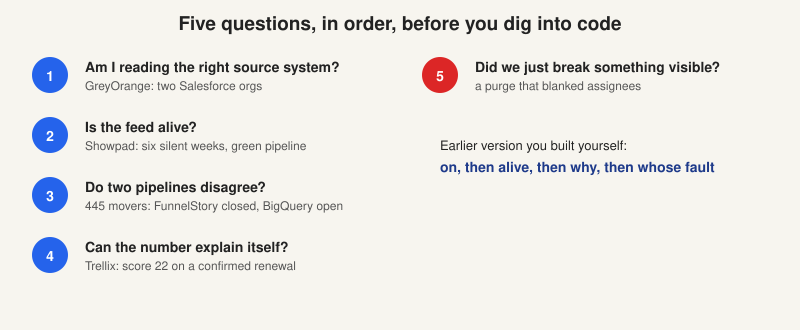

# How to read a customer

> [!STORY] The same five things, everywhere
> After enough customer stories, a pattern shows. The accounts are different, the products are different, the people are different. But the same five things break in the same order. A person who knows the five can walk into any customer problem and have a plan within a minute.
> This chapter is the part of the customer section that is worth more than the roster.

## The roster, in one breath

Seventeen named accounts. **Three are yours:** GreyOrange directly, Trellix as the account you were tagged on, and DocuSign as the one being provisioned. Three more are the ones Arun named for the adoption assignment: Showpad, Descope and GreyOrange. The other eleven are context.

The record's rule of thumb: a configuration folder in the handbook means someone did real onboarding work, which is the best proxy for "active enterprise account" until Arun says otherwise.

## The accounts at a glance

- **Trellix:** enterprise cybersecurity. The most operationally involved account. Own cloud projects, own runbook, own release train.
- **GreyOrange:** warehouse robotics. Your account. Three use cases, one surface (ClickUp).
- **Showpad and Brainshark:** sales enablement. Brainshark is a product inside Showpad's workspace with its own CSMs.
- **Descope:** authentication. Two workspaces, both real. Also a vendor to FunnelStory: the front-end's login is Descope.
- **DocuSign:** e-signature. A long proof of concept, now moving toward production.
- **Photon:** IT services. Wanted three levels of account hierarchy. Wanted RBAC and group sync.
- **Brandlight:** AI brand visibility. Agents email CSMs and escalate. Runs on Attio.
- **Aviz Networks:** open networking. FunnelStory is shown to their customer, eBay.
- **Cyera:** data security. Account status broke for 25 days when they changed Salesforce properties.
- **DuploCloud:** DevOps automation. Two agents: Activity Drop Detection and Feature Gap Analyst.
- **Dusty Robotics:** construction layout robots. Health monitoring and billing work.
- **Halcyon:** ransomware resilience.
- **AuditBoard:** audit and compliance. Partial product churn specified for them.
- **Nirmata:** Kubernetes policy. Postgres tunnel broken for days.
- **Reveneer:** outsourced sales development. Account Summary agent.
- **Winning by Design:** revenue consultancy. The QBR deck agent was built there first.
- **Workstream, Docyt, Popmenu:** older configuration folders, not in 2026 Slack traffic. Treat as older or dormant until confirmed.

## The five failure patterns

1. **Wrong source system.** GreyOrange had two Salesforce orgs, Sales and Customer Success, and FunnelStory queried the wrong one for weeks. Their Zendesk and Zoom models carried account IDs from the old instance, so domains matched and IDs did not.
2. **A feed dies and nothing errors.** Showpad's two feeds were silent for about six weeks, so 1,058 accounts and $74.5M sat in the neutral band. Nirmata's tunnel. Cyera's removed column.
3. **Two pipelines disagree.** FunnelStory says closed, BigQuery says open: 445 rows. Predictions read content labels while needle movers are generated separately, and about 58,000 Showpad labels were never processed. The dossier, the mover, the relationship map and the conversations tab each answering differently.
4. **A score nobody can explain.** Trellix's 22 on a confirmed renewal. Navan at zero health. Photon's largest account predicted to churn. Each is a trust event, not a bug report.
5. **Reprocessing is customer-visible.** Purges reset assignees and comments. Manisha noticed within a day. Preetam's rule: do not touch needle movers that have been assigned or commented on.

## Use them as a diagnostic order

Ask them in this order, because that is how they get used in front of a customer.

1. Am I even reading the right source system?
2. Is the feed alive?
3. Do two pipelines disagree?
4. Can the number explain itself?
5. Did we just break something visible?

In the 3 September lab session you built almost exactly this ordering yourself: on, then alive, then why, then whose fault. The point now is that it survives pressure.

## What each customer teaches

- **GreyOrange** teaches surfaces and permission.
- **Trellix** teaches explainability.
- **Showpad** teaches silent data death.
- **Descope** teaches that the denominator is half the argument.
- **DocuSign** teaches that a large customer sets timelines by procurement, not by engineers.

## The shape of a customer contact

You will meet the same four people in every account.

- **The requester**, who does the work by hand today (Mahima, Jaspreet, Vivian). They know what good looks like and will spot a wrong number instantly. The product replaces their Saturday.
- **The gatekeeper**, who controls the data and is not blocked on you (Shoaib, Ajay). Two workstreams can be blocked on the same person while nobody owns the relationship.
- **The sceptic**, who was not consulted (Jaspreet again). Their objection is usually governance, not technology.
- **The escalator** (Maria at Aviz: "Do I now go tell Vishal and Naresh not to pay FunnelStory?"). Alok's standing instruction: when you are blocked, avoid the blocker and go for a solution.

## Verified versus assumed

Most of what you know about these accounts came out of repos and Slack, not a briefing. Nobody has walked you through a single account. So any briefing carries its own confidence.

- **Verified** means you ran the query, opened the workspace, read the file. The 92, 26, 15, 11 flow counts. The 22 unclosed tasks. The function census.
- **Assumed** means read once in a channel, or inferred. Which Descope workspace is "the real one" (Arun later said both are valid). Whether Workstream, Docyt and Popmenu are still live.

Saying which is which is not a hedge. It is the house register: Preetam's method before numbers, Alok's definition before the number.

## Traps

- Reciting seventeen names. Three in depth beats seventeen in a list.
- Naming a customer's customer outside the private repo. The end-accounts stay in the private notes.
- Presenting a number without saying whether you measured it.

## Check yourself

1. Name the five failure patterns in diagnostic order.
2. Which three accounts would you brief cold, and what is the one lesson each teaches?
3. Give one number you verified yourself and one thing you are still assuming.
