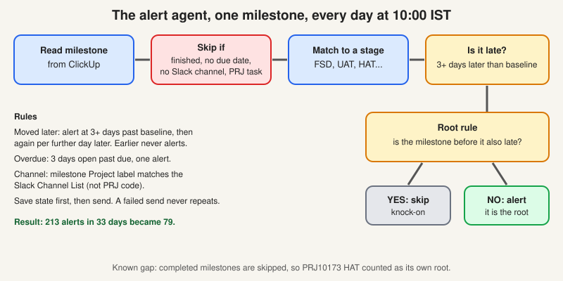

# GreyOrange: the alert agent and the filing agent

> [!STORY] 213 alerts that became 79
> On 28 September Mahima asked: when a milestone's due date slips, tell the project channel. Aadarsh built it, tested it in an internal channel on 30 September, and it went live that afternoon.
> It worked, and then it talked too much. If one milestone slipped, every milestone after it also slipped, and each sent its own alert. Over 33 days that made 213 alerts. On 3 November Dikshant asked for something sharper: alert only on the first late milestone, because the rest are a knock-on effect.
> On 4 November the order of milestones was taken from the stage list in Mahima's RCA report. It went live in the 5 November run. Replaying history, 213 alerts became 79.
> The lesson: an agent that is right but noisy is wrong.

*Facts in this chapter are from the 10 November session unless marked. Flow ids are in the work folder.*

## The alert agent ("Milestone RCA Slack Alerts")

Built by Aadarsh. Live. It runs daily at 10:00 India time. Last edited 4 November.

**How it works, step by step**

1. Read all milestone tasks from ClickUp (the Active Projects list, with the milestone tag).
2. Skip: finished milestones, project-level tasks named PRJ and a number, milestones with no due date, and projects with no Slack channel.
3. Match each milestone name to a stage: Kick Off, FSD, ISD, Site Readiness, Hardware Delivery, Software Delivery, SIT, I&C, UAT, Performance Test, HAT, Go-Live, Hypercare. "SIT - Phase 1" counts as SIT. A name with no stage, and SaaS Commencement, are judged on their own.
4. **Date moved later:** alert when the due date is three or more days later than the **baseline**, the date the agent first saw (30 September). Then one more alert each time it moves at least one more day later. Moving earlier never alerts.
5. **Overdue:** open for three days past the due date gets one alert.
6. **The root rule:** if the milestone before it, in the stage order, is also late, skip it. The first late one is the root and gets the alert.
7. Post in the project's Slack channel and tag the assignees. State is saved first, then the message is sent, so a failed send never repeats.

**Which Slack channel?** The milestone's Project label (a ClickUp dropdown) is matched to the same Project label in ClickUp's Slack Channel List. It does **not** use the PRJ code or the full name. On the 10 November call you said yes to "does it match on PRJ code or PRJ plus name?". That was wrong for this agent, and the correction is recorded.

**The three stage orders**, from Mahima's report:

- Site route: Kick Off, FSD, Site Readiness, I&C, UAT, HAT, Go-Live, Hypercare.
- Software route: Kick Off, FSD, ISD, Software Delivery, SIT, UAT, Performance Testing, HAT, Go-Live, Hypercare.
- Hardware route: Kick Off, FSD, Hardware Delivery, I&C, UAT, HAT, Go-Live, Hypercare.

**What was found on 10 November**

- Over 8 to 10 November: 11 alerts (0, 9, 2 by day). 12 milestones held back as knock-on. All sends logged as successful.
- **FSD:** every open FSD slip had an alert. The only one without is a project whose FSD is completed. Slips before the baseline date are invisible to the agent.
- **Kenco Kansas City:** the ISD alert was sent (5, 6, 9, 14 and 30 October, all to the right channel). None in the last three days because the date has not moved since 30 October. Its two project codes do not cause a problem because both Slack Channel List rows point to the same channel.
- **PRJ10173 (Exol RTP Jackson):** both I&C and HAT alerted on 9 November. UAT is completed there, and the agent skips completed milestones, so HAT counted as its own root. Mahima's report says only the earliest delayed milestone should alert, so she is right, and it needs a small logic change by Aadarsh: look past completed milestones to the nearest earlier open one.

**Open:** that logic change. What Mahima expected for FSD (we asked Dikshant for a project and date). Whether a milestone that slips again after its root completes becomes the new root.

## AGT-013, the RCA filing agent

**Draft, no trigger.** Aadarsh rebuilt it on 5 November (67 steps).

**The story.** Project managers write an RCA, a root cause analysis, whenever a milestone slips. They post it in the project's Slack channel, and those documents end up scattered. On 26 October Mahima asked for an agent that finds each final RCA and files it in ClickUp, in a folder per project.

**The rules** (Dikshant, 3 November):

- A document is **final** when **Satish and Deepak are both tagged** in the same thread, within **6 hours** of the upload. At 3 hours with no tags, the agent posts one reminder in the thread.
- The project comes from the **file name first**. It must be `PRJnumber Project Name` exactly as in ClickUp, for example `PRJ10234 ODW Logistics`. If it is missing or does not match, the agent asks the PM in the thread to rename it and holds the file. The Slack channel is only a backup.
- Several uploads in a day are all kept, as versions v1, v2 and so on.
- Files go into ClickUp: space "Impl Projects RCA Repository", then a folder `PRJ##### Site`, then a list "RCA Documents", then one task per file, named `date | file name`, with the file attached.

**How it finds files now.** The old Slack sync was failing because Slack limits how often our app may read. Pulkit's fix, merged on 2 November, lets a flow call Slack directly, so the agent lists new Slack files itself. That is why the old blocker (issue 4793) no longer stops it.

**State.** A real run on 5 November filed a test file in the test project. It has not been switched on. Dikshant says it needs one activation. **Activating is your explicit decision only.** It also posts in PMs' Slack threads (asking them to rename files), which Dikshant agreed to on 3 November. Failure emails go to Aadarsh.

**The folder creator.** On 10 November Dikshant asked for every project's folder to exist now, so his team can upload the old RCAs by hand and the agent keeps filing new ones in the same place. A one-time flow made **33 folders**, each with one "RCA Documents" list, verified in ClickUp with no duplicates. Two are held back (Dematic_FAC and Kenco Kansas City WES) until Dikshant confirms their codes.

**Open:** activation, the two codes, where "subfolders" fit (read as the RCA Documents list, not confirmed), and what happens if one file fails mid-batch.

## The timeline

- 28 Sep: Mahima asks for slip alerts. 30 Sep: alert agent live. 1 Oct: first scheduled run.
- 26 Oct: Mahima's sheet row for AGT-013 and AGT-014.
- 28 to 30 Oct: AGT-013 built, blocked by Slack's rate limit, first file filed in ClickUp on 30 Oct.
- 2 Nov: Pulkit's fix merged. 3 Nov: Dikshant sends the new rules. 4 Nov: alert order set from Mahima's report. 5 Nov: both new versions live, AGT-013 rebuilt.
- 6 Nov: Pulkit's last day. 7 Nov: Mahima asks two questions and for a document, Aadarsh hands them to you. 10 Nov: the work in this chapter.

## Traps

- Answering "yes" to a question about an agent you have not read.
- Thinking the Slack channel comes from the PRJ code.
- Activating AGT-013 because Dikshant said it only needs one activation.

> [!PROJECT] Where you see this in your week
> Mahima's two questions and her request for a document are the live ask. The PRIMER and STUDY-PLAN in work-ops hold the six sessions and check questions for these agents.

> [!TRY] Try it
> Pick one project with two late milestones. Using the seven steps, say which one gets the alert, and why. Then pick PRJ10173 and say why the current agent gets it wrong.

## Check yourself

1. Explain the root rule, and why it cut 213 alerts to 79.
2. How does the alert agent pick a Slack channel, and what did you get wrong about it on 10 November?
3. What makes an RCA document final, and where does AGT-013 put it?
