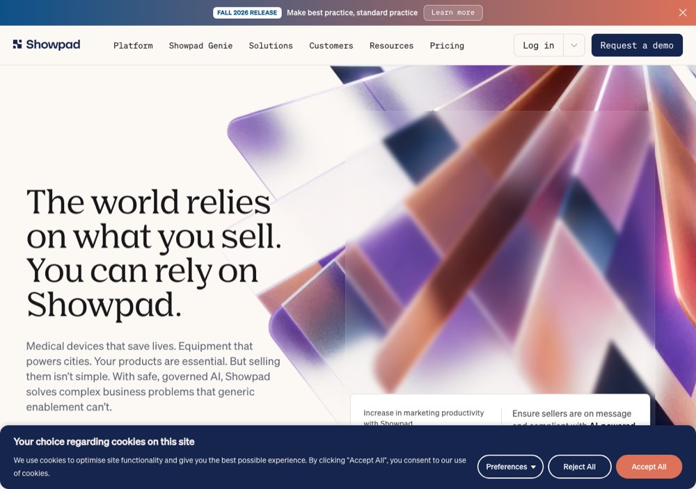

# Showpad and Brainshark: the feeds that went quiet

> [!STORY] Coursera inside your company
> Arun's way of explaining Showpad to anyone: "Showpad or Brainshark, they are into enablement as a platform. Think of this as Coursera or Udemy within your company."
> A company uses it to train its sales team. People author courses and presentations, and other people consume them. For FunnelStory, the question is: which accounts are heading for trouble? The creative answer was one nobody expected: look at accounts where **nothing new is being created** in the platform, and the renewal is within six months. People may still be taking courses, but nothing new is being authored. That predicts churn in a few months.
> Hold that picture. It is how a domain metaphor becomes a product signal.

## Who they are

Showpad is sales enablement. **Brainshark is a product inside Showpad's workspace**, not a separate workspace, with its own CSMs. Accounts carry several products. The renewal is analysed **per product, not per account**. "Showpad's renewal" is not a thing. "Brainshark's renewal at account X" is.

- **Trevor**, the main contact.
- **Steve**, VP of CS. Priorities: multi-threaded relationships, renewals and expansion, Brainshark first. He "gates everything on the cohorts". Described as hyper excited.

## The story in dates

- **31 August:** the cohort analysis was presented to their VP of CS, and to the VP's team on 2 September. 14 tracked products, 6 with no activity data at all, and the customer already knew.
- **Early September:** Showpad's deadline became a deployment date: both agents by 15 September. It was already late by the 16th.
- **16 September:** Arun walked the "creation stalled" strategy blueprint from a Google doc. The agent work split in two, and the account-specific half became yours.
- **17 September:** Showpad's accounts model keeps no data on churned accounts, and cohorts look back two years, so Vivek added an outcome model to keep churn and renewal history.
- **21 September:** the demo to Steve, rehearsed beforehand in the Winning by Design workspace.
- **7 October:** your workspace-agent task paused (Arun had tested Vivek's resource file himself).
- **9 October:** Showpad's first CSM yes.
- **Late October:** a CSAT survey queued second, after Descope, for the hosted survey feature.

## The cohort

Built on two Brainshark metrics: monthly presentations created and monthly course views. Its accounts are all in the software industry (a label, and the thing that makes them comparable). It is the accounts that hold Brainshark and have it renewing in the next twelve months.

> [!GOTCHA] The numbers are not safe to repeat
> Vivek walked two inconsistent versions in fifteen minutes. Risk equal to both metrics zero gave a 50 to 51 percent renewal rate, and target equal to both at least one gave 94 percent with about 26 accounts. The other version, from the Brainshark doc, gave risk at 50 percent and target at 74 percent. A third figure, 48 percent, reconciles with neither. Get the doc before quoting any of this to anyone, inside or outside.

## The agent

The Action Agent is linked to Showpad's outcome agent "BNSK - Creation Stalled". Its target is a Criteria: CSM manager any of Steve Hendricks, AND Brainshark presentations created at most 0 in the past quarter, AND products any of Brainshark. 8 accounts matched that day, replacing the earlier $100K cohort.

Output per account, in Arun's words: "Why is it? Who to contact? What do you recommend? And the email draft."

**The gate for anything run in their workspace**, from Arun unprompted: no emails, **no tasks created**, and no tagging or pinging anyone on Showpad's side, including their own internal people. Output is JSON you look at. A real task creation alerts a CSM at Showpad.

Showpad's own constraint, relayed by Alok: "we don't even know the email address because it's not in our data". That is why the runner is a separate agent. Every customer's guard rails differ.

A per-account action generator already existed in the product. It produced a full email per account, and Vivek said it was not very good. That was the bar to beat.

## The silent failure

The six silent weeks (chapter 2.1). The two feeds died on 4 May. Because predictions score product factors on the last 30 days, 1,058 accounts holding $74.5M collapsed into the neutral band with "No usage data for the last 30 days" and low confidence. No error anywhere.

## Other Showpad facts worth keeping

- The label mapping used `fs_analyze` without `fs_sanitize`, so the quoted reply chain was labelled again and again (chapter 1.3).
- Salesforce emails were capturing Zendesk tickets, and the matcher linked both to the same needle mover.
- About 58,000 Showpad content labels were never processed into needle movers.
- Vivek planned to purge Showpad's needle movers a week at a time and reprocess.

## What Showpad teaches

**Silent data death.** A pipeline can be green while the picture is wrong.

## Traps

- Quoting the cohort percentages.
- Creating tasks or emails in the workspace to "see how it looks".
- Saying "Showpad's renewal".

> [!PROJECT] Where you see this in your week
> Your Showpad workspace agent (now paused) taught you the draft gate in its strictest form. The 9-point feedback note on Vivek's resource test is still in the folder, to check against what he fixed overnight.

## Check yourself

1. How is Brainshark related to Showpad, and why is renewal per product?
2. What is the "creation stalled" idea, in plain words?
3. What is the gate for anything you run in their workspace?
