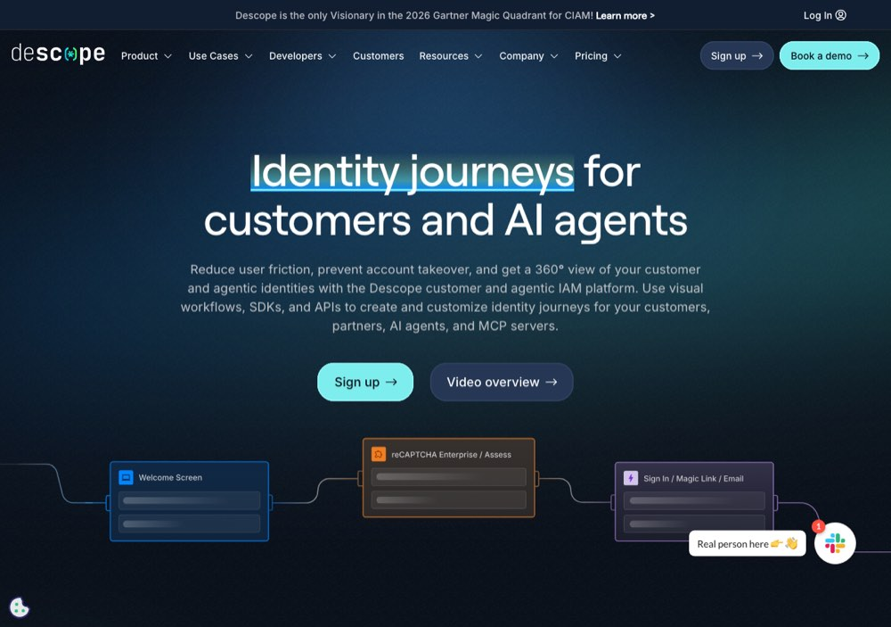

# Descope: customer and supplier at once

> [!STORY] 1,700 and 70
> Pulkit was working on Descope's churn recall when he noticed a number that did not add up, and raised it himself. In Descope's HubSpot there are about 1,700 closed-lost deals. In the analytics view Descope built there are 70 churned accounts.
> Nobody on the call could answer why. And it sat directly under the recall figure he owed that day.
> Alok's position since the first week: a number on a convenient sample is misleading, very misleading. Pulkit's number was a warning that the denominator was not agreed. Before you can say how well a model predicted churn, you need to agree what churn is.

## Who they are

Descope sells authentication and customer identity: drag-and-drop auth flows. It is the most-mentioned name in the internal docs, and it is also **a vendor to FunnelStory**: the front-end's login uses `@descope/react-sdk`. A customer and a supplier at once.

**Two workspaces, and both are real.** Arun said on 11 September: "I know what this workspace is and yes, it is valid."

- **"Descope"** runs `Hubspot Custom Object Sync v2`, live since 11 July on a 30-minute interval, about 48 runs a day. Its final action is a HubSpot write, so it sends nothing by design.
- **"Descope - Paid"** runs the daily custom health score.

People: **Manny**, **Manpreet Singh**, **Gilad Shriki**, **Alex**. Manny reviewed everything and answered all of Aadarsh's questions.

## The story, in order

- **28 Aug to 1 Sep:** Vivek noticed the Descope account model had not refreshed for 16 days. Aadarsh gave you a diagnosis-only task: find the root cause, do not fix it. The cause on record: a duplicated adoption-score join, one copy holding SQL BigQuery cannot parse, so the next refresh returned zero rows.
- **16 Sep:** Arun moved Descope from Aadarsh to Pulkit. The churn denominator stayed unresolved. FunnelStory does not set a churn date on accounts at all (Pulkit: "that's the main issue"). Preetam's answer: read it from Descope's HubSpot into a JSON file rather than adding it to the product. A platform gap, logged.
- **17 Sep:** Pulkit's recall covers accounts churning in April, with ground truth from Descope's BigQuery license table and predictions from prediction history. Descope's accounts model only holds paid accounts (their view filters to paid), so churned accounts vanish and churn is computed wrongly. Pulkit fixes the model. Alok emailed Gilad Shriki that initial recall numbers were coming.
- **18 Sep:** the model changes over the weekend, on numbers the architect has not checked.
- **23 Sep:** Arun assigned you the Descope email outreach: prove the sequence, recommend the sender. Specified in writing on the huddle.
- **1 Oct:** the PDF step (issue 4426). Descope wants a usage summary attached to the "happy route" email. Today a PPTX is attached. A PDF "would be cleaner and can be opened by everyone". It blocks the launch to Manny together with Nitin's Gmail alias work.
- **13 Oct:** go for the data join in Descope - Paid's Accounts model ("Join it to SemanticDB"). Two outcome agents and two flow agents, all draft, configured but not connected. Arun talks to Descope and enables.
- **27 Oct:** Descope is the first customer for the hosted survey. A re-engagement email with three or four options: "I'm kind of stuck" leads to their docs, "our timing changed" leads to a confirmation page, "I would like someone to help me" leads to a confirmation that someone will reach out.
- **30 Oct:** Arun sent them a demo video of the survey and it misses the ask. They want the survey inside the email, one click, not a link to a hosted page, and a results drill-in. Preetam merged the survey PRs "to give them something" after they waited almost a week. The in-email change has no owner yet, and your build waits on it.

## The rules Arun set

- **Do not change the config to get an analysis output** if the output can be reached without it.
- Anything for Descope starts as a draft. The criteria were: unhappy (adoption score below 50, production false, customer for at least 90 days, tier 3 or 4). Happy lacks "production for 14 days", which needs a read-only check of Descope's BigQuery for the field.
- Descope's brand guide (version 1.2.1) governs documents you build for them.

## What Descope teaches

**The denominator is half the argument.** And that a customer can be a supplier: a bug in your own login is a bug in your own product.

## Traps

- Computing churn from a model that only holds the paid accounts.
- Changing configuration just to see an output.
- Assuming the happy route and the unhappy route use the same data.

> [!PROJECT] Where you see this in your week
> The email outreach agents, the PDF step, the hosted survey and the model-refresh diagnosis are all Descope. They are four of your named work folders.

## Check yourself

1. What is the 1,700 versus 70 problem?
2. Why were there two Descope workspaces, and what does each do?
3. What did Descope's survey demo miss?
