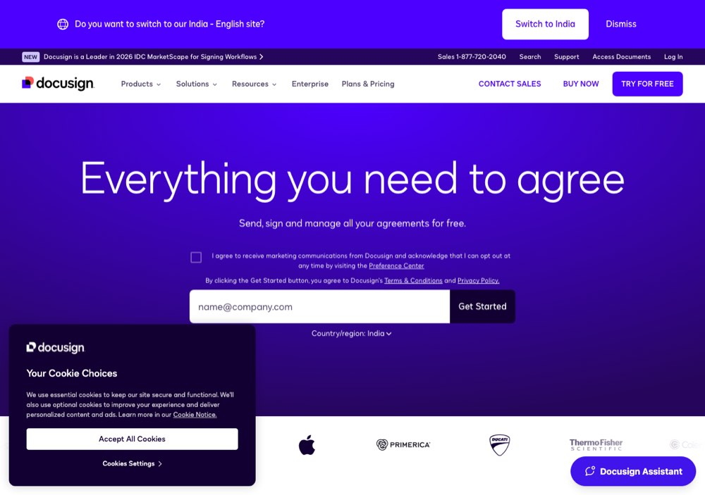

# DocuSign: two hops away

> [!STORY] The account tagged "POC"
> DocuSign gave FunnelStory an AWS account to run in. It was tagged as a proof-of-concept account. Their infrastructure team would not grant a security-group exception on a POC-tagged account. Granting it meant creating a brand new account from scratch, which they would not do on a Friday and would not do during the holidays.
> Arun's description of why: it is a big organisation and we are not talking directly to the people who are doing this. We are two hops away.
> So a perfectly written Terraform plan, reviewed and checked in, sat unapplied, waiting on a procurement tag. Expect DocuSign's timelines to be set by their procurement tags and sprint calendar, not by their engineers.

## Who they are

E-signature. A **proof of concept**, now moving toward production. It was named the next account on 31 August, and the Trellix accuracy work was run deliberately as the dress rehearsal for it.

The success criteria, from Alok's discussion with their team (not a signed spec):

1. **75 percent recall.** The deadline was garbled in the audio and is unrecoverable. Owner: Mamta.
2. **The journey-creation agent**, "ability to identify the place". Not properly decoded.
3. **The outcome agent**, "the most important one for them". Owners: Vivek, Preetam and Mamta, with Aadarsh and you on execution.

What criterion three means in practice, unusually concrete for a POC: if they say feature adoption should improve by 10 percent, they want to see it, they would move us to production and put CSMs on it, and see whether we can achieve 10 percent. So the proof of concept grew from 45 days to maybe three months, with DocuSign's own CSMs involved. A failure is visible to their whole CS organisation, not a champion.

Alok's commercial read: if outcome targets can be hit, we can operate where we guarantee outcomes. A positioning claim being tested on this account.

## The story in dates

- **7 to 10 Sep:** AWS access stuck on their side. Terraform written and reviewed. Everything stays as PRs. Nothing applied until DocuSign provisions the account. Preetam: be prepared for both (attaching to their security groups or creating our own). Their sprint starts Wednesday.
- **10 Sep:** VPC confirmed, configuration is you and Aadarsh, and the criteria are "final" now.
- **15 to 16 Sep:** infrastructure but no data. Then Snowflake landed, their people log in Thursday, and the product is failing on their data.
- **Mid October:** the agent stalled live with zero actions in 7.5 hours. The cause turned out to be semantic database load on the conversations table. A production release followed, and the standup that day also mentioned a $1K budget and 150 accounts (exact meaning not re-checked), plus your QA at scale.
- **15 Oct:** you were assigned "QA at scale" on the UI changes: do it manually, also use Cursor with the GitHub ticket and visual QA. "We are not looking for volume, but for accuracy": the numbers on each tab answer questions (when was the last meeting, the last email) and must be right.
- **27 Oct:** their testing feedback, nine rows, triaged on screen. The clearest picture of what DocuSign's users hit.

## The nine rows (27 October)

- **Envelope utilization, the one with a number.** On one account their internal dashboard shows 2.3 million purchased, 368 completed, 7 percent month on month, 27 percent utilized. FunnelStory does not show utilization at all, and says "no activity in 90 days", which Arun doubts. Three figures were stated in one minute and not reconciled.
- **Tags on contacts.** Their Salesforce effectively has one tag, and the contacts page is always empty. They like FunnelStory's dossier tags, "much better than what they had today", and want them where the empty field is. Their one requirement is provenance: tell a FunnelStory-determined tag from theirs.
- **Russ** (DocuSign-side) can see action cards but can only open ones assigned to him, and the teams filter with his own name returns only two people.
- The seven-day filter on the grouped page does nothing. The Investigate panel is too small to use. New task is empty inside an account. The pinned properties page is gone (Arun rebuilt it the same morning).
- **Configuration state:** the top 25 accounts plus the accounts of the managers and ICs on the channel list have relationship data, relationship needle movers and dossiers complete. Episode needle movers were pending that day, and Mamta did them. She verified a sample by hand.

## Engineering consequences already named

- At DocuSign scale, the account-domain join for conversations will not hold. Preetam moved to a `conversation_account` table with an explicit join.
- The semantic database load on the conversations table caused the stall (chapter 2.6).
- Email threading: DocuSign's emails did not thread.

## What DocuSign teaches

A large customer's rhythm comes from procurement and sprint calendars. Your tests need to be accurate, not just numerous. And their users read your numbers against their own dashboards, so every number needs a source (chapters 1.2 and 3.7).

## Traps

- Promising an access date based on what their engineers say.
- Reading three unreconciled numbers as one.
- Testing in their workspace. In the 30 October standup, no one else tests there.

> [!PROJECT] Where you see this in your week
> The DocuSign UI QA folder, the contacts test, the needle mover pilot, and the Monday triage notes are all this account.

## Check yourself

1. What were the three success criteria, and which was the most important?
2. Why was the AWS access stuck, in Arun's words?
3. What is their one requirement for tags, and why?
