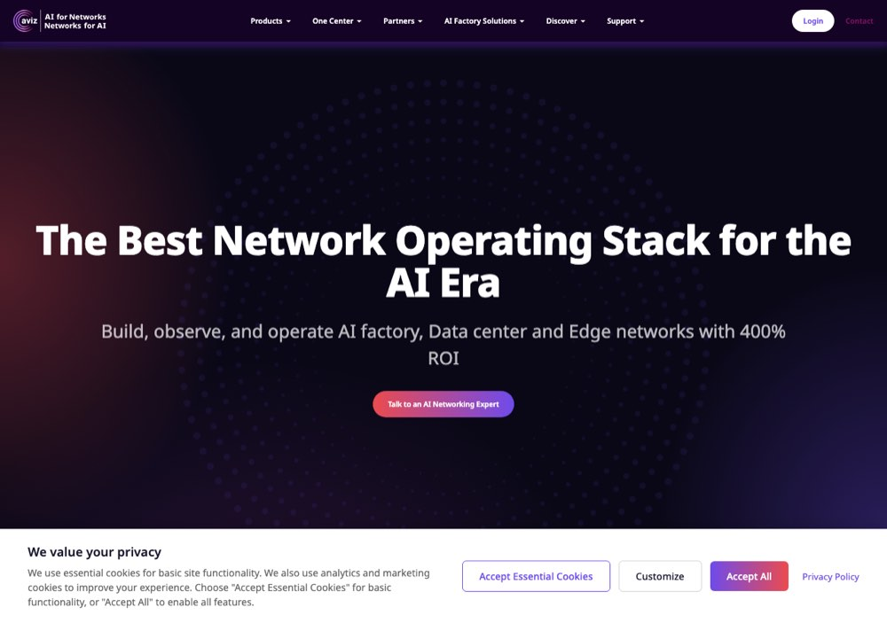

# The smaller accounts, one story each

> [!STORY] Do I now go tell them not to pay?
> Maria at Aviz Networks, upset about something, wrote in the shared channel: "Do I now go tell Vishal and Naresh not to pay FunnelStory?"
> Aviz is unusual. FunnelStory is not just a tool they use. It is shown to **their** customer, eBay. The whole ask had been shareable dashboard links plus drill-down, so Aviz could hand the view to eBay. A problem in the dashboard was a problem in Aviz's own customer relationship.
> That one line is a lesson about this whole group of accounts: each is a different shape, and each has one sentence that explains it.

The accounts below are in the record, with less detail than the big five. Check the current state before saying anything about them, because their records are thinner.

## Photon

IT services and digital consultancy. Live. They wanted a three-level hierarchy, `super_account → account → sub_account`, which the product does not support (only `account → sub_account`). They wanted RBAC and group sync, and "Accounts" instead of "Parent Accounts". People: Joshna, Praveen, Abhishekha, plus five named users added in April. Their config includes a **book-of-business view driven from CRM ownership** (owner-email mapping), not hand-edited. At one point their largest account was predicted to churn, a trust event.

## Brandlight

AI brand visibility. Live. Agents email CSMs and escalate to their head of customer success. Runs on **Attio** as its CRM, which is why Attio SQL support became a real product question. The Brandlight test-mode story (chapter 3.1) is this account.

## Aviz Networks

Open networking and SONiC software. Live. Their config is about **device RMAs** (returns): the assistant's prompt tells the agent how to find RMA tickets and read comments for shipping labels. Hardware support, not SaaS usage. The dashboard is shown to eBay.

## Cyera

Data security posture management. Live. Account status was broken for 25 days when they changed Salesforce property values and removed the active ARR column. A model refresh failure (chapter 2.1).

## DuploCloud

DevOps automation and compliance-as-code. Live. Two agents: Activity Drop Detection and Feature Gap Analyst. Prediction-model configuration.

## Dusty Robotics

Construction layout robots. Live. Health monitoring and usage alert agents, plus billing table work: pay per use across multiple contracts. Contact: Bashar.

## Halcyon

Ransomware resilience. Live. Agent formatting work, and "create users in the semantic db".

## AuditBoard

Audit, risk and compliance. Live. **Partial product churn** was specified for them: set `churned_at` in `products_info` when `product_arr` drops from an earlier value.

## Nirmata

Kubernetes policy management. Live but degraded. Their Postgres tunnel broke around 2 July, with 220 to 240 failures a day, recovered for four days, then broke again for eight days.

## Reveneer

Outsourced sales development. Live. An Account Summary agent.

## Winning by Design

Revenue-architecture consultancy. A workspace exists, and the **QBR deck agent** was built there first. It is also the workspace used for demo rehearsals.

## Workstream, Docyt, Popmenu

Older configuration folders in the handbook. Not seen in 2026 Slack traffic. Treat them as older or dormant until confirmed. Their label prompts are the best teaching examples in the repo:

- **Workstream**: HR and payroll for hourly workers. Twenty worked examples about downgrades and month-to-month.
- **Docyt**: AI accounting for small businesses and hotels. A full product teardown in the prompt.
- **Popmenu**: digital presence for restaurants. Pricing means Popmenu's fees, not menu prices.

## Other mentions

- **Gainsight** is an integration package, not a customer. FunnelStory ingests from it.
- **Navan** appeared in a shared channel with "why is Navan marked as 0 health?".
- The **Fortune-400 trial** Arun mentioned on 28 August appears nowhere in the repos.

## Check yourself

1. Which account is shown to another company's customer, and what was the whole ask?
2. Which account taught partial product churn?
3. Which account taught you that tests can email real people?
